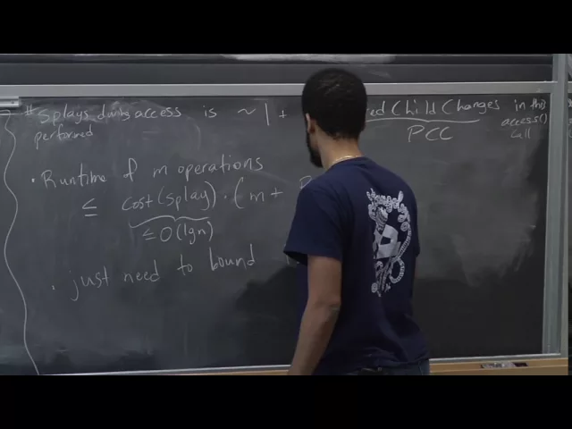
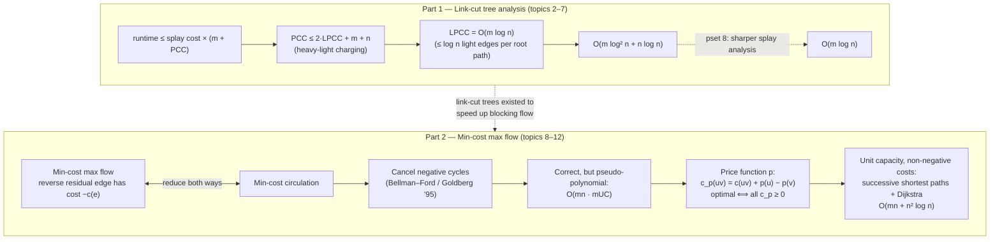

# Advanced Algorithms (COMPSCI 224), Lecture 23

*Harvard University · 1:26:46 · [Watch on YouTube](https://www.youtube.com/watch?v=nDLe6_sPSfs)*

## Summary

A lecture in two halves. First, Jelani Nelson **completes the amortized analysis of link-cut trees**, introducing the **heavy-light decomposition** purely as an accounting device: every operation's cost is charged to preferred child changes, those are charged to *light* preferred edge creations, and each root-to-vertex path carries at most `log n` light edges — yielding **`O(m log² n + n log n)`** for `m` operations, with the improvement to `O(m log n)` (same structure, sharper splay analysis) left to the problem set. Second, he opens **min-cost max flow**: costs in the residual graph negate on reverse edges, the problem is interreducible with **min-cost circulation**, and the naive **negative-cycle canceling** algorithm is correct — via a decomposition of any circulation into at most `m` cycles — but only pseudo-polynomial at `O(mn · mUC)`. The fix is the **price function / reduced cost** machinery: a circulation is optimal iff some price function makes all reduced costs non-negative, which in the unit-capacity, non-negative-cost case makes **successive shortest paths with Dijkstra** valid and gives **`O(mn + n² log n)`**.

## Topics

1. [Logistics and lecture roadmap](01-logistics-and-lecture-roadmap.md)
2. [Link-cut tree operations: recap of `access`, `cut`, `link`](02-link-cut-tree-operations-recap.md)
3. [Reducing the runtime to preferred child changes](03-access-cost-and-preferred-child-changes.md)
4. [The heavy-light decomposition (analysis tool)](04-heavy-light-decomposition.md)
5. [Bounding `PCC` by light preferred child creations](05-bounding-pcc-by-light-creations.md)
6. [Bounding `LPCC` across `access`, `link`, `cut` — and the final bound](06-bounding-lpcc-and-the-final-bound.md)
7. [Augmented BSTs inside aux trees](07-augmented-bsts-inside-aux-trees.md)
8. [Min-cost max flow: the problem and residual costs](08-min-cost-max-flow-definition.md)
9. [Min-cost circulation and its equivalence with min-cost max flow](09-min-cost-circulation-and-the-reduction.md)
10. [Negative-cycle canceling for min-cost circulation](10-negative-cycle-canceling.md)
11. [Price functions, reduced costs, and the optimality characterization](11-price-functions-and-reduced-costs.md)
12. [Faster min-cost max flow: successive shortest paths](12-successive-shortest-paths-unit-capacity.md)

## Key takeaways

- **`m` link-cut tree operations run in `O(m log² n + n log n)`** amortized; the `n log n` term is harmless in blocking-flow use, where `m ≥ n` and `m log² n` dominates [`42:15`](https://www.youtube.com/watch?v=nDLe6_sPSfs&t=2535), [`43:23`](https://www.youtube.com/watch?v=nDLe6_sPSfs&t=2603).
- **`log² n` improves to `log n` with no change to the data structure** — only a better amortized analysis of the splay trees, via the lecture-7 access lemma with the right weight function [`1:35`](https://www.youtube.com/watch?v=nDLe6_sPSfs&t=95), [`2:09`](https://www.youtube.com/watch?v=nDLe6_sPSfs&t=129), [`43:39`](https://www.youtube.com/watch?v=nDLe6_sPSfs&t=2619).
- **The whole analysis reduces to `PCC ≤ 2·LPCC + m + n`**: light creations are counted directly, heavy creations at a childless parent are charged one dollar to the last access (`+m`, `+n`), and heavy creations at a parent that already had a preferred child must destroy a *light* preferred edge — since **a vertex has at most one heavy child** — giving the factor 2 [`16:15`](https://www.youtube.com/watch?v=nDLe6_sPSfs&t=975), [`24:37`](https://www.youtube.com/watch?v=nDLe6_sPSfs&t=1477), [`25:29`](https://www.youtube.com/watch?v=nDLe6_sPSfs&t=1529).
- **`LPCC = O(m log n)`** because a root-to-vertex path contains **at most `log n` light edges** (subtree size ≤ `n`, halved at each light edge), and `access` changes only preferred-ness, never light/heavy [`27:46`](https://www.youtube.com/watch?v=nDLe6_sPSfs&t=1666), [`29:26`](https://www.youtube.com/watch?v=nDLe6_sPSfs&t=1766), [`30:30`](https://www.youtube.com/watch?v=nDLe6_sPSfs&t=1830).
- **`link` and `cut` are essentially free beyond their accesses**: edges that get lighter aren't preferred, and heavy creations are not counted at all — `cut` adds only `O(log n)` more along one root-to-leaf path [`35:15`](https://www.youtube.com/watch?v=nDLe6_sPSfs&t=2115), [`35:40`](https://www.youtube.com/watch?v=nDLe6_sPSfs&t=2140), [`40:22`](https://www.youtube.com/watch?v=nDLe6_sPSfs&t=2422).
- **Min-cost max flow and min-cost circulation reduce to each other**; the clean one-call direction is *find any max flow ignoring costs, then find a min-cost circulation in its residual graph and add it back* — valid because **the difference of two equal-value `s`–`t` flows is a circulation** [`53:29`](https://www.youtube.com/watch?v=nDLe6_sPSfs&t=3209), [`1:00:24`](https://www.youtube.com/watch?v=nDLe6_sPSfs&t=3624), [`1:01:10`](https://www.youtube.com/watch?v=nDLe6_sPSfs&t=3670).
- **Negative-cycle canceling is correct but pseudo-polynomial**: `O(mn)` per Bellman–Ford iteration (or `O(m√n log C)` by Goldberg '95) times at most **`mUC`** iterations — explicitly "the Ford–Fulkerson of min-cost circulation" [`1:03:58`](https://www.youtube.com/watch?v=nDLe6_sPSfs&t=3838), [`1:10:50`](https://www.youtube.com/watch?v=nDLe6_sPSfs&t=4250).
- **Correctness rests on cycle decomposition**: any circulation splits into at most **`m` cycles** (extract a cycle at its minimum capacity, saturating ≥ 1 edge each time), so a negative circulation must contain a negative cycle [`1:07:58`](https://www.youtube.com/watch?v=nDLe6_sPSfs&t=4078), [`1:08:56`](https://www.youtube.com/watch?v=nDLe6_sPSfs&t=4136).
- **Optimality characterization**: `f` is a min-cost circulation **iff** a price function `p` exists with `c_p(uv) = c(uv) + p(u) − p(v) ≥ 0` everywhere — the prices **cancel around cycles**, so cycle costs are unchanged; the witness is `p(u) = ` shortest-path distance from a new zero-cost super-source, well defined exactly because no negative cycles exist [`1:13:23`](https://www.youtube.com/watch?v=nDLe6_sPSfs&t=4403), [`1:14:08`](https://www.youtube.com/watch?v=nDLe6_sPSfs&t=4448), [`1:15:29`](https://www.youtube.com/watch?v=nDLe6_sPSfs&t=4529).
- **Unit capacities with non-negative costs: `O(mn + n² log n)`** by successive shortest paths — ≤ `n` iterations of Dijkstra with Fibonacci heaps. Dijkstra stays legal because **every edge on a shortest path has reduced cost exactly 0**, so the saturated edge's reverse enters the residual graph at `−0 = 0` [`1:19:43`](https://www.youtube.com/watch?v=nDLe6_sPSfs&t=4783), [`1:22:52`](https://www.youtube.com/watch?v=nDLe6_sPSfs&t=4972), [`1:23:41`](https://www.youtube.com/watch?v=nDLe6_sPSfs&t=5021).
- **Negative cycles are handled by preprocessing, not by a new algorithm**: saturate every negative edge outright, then repair the resulting imbalances with a new source/sink whose capacities equal the exact excesses — leaving a non-negative-cost instance [`1:24:57`](https://www.youtube.com/watch?v=nDLe6_sPSfs&t=5097), [`1:25:19`](https://www.youtube.com/watch?v=nDLe6_sPSfs&t=5119), [`1:25:45`](https://www.youtube.com/watch?v=nDLe6_sPSfs&t=5145).
