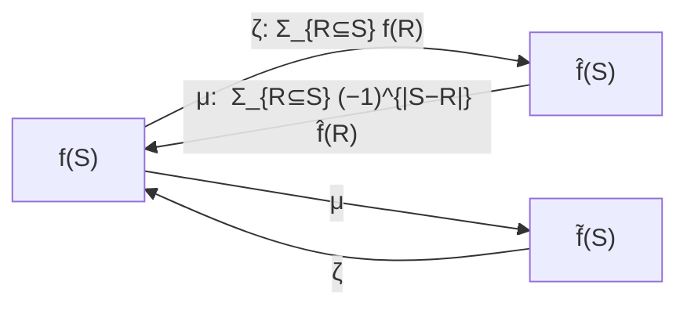

# 2. Zeta transform and Möbius inversion

## The two transforms

For `f` mapping subsets of a ground set into a ring:

- **Zeta transform**: `f̂(S) = Σ_{R ⊆ S} f(R)` [`2:07`](https://www.youtube.com/watch?v=M42rQM0vC4g&t=127), [`8:16`](https://www.youtube.com/watch?v=M42rQM0vC4g&t=496).
- **Möbius inversion**: `f̃(S) = Σ_{R ⊆ S} (−1)^{|S − R|} · f(R)` [`8:16`](https://www.youtube.com/watch?v=M42rQM0vC4g&t=496).

## The key claim — they are inverses

- **Claim**: `(f̂)~ = (f̃)^ = f` [`8:56`](https://www.youtube.com/watch?v=M42rQM0vC4g&t=536).
- In words: zeta-transform then Möbius-invert gives back `f`; Möbius-invert then zeta-transform also gives back `f` [`8:56`](https://www.youtube.com/watch?v=M42rQM0vC4g&t=536).
- This is "the real place where the formula comes from and why it works" — the whole k-coloring identity is a consequence [`8:56`](https://www.youtube.com/watch?v=M42rQM0vC4g&t=536).

## Proof of one direction: `(f̃)^ = f`

Only one direction is shown; the other is very similar [`9:38`](https://www.youtube.com/watch?v=M42rQM0vC4g&t=578).

1. Start from the definition: `f̃(T) = Σ_{S ⊆ T} (−1)^{|T − S|} f(S)` [`11:12`](https://www.youtube.com/watch?v=M42rQM0vC4g&t=672).
2. Apply the zeta transform: `(f̃)^(T) = Σ_{S ⊆ T} f̃(S)`, and expand `f̃(S)` over `R ⊆ S` [`12:13`](https://www.youtube.com/watch?v=M42rQM0vC4g&t=733).
3. Get the double sum `Σ_{R ⊆ S ⊆ T} (−1)^{|S − R|} f(R)` [`13:03`](https://www.youtube.com/watch?v=M42rQM0vC4g&t=783).
4. **Swap the order of summation**: `Σ_{R ⊆ T} f(R) · ( Σ_{R ⊆ S ⊆ T} (−1)^{|S − R|} )` [`14:01`](https://www.youtube.com/watch?v=M42rQM0vC4g&t=841).
5. The inner sum is the **inclusion–exclusion fact**, so it collapses to `[R = T]`, leaving just `f(T)` [`14:58`](https://www.youtube.com/watch?v=M42rQM0vC4g&t=898).

## Caveat from the live derivation

- The lecturer wanted the exponent to read `|T − S|` rather than `|S − R|` and got briefly stuck on a sign [`14:58`](https://www.youtube.com/watch?v=M42rQM0vC4g&t=898), [`15:16`](https://www.youtube.com/watch?v=M42rQM0vC4g&t=916).
- Resolution given on the spot: the inner sum differs from the inclusion–exclusion form only by a **fixed sign that depends on nothing else**, and the term **vanishes unless `R = T`** — where a single summand survives — so the sign is irrelevant to the conclusion [`16:10`](https://www.youtube.com/watch?v=M42rQM0vC4g&t=970), [`16:34`](https://www.youtube.com/watch?v=M42rQM0vC4g&t=994), [`17:02`](https://www.youtube.com/watch?v=M42rQM0vC4g&t=1022).
