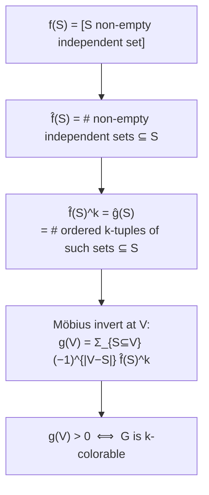

# 3. Where the k-colorability formula comes from

The point of this section: the formula from Lecture 24 is **not magic** — it is exactly "take `f̂`, raise it to the `k`-th power, Möbius-invert, evaluate at `V`" [`23:34`](https://www.youtube.com/watch?v=M42rQM0vC4g&t=1414), [`46:58`](https://www.youtube.com/watch?v=M42rQM0vC4g&t=2818).

## Step 1 — define the counting function `g`

- `g(S)` = **number of ways to write `S` as a union of `k` non-empty independent sets** [`17:02`](https://www.youtube.com/watch?v=M42rQM0vC4g&t=1022), [`43:18`](https://www.youtube.com/watch?v=M42rQM0vC4g&t=2598).
- The tuples are **ordered**: (set₁, set₂) and (set₂, set₁) count as two different ways [`22:40`](https://www.youtube.com/watch?v=M42rQM0vC4g&t=1360).

## Step 2 — `g(V) > 0` ⇔ `G` is k-colorable

- `k`-colorable means the vertex set can be written as a union of `k` non-empty independent sets [`18:47`](https://www.youtube.com/watch?v=M42rQM0vC4g&t=1127).
- The sets are **not required to be disjoint**, and that does not matter: if a vertex lands in several sets, keep it in one and drop it from the rest — greedily assign each vertex the first color whose set contained it [`19:12`](https://www.youtube.com/watch?v=M42rQM0vC4g&t=1152), [`19:35`](https://www.youtube.com/watch?v=M42rQM0vC4g&t=1175).
- So a possibly-overlapping union of independent sets can always be converted into a **disjoint** one [`19:35`](https://www.youtube.com/watch?v=M42rQM0vC4g&t=1175).

## Step 3 — the zeta transform of `g` is a k-th power

- With `f(S) = [S is a non-empty independent set]`, the identity is `ĝ(S) = f̂(S)^k` [`19:58`](https://www.youtube.com/watch?v=M42rQM0vC4g&t=1198), [`20:26`](https://www.youtube.com/watch?v=M42rQM0vC4g&t=1226).
- **Why (a counting-in-words argument, not a computation)**: both sides count the number of ways of choosing `k` non-empty independent sets that are all contained in `S` [`20:26`](https://www.youtube.com/watch?v=M42rQM0vC4g&t=1226), [`21:33`](https://www.youtube.com/watch?v=M42rQM0vC4g&t=1293).
  - Left: `ĝ(S) = Σ_{R ⊆ S} g(R)` counts unions of `k` independent sets whose union lies inside `S` [`20:26`](https://www.youtube.com/watch?v=M42rQM0vC4g&t=1226).
  - Right: count the non-empty independent sets contained in `S` — that is `f̂(S)` — and raise it to the `k` [`21:02`](https://www.youtube.com/watch?v=M42rQM0vC4g&t=1262).

## Step 4 — invert

- By Möbius inversion, `g(V) = (ĝ)~(V) = ( f̂^k )~ (V)` [`23:03`](https://www.youtube.com/watch?v=M42rQM0vC4g&t=1383), [`23:34`](https://www.youtube.com/watch?v=M42rQM0vC4g&t=1414).
- Written out, that is exactly the Lecture-24 formula: `G` is `k`-colorable **iff** `Σ_{S ⊆ V} (−1)^{|V − S|} f̂(S)^k > 0` [`46:38`](https://www.youtube.com/watch?v=M42rQM0vC4g&t=2798).
- The algorithm is literally: **evaluate that sum and check it is positive** [`46:38`](https://www.youtube.com/watch?v=M42rQM0vC4g&t=2798).

