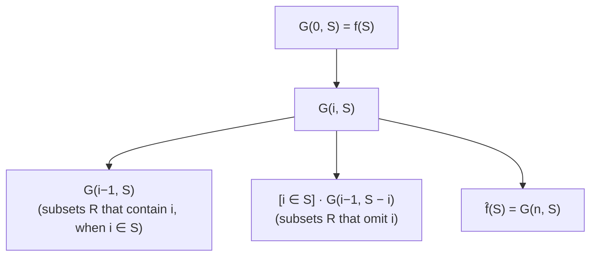

# 5. Yates's algorithm: `O*(2^n)` time and space

A **dynamic program** for the zeta transform, presented as a recurrence plus memoization; the Möbius version is almost identical [`28:29`](https://www.youtube.com/watch?v=M42rQM0vC4g&t=1709), [`29:06`](https://www.youtube.com/watch?v=M42rQM0vC4g&t=1746).

## The auxiliary function

- Ground set is `{1, …, n}`. Define `G(i, S) = Σ_{R ⊆ S, S_i = R_i} f(R)` [`29:56`](https://www.youtube.com/watch?v=M42rQM0vC4g&t=1796).
- Notation: `S_i := S ∩ {i+1, …, n}` — the part of `S` **above** index `i` [`30:30`](https://www.youtube.com/watch?v=M42rQM0vC4g&t=1830).
- So `G(i, S)` sums `f(R)` over subsets `R ⊆ S` that **agree with `S` on all coordinates above `i`**, leaving coordinates `1..i` free.
- **`f̂(S) = G(n, S)`**: at `i = n` the set `{n+1,…,n}` is empty, so the constraint `∅ = ∅` is always true and the sum runs over all `R ⊆ S` [`31:10`](https://www.youtube.com/watch?v=M42rQM0vC4g&t=1870).

## The recurrence

- **Base case `i = 0`**: `S_0 = S`, so the constraint forces `R = S`, giving `G(0, S) = f(S)` [`31:40`](https://www.youtube.com/watch?v=M42rQM0vC4g&t=1900), [`32:24`](https://www.youtube.com/watch?v=M42rQM0vC4g&t=1944).
- **For `i > 0`**: `G(i, S) = G(i−1, S) + [i ∈ S] · G(i−1, S − i)` [`32:43`](https://www.youtube.com/watch?v=M42rQM0vC4g&t=1963).

## Cost

- **States**: `2^n` choices of `S` × `n` choices of `i` [`33:21`](https://www.youtube.com/watch?v=M42rQM0vC4g&t=2001).
- **Space**: `n · 2^n ·` (space for one ring element) — the sums are at most exponentially large so a ring element fits in about `n` bits, though it depends on the ring `f` maps into [`33:21`](https://www.youtube.com/watch?v=M42rQM0vC4g&t=2001), [`33:44`](https://www.youtube.com/watch?v=M42rQM0vC4g&t=2024).
- **Time**: each state needs `O(1)` recursive calls and `O(1)` arithmetic operations, so **time is proportional to space** [`34:03`](https://www.youtube.com/watch?v=M42rQM0vC4g&t=2043).
- Conclusion: all `f̂(S)` in `O*(2^n)` time and space [`34:23`](https://www.youtube.com/watch?v=M42rQM0vC4g&t=2063).

## Correctness proof

Split the sum by whether `i ∈ R` [`35:02`](https://www.youtube.com/watch?v=M42rQM0vC4g&t=2102), [`36:00`](https://www.youtube.com/watch?v=M42rQM0vC4g&t=2160):

`G(i,S) = Σ_{R ⊆ S, i ∈ R} [S_i = R_i] f(R)  +  Σ_{R ⊆ S, i ∉ R} [S_i = R_i] f(R)`

- **Case 1 — `i ∉ S`** [`36:00`](https://www.youtube.com/watch?v=M42rQM0vC4g&t=2160):
  - `R ⊆ S` forces `i ∉ R`, so the **first sum is empty** and vanishes [`36:35`](https://www.youtube.com/watch?v=M42rQM0vC4g&t=2195), [`37:04`](https://www.youtube.com/watch?v=M42rQM0vC4g&t=2224).
  - Since neither `S` nor `R` contains `i`, `S_{i−1} = S_i` and `R_{i−1} = R_i`, so the second sum is exactly `G(i−1, S)` [`36:35`](https://www.youtube.com/watch?v=M42rQM0vC4g&t=2195), [`37:04`](https://www.youtube.com/watch?v=M42rQM0vC4g&t=2224).
  - The indicator `[i ∈ S]` correctly kills the extra term [`37:04`](https://www.youtube.com/watch?v=M42rQM0vC4g&t=2224).
- **Case 2 — `i ∈ S`** [`37:36`](https://www.youtube.com/watch?v=M42rQM0vC4g&t=2256):
  - If `i ∈ R` too, then `S_{i−1} = R_{i−1}`, so the first sum is `G(i−1, S)` [`37:36`](https://www.youtube.com/watch?v=M42rQM0vC4g&t=2256), [`38:31`](https://www.youtube.com/watch?v=M42rQM0vC4g&t=2311), [`39:04`](https://www.youtube.com/watch?v=M42rQM0vC4g&t=2344).
  - If `i ∉ R`, then agreeing with `S` from `i+1` on is the same as agreeing with `S − i` from `i` on, giving exactly `G(i−1, S − i)` [`39:04`](https://www.youtube.com/watch?v=M42rQM0vC4g&t=2344), [`39:52`](https://www.youtube.com/watch?v=M42rQM0vC4g&t=2392), [`40:20`](https://www.youtube.com/watch?v=M42rQM0vC4g&t=2420).

## Bottom line

- **k-colorability is decidable in roughly `2^n` time**, up to poly(n) factors [`40:20`](https://www.youtube.com/watch?v=M42rQM0vC4g&t=2420).
