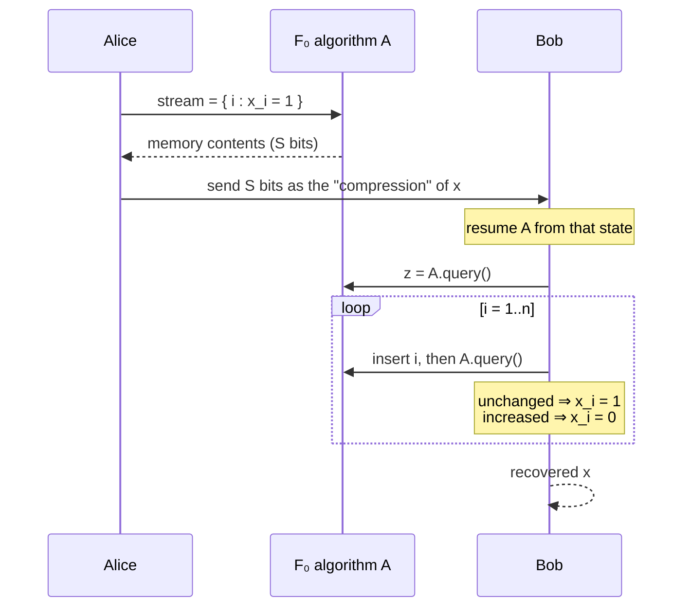

# 8. Lower bound: no deterministic exact `F₀` in sublinear space

## The claim

- Any **deterministic exact** algorithm for `F₀` requires `Ω(min(n, m))` bits of space [`56:47`](https://www.youtube.com/watch?v=M42rQM0vC4g&t=3407).
- First observed in **Alon–Matias–Szegedy** (conference version '96, journal version believed '99) [`57:34`](https://www.youtube.com/watch?v=M42rQM0vC4g&t=3454).
- In the streams built by this proof, `m ≈ n`, so the two terms coincide [`1:00:32`](https://www.youtube.com/watch?v=M42rQM0vC4g&t=3632).

## Proof technique: an encoding argument

- Idea: if the problem could be solved in sublinear space, we could **compress arbitrary `n`-bit strings** [`58:08`](https://www.youtube.com/watch?v=M42rQM0vC4g&t=3488).
- A compression algorithm maps `n`-bit strings to `t`-bit strings and must be **invertible — an injection** [`58:40`](https://www.youtube.com/watch?v=M42rQM0vC4g&t=3520).
- **Pigeonhole**: no injection into a smaller set, so `t ≥ n` [`59:02`](https://www.youtube.com/watch?v=M42rQM0vC4g&t=3542).
- Therefore a space-`S` streaming algorithm yielding an injection from `n`-bit strings to `S`-bit strings forces **`S ≥ n`** [`59:27`](https://www.youtube.com/watch?v=M42rQM0vC4g&t=3567).

## Encoding (Alice)

- Alice holds `x ∈ {0,1}^n` and wants to compress it using the `F₀` algorithm `A` [`1:00:51`](https://www.youtube.com/watch?v=M42rQM0vC4g&t=3651).
- `A` consumes streams, so she builds an **artificial stream**: the set of indices `i` with `x_i = 1` [`1:01:22`](https://www.youtube.com/watch?v=M42rQM0vC4g&t=3682), [`1:01:43`](https://www.youtube.com/watch?v=M42rQM0vC4g&t=3703).
- She runs `A` on it and **outputs `A`'s memory contents** — an `S`-bit encoding [`1:01:22`](https://www.youtube.com/watch?v=M42rQM0vC4g&t=3682), [`1:01:43`](https://www.youtube.com/watch?v=M42rQM0vC4g&t=3703).

## Decoding (Bob)

- Bob resumes `A` from the received memory state [`1:03:03`](https://www.youtube.com/watch?v=M42rQM0vC4g&t=3783).
- Set `z ← A.query()` — the number of distinct elements so far, i.e. the number of 1-bits of `x` [`1:03:56`](https://www.youtube.com/watch?v=M42rQM0vC4g&t=3836).
- For `i = 1 … n` [`1:03:56`](https://www.youtube.com/watch?v=M42rQM0vC4g&t=3836), [`1:04:43`](https://www.youtube.com/watch?v=M42rQM0vC4g&t=3883):
  - insert `i` into the stream and re-query;
  - if the answer **did not go up**, `i` was already present ⇒ `x_i = 1`;
  - if it **increased**, `x_i = 0`;
  - update `z` to the new value.
- Recovering `x` proves the map is an injection, closing the argument [`1:01:43`](https://www.youtube.com/watch?v=M42rQM0vC4g&t=3703), [`1:05:19`](https://www.youtube.com/watch?v=M42rQM0vC4g&t=3919).
