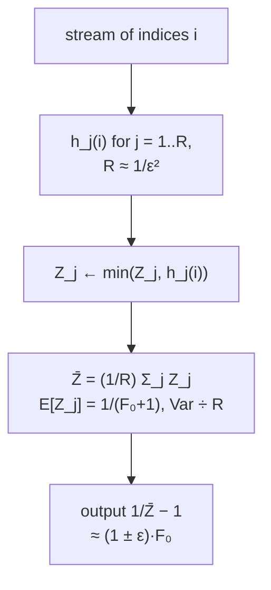

# 10. The idealized Flajolet–Martin algorithm

Goal of this section: **intuition for why randomization + approximation beats linear space** [`1:09:33`](https://www.youtube.com/watch?v=M42rQM0vC4g&t=4173).

## Formal guarantee sought

- A randomized algorithm `A` such that for **every** stream `S`:
  `Pr[ |A(S) − F₀| > ε·F₀ ] ≤ 1/3` [`1:09:58`](https://www.youtube.com/watch?v=M42rQM0vC4g&t=4198).
- The `1/3` can be pushed down to any `δ`, at a cost in efficiency [`1:10:43`](https://www.youtube.com/watch?v=M42rQM0vC4g&t=4243).

## Why "idealized"

The algorithm assumes a **totally random hash function** `h : [n] → [0,1]`, assigning each index a uniform random real in `[0,1]` [`1:10:43`](https://www.youtube.com/watch?v=M42rQM0vC4g&t=4243), [`1:11:40`](https://www.youtube.com/watch?v=M42rQM0vC4g&t=4300).

Two problems, both fixable [`1:12:12`](https://www.youtube.com/watch?v=M42rQM0vC4g&t=4332), [`1:12:33`](https://www.youtube.com/watch?v=M42rQM0vC4g&t=4353), [`1:12:56`](https://www.youtube.com/watch?v=M42rQM0vC4g&t=4376):

| Problem | Fix |
|---|---|
| Storing `n` random values already costs `n` space | Use **limited-independence** hash families (e.g. pairwise independent), covered earlier in the course [`1:12:56`](https://www.youtube.com/watch?v=M42rQM0vC4g&t=4376), [`1:13:12`](https://www.youtube.com/watch?v=M42rQM0vC4g&t=4392) |
| Computers cannot store real numbers | **Discretize** to fractions with denominator poly(n) ⇒ only `log n` bits of precision needed [`1:12:33`](https://www.youtube.com/watch?v=M42rQM0vC4g&t=4353), [`1:12:56`](https://www.youtube.com/watch?v=M42rQM0vC4g&t=4376) |

## The single-hash algorithm

- Maintain `Z = min_{i in stream} h(i)` — **one number**, updated as `Z ← min(Z, h(i))` on each arrival [`1:13:31`](https://www.youtube.com/watch?v=M42rQM0vC4g&t=4411), [`1:14:08`](https://www.youtube.com/watch?v=M42rQM0vC4g&t=4448).
- On a query, **output `1/Z − 1`** [`1:14:08`](https://www.youtube.com/watch?v=M42rQM0vC4g&t=4448).

## Why `1/Z − 1` is the right estimator

- The `F₀` distinct items are hashed into `[0,1]` and land **roughly evenly spaced**, with gaps about `1/(F₀+1)` [`1:16:43`](https://www.youtube.com/watch?v=M42rQM0vC4g&t=4603), [`1:17:17`](https://www.youtube.com/watch?v=M42rQM0vC4g&t=4637).
- So the **minimum hash value has expectation `1/(F₀+1)`** — inverting and subtracting 1 recovers `F₀` [`1:17:17`](https://www.youtube.com/watch?v=M42rQM0vC4g&t=4637), [`1:21:19`](https://www.youtube.com/watch?v=M42rQM0vC4g&t=4879).
- Formal computation [`1:17:52`](https://www.youtube.com/watch?v=M42rQM0vC4g&t=4672), [`1:18:20`](https://www.youtube.com/watch?v=M42rQM0vC4g&t=4700), [`1:18:52`](https://www.youtube.com/watch?v=M42rQM0vC4g&t=4732), [`1:19:20`](https://www.youtube.com/watch?v=M42rQM0vC4g&t=4760), [`1:19:38`](https://www.youtube.com/watch?v=M42rQM0vC4g&t=4778):
  - `E[Z] = ∫₀¹ Pr[Z > x] dx`
  - `Pr[Z > x] = Pr[∀ i in stream, h(i) > x] = Π (1 − x) = (1 − x)^{F₀}` (using independence of the hash values; the min exceeds `x` iff **all** values do — a correction made live).
  - Integrating gives `E[Z] = 1/(F₀+1)`.
- Second moment: `E[Z²] = 2 / ((F₀+1)(F₀+2))` — stated, left unproved [`1:20:00`](https://www.youtube.com/watch?v=M42rQM0vC4g&t=4800).
- **Chebyshev** then bounds `Pr[ |Z − E[Z]| > ε·E[Z] ] ≤ Var[Z] / (ε²·E[Z]²)`, so `Z` is close to `1/(F₀+1)` with decent probability [`1:20:27`](https://www.youtube.com/watch?v=M42rQM0vC4g&t=4827), [`1:21:19`](https://www.youtube.com/watch?v=M42rQM0vC4g&t=4879).

## Getting a `(1 ± ε)` guarantee: average `R = 1/ε²` copies

- Pick independent hash functions `h₁, …, h_R` with **`R ≈ 1/ε²`**, and let `Z_j = min_{i in stream} h_j(i)` — i.e. run the algorithm `R` times in parallel [`1:14:42`](https://www.youtube.com/watch?v=M42rQM0vC4g&t=4482), [`1:15:13`](https://www.youtube.com/watch?v=M42rQM0vC4g&t=4513).
- Output `1/Z̄ − 1` where `Z̄ = (1/R) Σ_j Z_j` [`1:15:48`](https://www.youtube.com/watch?v=M42rQM0vC4g&t=4548).
- **Why it works**: averaging leaves the expectation unchanged but **divides the variance by `R`**; setting `R = 1/ε²` exactly cancels the `ε²` in Chebyshev's denominator, turning constant-factor error into a multiplicative `1 ± ε` [`1:15:48`](https://www.youtube.com/watch?v=M42rQM0vC4g&t=4548), [`1:16:15`](https://www.youtube.com/watch?v=M42rQM0vC4g&t=4575), [`1:21:37`](https://www.youtube.com/watch?v=M42rQM0vC4g&t=4897), [`1:21:58`](https://www.youtube.com/watch?v=M42rQM0vC4g&t=4918).
- Memory cost: **`R` units** instead of one [`1:15:13`](https://www.youtube.com/watch?v=M42rQM0vC4g&t=4513).

