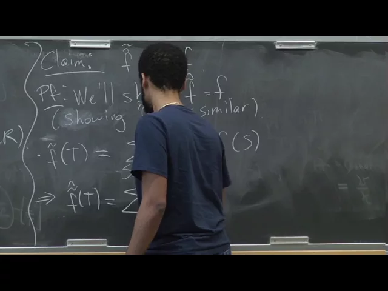
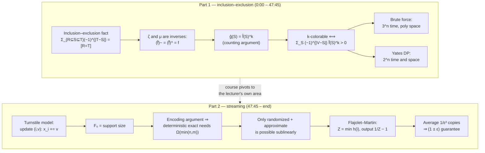

# Advanced Algorithms (COMPSCI 224), Lecture 25

*Harvard University · 1:26:14 · [Watch on YouTube](https://www.youtube.com/watch?v=M42rQM0vC4g)*

## Summary

A two-part lecture that closes the **exponential-time algorithms in small space** thread and opens the course's final topic, **streaming and sketching**. The first half derives the k-colorability inclusion–exclusion formula properly: it defines the **zeta transform** and **Möbius inversion**, proves they invert each other, and shows that the mysterious identity `Σ_{S⊆V}(−1)^{|V−S|} f̂(S)^k > 0` is nothing but the Möbius inversion of `f̂^k` evaluated at `V`. Two ways to evaluate it are given — brute force in `O*(3^n)` time with **polynomial space**, and **Yates's dynamic program** in `O*(2^n)` time and space — settling k-colorability in roughly `2^n` time. The second half sets up the **turnstile streaming model**, proves via an encoding argument that the distinct-elements problem `F₀` admits no sublinear-space deterministic exact algorithm, maps out which of the four determinism/approximation variants survive, and closes with the idealized **Flajolet–Martin** min-hash estimator and its `1/ε²`-copy averaging trick.

## Topics

1. [Recap: inclusion–exclusion and the k-colorability formula](01-recap-inclusion-exclusion-and-k-colorability.md)
2. [Zeta transform and Möbius inversion](02-zeta-transform-and-mobius-inversion.md)
3. [Where the k-colorability formula comes from](03-deriving-the-k-colorability-formula.md)
4. [Brute force: `O*(3^n)` time in polynomial space](04-brute-force-3n-time-poly-space.md)
5. [Yates's algorithm: `O*(2^n)` time and space](05-yates-algorithm.md)
6. [Applications, references, and finding an actual coloring](06-applications-references-and-finding-the-coloring.md)
7. [The streaming model and the `F₀` problem](07-streaming-model-and-f0.md)
8. [Lower bound: no deterministic exact `F₀` in sublinear space](08-lower-bound-encoding-argument.md)
9. [The four variants: what is and isn't possible](09-four-variants-what-is-possible.md)
10. [The idealized Flajolet–Martin algorithm](10-flajolet-martin-algorithm.md)
11. [Closing Q&A: point queries and other streaming problems](11-point-queries-and-closing-qa.md)

## Key takeaways

- **The k-colorability formula is a derivation, not a trick**: `g(V) = (f̂^k)~(V)`, because `ĝ(S) = f̂(S)^k` — both sides count ordered `k`-tuples of non-empty independent sets contained in `S` — and Möbius inversion undoes the zeta transform [`20:26`](https://www.youtube.com/watch?v=M42rQM0vC4g&t=1226), [`23:03`](https://www.youtube.com/watch?v=M42rQM0vC4g&t=1383), [`23:34`](https://www.youtube.com/watch?v=M42rQM0vC4g&t=1414).
- **Overlap doesn't matter for coloring**: a union of `k` possibly-overlapping non-empty independent sets can always be turned into a disjoint one by keeping each vertex in only the first set it appeared in [`19:12`](https://www.youtube.com/watch?v=M42rQM0vC4g&t=1152), [`19:35`](https://www.youtube.com/watch?v=M42rQM0vC4g&t=1175).
- **Inclusion–exclusion buys space, not time, at first**: brute force evaluates the formula in `O*(3^n)` time with **poly(n) space** — matching last lecture's DP in time while dropping its `2^n` space — because each `f̂(S)` is folded into a running sum and discarded [`26:42`](https://www.youtube.com/watch?v=M42rQM0vC4g&t=1602), [`27:47`](https://www.youtube.com/watch?v=M42rQM0vC4g&t=1667), [`28:05`](https://www.youtube.com/watch?v=M42rQM0vC4g&t=1685).
- **Yates's algorithm decides k-colorability in `O*(2^n)`**: the recurrence `G(i,S) = G(i−1,S) + [i∈S]·G(i−1,S−i)` with base `G(0,S) = f(S)` has `n·2^n` states and `O(1)` work each, so time ≈ space [`32:43`](https://www.youtube.com/watch?v=M42rQM0vC4g&t=1963), [`34:03`](https://www.youtube.com/watch?v=M42rQM0vC4g&t=2043), [`40:20`](https://www.youtube.com/watch?v=M42rQM0vC4g&t=2420).
- **Best known poly-space bound is `O*(2.2461^n)`** (Björklund–Husfeldt, FOCS '06); reaching ~`2^n` time in polynomial space is an **open problem** [`6:40`](https://www.youtube.com/watch?v=M42rQM0vC4g&t=400), [`7:16`](https://www.youtube.com/watch?v=M42rQM0vC4g&t=436).
- **Decision implies construction for free**: a black-box reduction of a couple of paragraphs turns any `2^n`-time chromatic-number algorithm into one that outputs an actual `k`-coloring in roughly the same time [`44:20`](https://www.youtube.com/watch?v=M42rQM0vC4g&t=2660), [`45:25`](https://www.youtube.com/watch?v=M42rQM0vC4g&t=2725).
- **Deterministic exact `F₀` needs `Ω(min(n,m))` bits** (AMS '96/'99): a space-`S` algorithm would compress every `n`-bit string to `S` bits — Alice streams the 1-indices and ships the memory image, Bob re-inserts `i = 1..n` and reads `x_i` off whether the count moves — contradicting pigeonhole unless `S ≥ n` [`56:47`](https://www.youtube.com/watch?v=M42rQM0vC4g&t=3407), [`59:27`](https://www.youtube.com/watch?v=M42rQM0vC4g&t=3567), [`1:04:43`](https://www.youtube.com/watch?v=M42rQM0vC4g&t=3883).
- **Three of the four `F₀` variants are impossible sublinearly**: deterministic-exact, deterministic-approximate (for *any* constant factor, not just 1%), and randomized-exact all fail; only **randomized + approximate** works, via Flajolet–Martin (JCSS '85) [`1:06:56`](https://www.youtube.com/watch?v=M42rQM0vC4g&t=4016), [`1:07:20`](https://www.youtube.com/watch?v=M42rQM0vC4g&t=4040), [`1:08:16`](https://www.youtube.com/watch?v=M42rQM0vC4g&t=4096).
- **Flajolet–Martin's estimator is one number**: `Z = min_i h(i)` over the stream, output `1/Z − 1`, justified by `Pr[Z > x] = (1−x)^{F₀}` giving `E[Z] = 1/(F₀+1)` (and `E[Z²] = 2/((F₀+1)(F₀+2))`) [`1:13:31`](https://www.youtube.com/watch?v=M42rQM0vC4g&t=4411), [`1:19:38`](https://www.youtube.com/watch?v=M42rQM0vC4g&t=4778), [`1:20:00`](https://www.youtube.com/watch?v=M42rQM0vC4g&t=4800).
- **Averaging `R = 1/ε²` independent copies converts constant error into `1 ± ε`**: the mean is unchanged, the variance drops by a factor `R`, exactly cancelling the `ε²` in Chebyshev's bound [`1:15:13`](https://www.youtube.com/watch?v=M42rQM0vC4g&t=4513), [`1:21:58`](https://www.youtube.com/watch?v=M42rQM0vC4g&t=4918).
- **Point queries behave differently from `F₀`**: deterministic *approximate* becomes possible there (error `± ε‖x‖₁`), at space `≈ 1/ε²` deterministically and `≈ 1/ε` randomized — but it cannot be recycled into a deterministic `F₀` approximation, since a true zero and an `ε‖x‖₁`-sized value are indistinguishable [`1:23:33`](https://www.youtube.com/watch?v=M42rQM0vC4g&t=5013), [`1:24:20`](https://www.youtube.com/watch?v=M42rQM0vC4g&t=5060), [`1:25:38`](https://www.youtube.com/watch?v=M42rQM0vC4g&t=5138).
