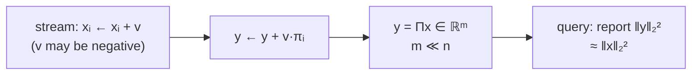

# 2. Linear sketching and why it supports deletions

## Why the previous lecture's algorithm breaks under deletions

- With `v` always positive there are no deletions, and the distinct-elements algorithm only stores the **minimum hash value ever seen** [`5:48`](https://www.youtube.com/watch?v=DpxNW0T8CWg&t=348).
- If the item owning that minimum is later deleted, the stored value is now meaningless — and the **second** minimum was never stored, so the algorithm has nothing to fall back on [`6:10`](https://www.youtube.com/watch?v=DpxNW0T8CWg&t=370).

## Linear sketching

- **Definition**: pick a matrix `Π ∈ ℝ^{m×n}` and store `y = Πx` in memory. Initially `y = 0` because `Π·0 = 0` [`8:15`](https://www.youtube.com/watch?v=DpxNW0T8CWg&t=495).
- `Π` is short and fat, with columns `π₁, …, πₙ` and `m` rows [`8:53`](https://www.youtube.com/watch?v=DpxNW0T8CWg&t=533).
- **Update rule**: an update `xᵢ ← xᵢ + v` becomes `y ← y + v·πᵢ` — arbitrary `v`, positive or negative [`9:19`](https://www.youtube.com/watch?v=DpxNW0T8CWg&t=559).
- Because the update is linear, **insertions and deletions are handled identically** [`6:10`](https://www.youtube.com/watch?v=DpxNW0T8CWg&t=370), [`9:19`](https://www.youtube.com/watch?v=DpxNW0T8CWg&t=559).

## Linear sketching is essentially universal for deletion streams

- Known result: **any** streaming algorithm that must support deletions can be converted into a linear sketch, for **any** query function `f`, with only a small (about `log n`) blow-up in space [`6:29`](https://www.youtube.com/watch?v=DpxNW0T8CWg&t=389), [`7:18`](https://www.youtube.com/watch?v=DpxNW0T8CWg&t=438).
- Due to **Li, Nguyen, and Woodruff** [`7:18`](https://www.youtube.com/watch?v=DpxNW0T8CWg&t=438).

## The AMS instantiation

- Choose `Πᵢⱼ = ±1/√m` uniformly and **independently**; write the sign as `σᵢⱼ` [`10:06`](https://www.youtube.com/watch?v=DpxNW0T8CWg&t=606), [`10:50`](https://www.youtube.com/watch?v=DpxNW0T8CWg&t=650).
- **Estimator**: report `‖y‖₂²` as the estimate of `‖x‖₂²` [`10:06`](https://www.youtube.com/watch?v=DpxNW0T8CWg&t=606).

