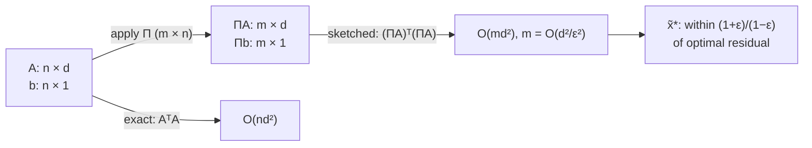

# 7. Fast least-squares regression via subspace embeddings

## The regression problem

- A hidden parameter vector `x ∈ ℝᵈ`; observed variables `a₁, …, a_d` and a response `b = Σᵢ aᵢxᵢ` [`49:59`](https://www.youtube.com/watch?v=DpxNW0T8CWg&t=2999).
- We run experiments: the `aᵢ` and `b` are observable, the `xᵢ` are what we want to solve for [`50:48`](https://www.youtube.com/watch?v=DpxNW0T8CWg&t=3048).
- Stack the experiments into a **tall, skinny `n × d` matrix `A`** and solve `Ax = b` with `b ∈ ℝⁿ` [`51:09`](https://www.youtube.com/watch?v=DpxNW0T8CWg&t=3069).
- Reality adds **noise**: `b = Σᵢ aᵢxᵢ + noise`, so we only want `Ax ≈ b` [`52:17`](https://www.youtube.com/watch?v=DpxNW0T8CWg&t=3137).
- **Least squares**: `x* = argmin_x ‖Ax − b‖₂` [`53:06`](https://www.youtube.com/watch?v=DpxNW0T8CWg&t=3186).

## The closed form and its bottleneck

- `x* = (AᵀA)⁺ Aᵀ b`, where `⁺` is the **pseudoinverse** — a generalization of the inverse that also handles `A` without full column rank [`53:06`](https://www.youtube.com/watch?v=DpxNW0T8CWg&t=3186), [`53:36`](https://www.youtube.com/watch?v=DpxNW0T8CWg&t=3216).
- **Cost of `AᵀA`**: it is a `d × n` times `n × d` product; each of the `d²` output entries is a length-`n` dot product ⇒ **`O(nd²)`** [`53:56`](https://www.youtube.com/watch?v=DpxNW0T8CWg&t=3236), [`54:42`](https://www.youtube.com/watch?v=DpxNW0T8CWg&t=3282), [`55:04`](https://www.youtube.com/watch?v=DpxNW0T8CWg&t=3304).
- The pseudoinverse costs only `poly(d)` (roughly `d³`), so **`AᵀA` is the bottleneck** [`55:04`](https://www.youtube.com/watch?v=DpxNW0T8CWg&t=3304).
- Alternative from the problem set: solve iteratively by **gradient descent** [`55:04`](https://www.youtube.com/watch?v=DpxNW0T8CWg&t=3304), [`55:52`](https://www.youtube.com/watch?v=DpxNW0T8CWg&t=3352).

## Subspace embeddings (Sarlós)

> **Definition.** `Π` is an **ε-subspace embedding** for a linear subspace `V` if for *all* `v ∈ V`, `‖Πv‖₂² = (1 ± ε)‖v‖₂²`.

- The same norm-preservation as before, but now demanded for **infinitely many vectors at once** [`56:14`](https://www.youtube.com/watch?v=DpxNW0T8CWg&t=3374).

### The claim

- If `Π` is an ε-subspace embedding for `span(b ∪ columns of A)`, and `x̃* = argmin_x ‖ΠAx − Πb‖`, then
  `‖Ax̃* − b‖ ≤ ((1+ε)/(1−ε))·‖Ax* − b‖` [`57:45`](https://www.youtube.com/watch?v=DpxNW0T8CWg&t=3465).
- I.e. **solving the tiny sketched regression is almost as good as solving the true one** [`58:54`](https://www.youtube.com/watch?v=DpxNW0T8CWg&t=3534).

### The proof (three lines)

1. `x̃*` is optimal for the sketched problem, so `‖ΠAx̃* − Πb‖ ≤ ‖ΠAx* − Πb‖` [`1:00:33`](https://www.youtube.com/watch?v=DpxNW0T8CWg&t=3633).
2. Both sides are `Π` applied to a vector of the form `Ax − b`, which **lives in the embedded subspace**, so both are preserved to within `1 ± ε` [`1:00:57`](https://www.youtube.com/watch?v=DpxNW0T8CWg&t=3657).
3. Rearrange. Done [`1:01:24`](https://www.youtube.com/watch?v=DpxNW0T8CWg&t=3684).

## The payoff

- With `Π` an `m × n` matrix and `m ≪ n`, the bottleneck becomes `(ΠA)ᵀ(ΠA)`, costing **`O(md²)` instead of `O(nd²)`** — an `n → m` swap. Space drops too [`59:19`](https://www.youtube.com/watch?v=DpxNW0T8CWg&t=3559), [`59:54`](https://www.youtube.com/watch?v=DpxNW0T8CWg&t=3594).
- Crucially, **`m` can be made to depend only on `d`, not on `n` at all** [`1:00:07`](https://www.youtube.com/watch?v=DpxNW0T8CWg&t=3607).
- **The catch an audience member raises**: you still have to compute `ΠA`. The answer is to use the **Thorup–Zhang sketch**, which is so sparse that `ΠA` is very cheap [`1:01:24`](https://www.youtube.com/watch?v=DpxNW0T8CWg&t=3684), [`1:01:56`](https://www.youtube.com/watch?v=DpxNW0T8CWg&t=3716).

