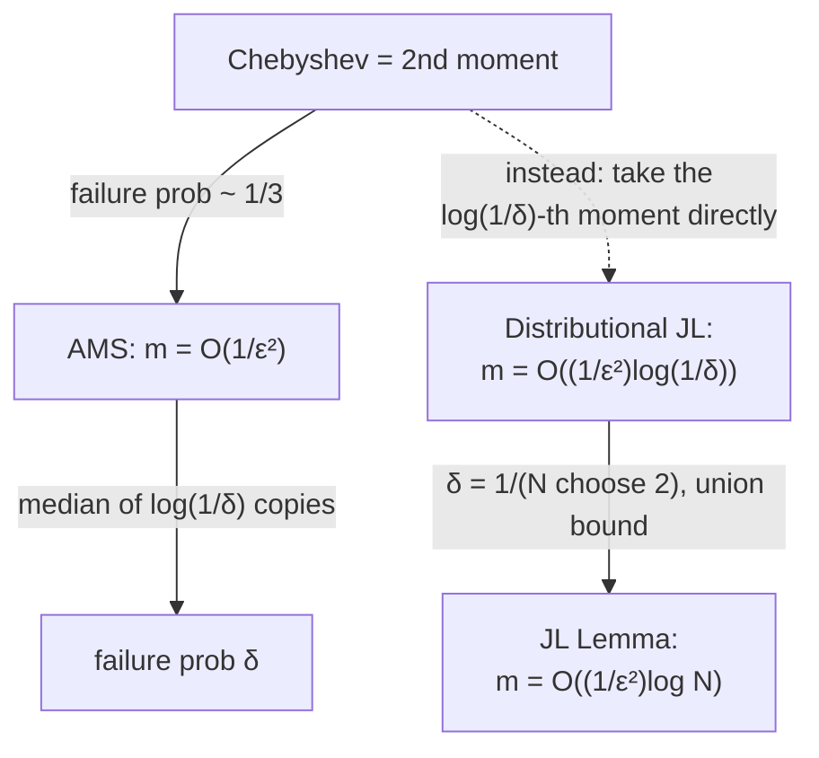

# 9. Dimensionality reduction: the Johnson–Lindenstrauss lemma

## The statement

> For any set `X ⊂ ℝⁿ` with `|X| = N`, there exists a matrix `Π ∈ ℝ^{m×n}` with `m = O((1/ε²)·log N)` such that for all `x, y ∈ X`, `‖Πx − Πy‖ = (1 ± ε)‖x − y‖`.

[`1:12:46`](https://www.youtube.com/watch?v=DpxNW0T8CWg&t=4366), [`1:13:12`](https://www.youtube.com/watch?v=DpxNW0T8CWg&t=4392), [`1:13:37`](https://www.youtube.com/watch?v=DpxNW0T8CWg&t=4417)

- The target dimension depends on **`log` of the number of points**, not on the ambient dimension `n` [`1:13:37`](https://www.youtube.com/watch?v=DpxNW0T8CWg&t=4417).

## Optimality

- For linear sketches this is **optimal**: `m = Ω(min{n, (1/ε²)·log N})` is necessary — there exist point sets `X` that genuinely require it [`1:13:37`](https://www.youtube.com/watch?v=DpxNW0T8CWg&t=4417), [`1:14:16`](https://www.youtube.com/watch?v=DpxNW0T8CWg&t=4456).
- **Why the `min` with `n`**: you can always take `Π = I`, so no lower bound can ever exceed `n` (an audience member supplies this). The `min` says: use JL until the identity matrix becomes the better choice [`1:15:00`](https://www.youtube.com/watch?v=DpxNW0T8CWg&t=4500), [`1:15:12`](https://www.youtube.com/watch?v=DpxNW0T8CWg&t=4512).

## Proof strategy: distributional JL plus a union bound

1. Design a **distribution `D` over matrices** such that for every unit vector `z ∈ ℝⁿ`:
   `Pr_{Π ~ D}[ |‖Πz‖ − 1| > ε ] ≤ δ` [`1:15:27`](https://www.youtube.com/watch?v=DpxNW0T8CWg&t=4527), [`1:16:07`](https://www.youtube.com/watch?v=DpxNW0T8CWg&t=4567).
2. Set `δ = 1/(N choose 2)` and apply it to `z = (x − y)/‖x − y‖` for each pair `x, y ∈ X` [`1:16:07`](https://www.youtube.com/watch?v=DpxNW0T8CWg&t=4567).
3. A **union bound** over all pairs shows one `Π` works for all of them simultaneously [`1:17:05`](https://www.youtube.com/watch?v=DpxNW0T8CWg&t=4625).

## The distribution: random signs again

- **`D` = uniform over `m × n` matrices of `±1/√m` entries**, with `m = O((1/ε²)·log(1/δ))` [`1:17:34`](https://www.youtube.com/watch?v=DpxNW0T8CWg&t=4654).
- The `log(1/δ)` here is exactly what turns into the `log N` in the lemma [`1:17:34`](https://www.youtube.com/watch?v=DpxNW0T8CWg&t=4654).

## Why it works (sketched in words, no board proof)

- It is the **same computation as the beginning of the lecture**, but instead of stopping at the second moment (Chebyshev), you take a **much higher moment** [`1:18:10`](https://www.youtube.com/watch?v=DpxNW0T8CWg&t=4690), [`1:18:31`](https://www.youtube.com/watch?v=DpxNW0T8CWg&t=4711), [`1:19:10`](https://www.youtube.com/watch?v=DpxNW0T8CWg&t=4750).
- **Which moment**: `log(1/δ)` — the same choice students made in the problem set proving the Chernoff bound via moments, and for the same reason [`1:18:31`](https://www.youtube.com/watch?v=DpxNW0T8CWg&t=4711), [`1:18:49`](https://www.youtube.com/watch?v=DpxNW0T8CWg&t=4729).
- The computation is hairier than the problem-set version; simpler routes exist, but the machinery is already familiar [`1:19:10`](https://www.youtube.com/watch?v=DpxNW0T8CWg&t=4750), [`1:19:25`](https://www.youtube.com/watch?v=DpxNW0T8CWg&t=4765).

