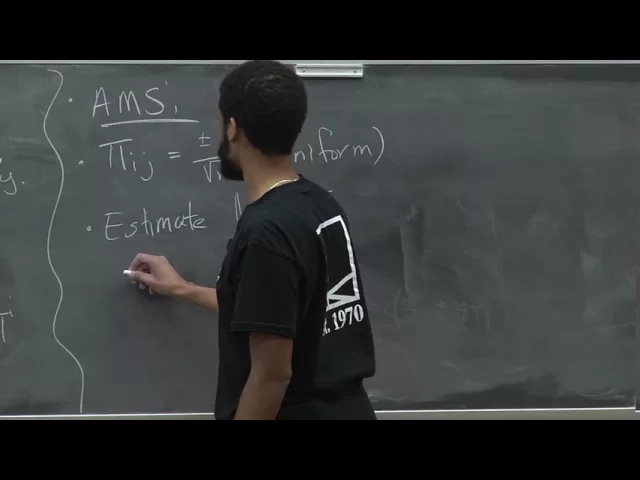
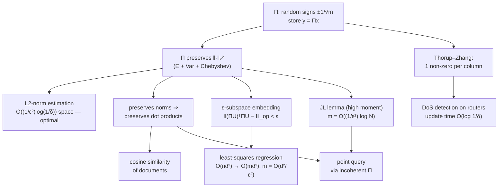

# Advanced Algorithms (COMPSCI 224), Lecture 26

*Harvard University · 1:25:02 · [Watch on YouTube](https://www.youtube.com/watch?v=DpxNW0T8CWg)*

## Summary

The final lecture of the course, which Jelani Nelson titles **"the power of random signs"**: one object — a matrix `Π` whose entries are random `±1/√m` — solves four apparently unrelated problems. He builds it first as the **AMS sketch** for estimating `‖x‖₂²` in a stream, proving unbiasedness and an `O(‖x‖₂⁴/m)` variance so Chebyshev gives `m = O(1/ε²)`, then amplifying with the median trick to `O((1/ε²)·log(1/δ))` space (which is optimal), and noting that **4-wise independence** is all the proof ever used, so `Π` fits in a handful of words. The **Thorup–Zhang** variant — one random signed non-zero per column — keeps every guarantee while cutting update time from `O((1/ε²)log(1/δ))` to `O(log(1/δ))`, a factor-10,000 saving that mattered when AT&T ran it on routers for denial-of-service detection. The same matrix is then reused for cosine similarity, for **ε-subspace embeddings** that turn `O(nd²)` least-squares regression into `O(md²)` with `m = O(d²/ε²)`, for the **Johnson–Lindenstrauss lemma** (`m = O((1/ε²)log N)`, proved by taking the `log(1/δ)`-th moment instead of the second), and finally for **point query** via incoherent matrices built by applying JL to the standard basis.

## Topics

1. [Lecture plan and the streaming model](01-lecture-plan-and-the-streaming-model.md)
2. [Linear sketching and why it supports deletions](02-linear-sketching-and-deletions.md)
3. [The AMS sketch: expectation, variance, Chebyshev](03-the-ams-sketch-and-its-analysis.md)
4. [Median amplification, optimal space, and limited independence](04-median-amplification-optimality-and-limited-independence.md)
5. [Update time and the Thorup–Zhang sparse sketch](05-update-time-and-the-thorup-zhang-sketch.md)
6. [Applications: DoS detection and cosine similarity](06-applications-dos-detection-and-cosine-similarity.md)
7. [Fast least-squares regression via subspace embeddings](07-fast-least-squares-regression.md)
8. [What a subspace embedding really is (and how to build one)](08-what-a-subspace-embedding-really-is.md)
9. [Dimensionality reduction: the Johnson–Lindenstrauss lemma](09-johnson-lindenstrauss-dimensionality-reduction.md)
10. [Point query via incoherent matrices](10-point-query-and-incoherent-matrices.md)

## Key takeaways

- **The AMS sketch is unbiased with variance `O(‖x‖₂⁴/m)`**, so Chebyshev plus `m = 6/ε²` yields a `(1 ± ε)` estimate of `‖x‖₂²` with probability `2/3` in `O(1/ε²)` words [`27:13`](https://www.youtube.com/watch?v=DpxNW0T8CWg&t=1633), [`28:58`](https://www.youtube.com/watch?v=DpxNW0T8CWg&t=1738).
- **`O((1/ε²)·log(1/δ))` space is optimal** for L2-norm estimation — reached by stacking `log(1/δ)` copies and taking the median (Chernoff), and proved optimal only after a long chain of papers ending at Jayaram–Woodruff [`32:40`](https://www.youtube.com/watch?v=DpxNW0T8CWg&t=1960), [`33:39`](https://www.youtube.com/watch?v=DpxNW0T8CWg&t=2019), [`34:02`](https://www.youtube.com/watch?v=DpxNW0T8CWg&t=2042).
- **The sketch matrix never has to be stored**: the whole analysis is degree-4 in the signs, so **4-wise independence suffices**, and a 4-wise family costs `O(log n)` bits — about one word per copy, `O(log(1/δ))` words total [`35:22`](https://www.youtube.com/watch?v=DpxNW0T8CWg&t=2122), [`36:18`](https://www.youtube.com/watch?v=DpxNW0T8CWg&t=2178).
- **Thorup–Zhang's one-non-zero-per-column sketch is strictly better than dense AMS**: identical space and accuracy, but update time drops from `O((1/ε²)log(1/δ))` to `O(log(1/δ))`. At 1% error that removed a factor of `1/ε² = 10,000` from AT&T's per-packet cost for DoS detection on routers [`38:56`](https://www.youtube.com/watch?v=DpxNW0T8CWg&t=2336), [`40:26`](https://www.youtube.com/watch?v=DpxNW0T8CWg&t=2426), [`40:50`](https://www.youtube.com/watch?v=DpxNW0T8CWg&t=2450), [`44:03`](https://www.youtube.com/watch?v=DpxNW0T8CWg&t=2643).
- **`p = 2` is the ceiling**: `‖x‖_∞` — the norm that best detects traffic spikes — admits no space-efficient streaming algorithm, and `2` is the largest `p` for which `Lp` estimation is space-efficient [`43:17`](https://www.youtube.com/watch?v=DpxNW0T8CWg&t=2597), [`43:37`](https://www.youtube.com/watch?v=DpxNW0T8CWg&t=2617).
- **Subspace embeddings make least squares dimension-free in `n`**: solving `argmin‖ΠAx − Πb‖` gives residual within `(1+ε)/(1−ε)` of optimal, with `m = O(d²/ε²)` rows (Clarkson–Woodruff, tightened by Mahoney–Meng and Nelson–Nguyen), turning the `O(nd²)` `AᵀA` bottleneck into `O(md²)` — plus `O(nnz(A))` to form `ΠA` with a sparse `Π` [`57:45`](https://www.youtube.com/watch?v=DpxNW0T8CWg&t=3465), [`1:00:07`](https://www.youtube.com/watch?v=DpxNW0T8CWg&t=3607), [`1:09:32`](https://www.youtube.com/watch?v=DpxNW0T8CWg&t=4172), [`1:10:21`](https://www.youtube.com/watch?v=DpxNW0T8CWg&t=4221), [`1:11:06`](https://www.youtube.com/watch?v=DpxNW0T8CWg&t=4266).
- **JL's `m = O((1/ε²)·log N)` is optimal for linear sketches**, in the form `Ω(min{n, (1/ε²)log N})` — the `min` only because `Π = I` is always available. The proof is the AMS computation with the `log(1/δ)`-th moment in place of the second, then a union bound over all `N choose 2` pairs [`1:13:37`](https://www.youtube.com/watch?v=DpxNW0T8CWg&t=4417), [`1:14:16`](https://www.youtube.com/watch?v=DpxNW0T8CWg&t=4456), [`1:17:05`](https://www.youtube.com/watch?v=DpxNW0T8CWg&t=4625), [`1:18:31`](https://www.youtube.com/watch?v=DpxNW0T8CWg&t=4711).
- **Preserving L2 norms ⇒ preserving dot products** (via `⟨a,b⟩ = (‖a‖²+‖b‖²−‖a−b‖²)/2`) is the single lever behind cosine similarity, subspace embeddings, and point query alike [`47:40`](https://www.youtube.com/watch?v=DpxNW0T8CWg&t=2860), [`48:43`](https://www.youtube.com/watch?v=DpxNW0T8CWg&t=2923), [`1:23:26`](https://www.youtube.com/watch?v=DpxNW0T8CWg&t=5006).
- **Point query in `O((1/ε²)·log n)` rows**: applying JL to `{0, e₁, …, eₙ}` produces unit columns with pairwise inner products `≤ ε`, and `(ΠᵀΠx)ᵢ = xᵢ ± ε‖x‖₁` [`1:22:24`](https://www.youtube.com/watch?v=DpxNW0T8CWg&t=4944), [`1:22:51`](https://www.youtube.com/watch?v=DpxNW0T8CWg&t=4971).
- **Open problem flagged by the lecturer**: whether L2-norm estimation can achieve optimal space with update time below `log(1/δ)` — linear sketches provably need about `√(log(1/δ))`, leaving a gap [`41:22`](https://www.youtube.com/watch?v=DpxNW0T8CWg&t=2482), [`41:41`](https://www.youtube.com/watch?v=DpxNW0T8CWg&t=2501).
