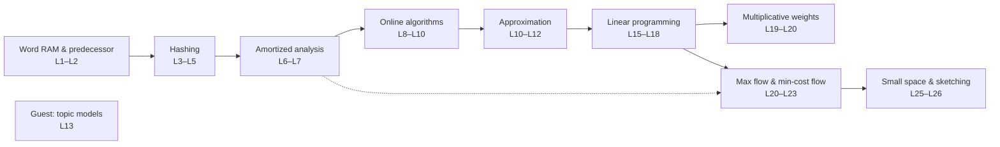

# Advanced Algorithms (COMPSCI 224)

<https://www.youtube.com/playlist?list=PL2SOU6wwxB0uP4rJgf5ayhHWgw7akUWSf>

Harvard University, taught by Jelani Nelson. 24 lectures of notes, one folder each.

## What this library covers

This is a graduate algorithms course built around a single recurring move: identify the *model* a classical impossibility result lives in, then step outside it. Lecture 1 opens by pointing out that `Ω(n log n)` sorting is an artifact of the comparison model, and the word-RAM model breaks it — and the rest of the course keeps repeating that pattern at larger and larger scales. Comparison-based priority queues can't do constant delete-min, but the word RAM can. NP-hardness kills exact set cover, but LP relaxation and dual fitting give `log n`. Worst-case simplex is exponential, but smoothed analysis explains why it is fast in practice. Exact `F₀` in a stream needs linear space, but randomization plus approximation needs almost none.

The series moves through five substantial blocks. It starts in **data structures** — van Emde Boas trees, fusion trees, hashing with k-wise independence, cuckoo hashing, Bloom and Bloomier filters — then formalizes **amortized analysis** with Fibonacci heaps and splay trees. From there it turns to **decision-making under incomplete information**: online algorithms and competitive analysis, which flow naturally into the online primal-dual framework, which in turn opens the **approximation algorithms** block (dual fitting, integrality gaps, PTAS/FPTAS/FPRAS, and Goemans–Williamson via SDP). The second half is a sustained treatment of **linear programming and flow**: simplex and duality from first principles, ellipsoid, interior point methods with Newton's method as their engine, multiplicative weights as a fast-but-imprecise alternative, and then max flow developed from Ford–Fulkerson through blocking flows, link-cut trees, and min-cost flow. It closes with exponential-time algorithms in small space and a final lecture on sketching that ties together four problems with one matrix of random signs.

What a reader gets end to end is not a catalogue of algorithms but a working command of the techniques that produce them — potential functions, k-wise independence, LP duality, dual fitting, competitive analysis, and randomized dimension reduction — together with an honest map of what is still open: dynamic optimality, strongly polynomial LP, linear-time word-RAM sorting.

## Videos

1. [Advanced Algorithms (COMPSCI 224), Lecture 1](./01-advanced-algorithms-compsci-224-lecture-1/README.md) — Course logistics, then the dismantling of the belief that sorting can't beat `n log n`: that bound holds only in the comparison model. Introduces the word-RAM model and the static/dynamic predecessor problem, since fast dynamic predecessor immediately yields fast sorting. Builds van Emde Boas trees in full, cuts their `Θ(u)` space to `Θ(n)` with a hash table and a charging argument, and sketches the X-fast/Y-fast trie route to the same bound.

2. [Advanced Algorithms (COMPSCI 224), Lecture 2](./02-advanced-algorithms-compsci-224-lecture-2/README.md) — A full treatment of fusion trees (Fredman–Willard), the word-RAM structure answering static predecessor queries in `O(log_w n)`. Builds a `Θ(w^(1/5))`-ary search tree, then confronts the central obstacle: a node's keys take `w^(6/5)` bits, so they do not fit in a machine word yet must be searched in constant time. Assembles the solution from sketching onto branch bits, multiplication as an approximate bit-gathering instruction, word-level parallel comparison, and a constant-time most-significant-bit routine.

3. [Advanced Algorithms (COMPSCI 224), Lecture 3](./03-advanced-algorithms-compsci-224-lecture-3/README.md) — Hashing in the word-RAM model, opening with hashing as load balancing and proving that `n` jobs hashed to `n` machines leave no machine with more than `O(log n / log log n)` — first via Chernoff, then via a much simpler union-bound argument. That second proof motivates k-wise independence: since it only inspects `k` items at a time, an expensive truly-random hash can be replaced by a cheap degree-`k−1` polynomial family. Applies hashing to dictionaries with chaining and to linear probing, covering its cache-friendliness and historical independence thresholds.

4. [Advanced Algorithms (COMPSCI 224), Lecture 4](./04-advanced-algorithms-compsci-224-lecture-4/README.md) — The final lecture devoted exclusively to hashing, completing the moment-method analysis of linear probing — first with 7-wise independence via a symmetrization trick, then with only 5-wise via the Pagh–Pagh–Ružić binary-tree argument. Turns to space-efficient hashing: approximate membership and Bloom filters, the retrieval problem and Bloomier filters, and cuckoo hashing with the cuckoo graph as its analysis tool. Closes by constructing Bloomier filters from an acyclic cuckoo hash table.

5. [Advanced Algorithms (COMPSCI 224), Lecture 5](./05-advanced-algorithms-compsci-224-lecture-5/README.md) — Closes the hashing unit by completing the expected-`O(1)` insertion proof for cuckoo hashing, modeling each insertion as a walk in the cuckoo graph and bounding the three possible shapes. Shifts to load balancing and the power of two choices, showing that probing two random bins instead of one drops max load from `Θ(log n / log log n)` to `ln ln n / ln 2 + Θ(1)`, and covering the diminishing returns of `d` choices plus Vöcking's asymmetric variant. Closes with the squaring intuition behind `log log n` and two errors the lecturer leaves openly unresolved.

6. [Advanced Algorithms (COMPSCI 224), Lecture 6](./06-advanced-algorithms-compsci-224-lecture-6/README.md) — Leaves the word-RAM model and opens the unit on amortized analysis, defining amortized cost and proving the potential function method sound via a telescoping sum. Applies it to priority queues: binomial heaps get constant amortized insertion under Φ = number of trees, and Fibonacci heaps are derived from them by being maximally lazy — deferring all consolidation to delete-min. The one repair that makes laziness safe is the mark bit with cascading cuts, which restores the rank-certifies-size property and yields the O(1)/O(1)/O(log n) bounds.

7. [Advanced Algorithms (COMPSCI 224), Lecture 7](./07-advanced-algorithms-compsci-224-lecture-7/README.md) — Devoted entirely to splay trees, Sleator and Tarjan's self-adjusting BST, as a second worked example of amortized analysis. Surveys the BST model and the catalogue of properties splay trees satisfy or are conjectured to satisfy: static optimality, working set, static and dynamic finger, the unified bound, and the long-open dynamic optimality conjecture. The second half is the proof — a potential function over arbitrary item weights producing a master bound from which uniform weights yield `O(log n)` and weights `1/3^L` yield static optimality.

8. [Advanced Algorithms (COMPSCI 224), Lecture 8](./08-advanced-algorithms-compsci-224-lecture-8/README.md) — Introduces online algorithms and competitive analysis: making irrevocable decisions without knowing the future, bounded against an omniscient OPT. After two warm-ups (ski rental, searching a hallway), it covers the two problems Sleator and Tarjan introduced the framework for — list update, where move-to-front is proved dynamically optimal via an inversion-counting potential, and paging, where LRU/FIFO are k-competitive with a matching deterministic lower bound. Closes with three ways around that bound and the start of the randomized MARK algorithm.

9. [Advanced Algorithms (COMPSCI 224), Lecture 9](./09-advanced-algorithms-compsci-224-lecture-9/README.md) — Completes the analysis of MARK, proving it `2·H_K` competitive via a phase-based argument on clean and stale pages, then establishes a matching `Ω(log K)` lower bound using a uniformly random request sequence and coupon collector. A survey interlude covers the `H_K`-optimal algorithms and two decades-old factor-2 gaps (resource augmentation, `k`-server). The second half introduces the online primal-dual framework of Buchbinder and Naor and re-derives 2-competitive ski rental in that language.

10. [Advanced Algorithms (COMPSCI 224), Lecture 10](./10-advanced-algorithms-compsci-224-lecture-10/README.md) — Closes out the primal-dual method for online algorithms with two complete worked examples. The first half re-derives the `e/(e−1)` randomized bound for ski rental by maintaining feasible primal and dual LP solutions online, then rounding with a single uniform random threshold. The second applies the same machinery to online set cover — a continuous-time multiplicative growth process gives `O(log m)`-competitive fractional, randomized rounding makes it integral — and sets up offline approximation and the dual-fitting proof for greedy set cover.

11. [Advanced Algorithms (COMPSCI 224), Lecture 11](./11-advanced-algorithms-compsci-224-lecture-11/README.md) — Completes the dual-fitting analysis of greedy weighted set cover, proving an `H_K` approximation, and gives a pure primal-dual 2-approximation for vertex cover alongside an LP-rounding alternative. Examines the limits of the LP framework by defining the integrality gap and constructing two gap instances, plus Feige's stronger NP-hardness barrier. Closes by defining PTAS/FPTAS/FPRAS and building a PTAS for knapsack, from why naive ratio-greedy fails through "guess the big items then greed the rest".

12. [Advanced Algorithms (COMPSCI 224), Lecture 12](./12-advanced-algorithms-compsci-224-lecture-12/README.md) — The closing lecture of the approximation block: a rounding-based FPTAS for Knapsack in `O(n³/ε)`, followed by bin packing as a problem where no FPTAS can exist. Introduces FPRAS through the Karp–Luby–Madras algorithm for DNF counting, a #P-complete problem made approximable by sampling from an enlarged universe. Finally defines semidefinite programming, establishes LP ⊂ SDP ≡ vector programming, and derives the Goemans–Williamson 0.878-approximation for Max-Cut via random hyperplane rounding.

13. [Advanced Algorithms (COMPSCI 224), Lecture 13](./13-advanced-algorithms-compsci-224-lecture-13/README.md) — A guest lecture by Rong Ge (Microsoft Research) on learning topic models, presented as a case study in applying theoretical-CS algorithm design to machine learning. Formalizes unsupervised learning as recovering the parameters of a probabilistic model, shows maximum likelihood is NP-hard, and surveys four ways around NP-hardness. Reduces learning from long documents to non-negative matrix factorization, then uses the separability / anchor-word assumption to turn that NP-hard factorization into a convex-hull vertex-finding problem solved with linear programs.

14. [Advanced Algorithms (COMPSCI 224), Lecture 15](./14-advanced-algorithms-compsci-224-lecture-15/README.md) — After many lectures treating LP as a black box, this develops the Simplex algorithm from first principles: standard form, the definition of a vertex, obtaining a starting vertex from an auxiliary LP, and proving that a bounded LP attains its optimum at a vertex. That characterization converts vertices into bases, which lets the LP be rewritten around any base so the objective becomes a constant plus reduced costs. Simplex then falls out — halt when reduced costs are non-negative, otherwise pivot — closing on Bland's Rule and the gap between exponential worst case and practical speed.

15. [Advanced Algorithms (COMPSCI 224), Lecture 16](./15-advanced-algorithms-compsci-224-lecture-16/README.md) — Closes out simplex: the reduced-cost pivot step, the degenerate case, and Bland's rule as the pivoting rule that provably terminates. Derives strong duality and complementary slackness as corollaries of simplex working, using the shadow price vector. The second half explains why simplex is exponential in the worst case yet fast in practice (polytope diameter, the Hirsch conjecture and its disproof, Spielman–Teng smoothed analysis), sketches the ellipsoid algorithm and its separation-oracle trick, and previews path-following interior point.

16. [Advanced Algorithms (COMPSCI 224), Lecture 17](./16-advanced-algorithms-compsci-224-lecture-17/README.md) — Develops the interior point method, replacing the LP with a penalized log-barrier objective and following the resulting central path from the analytic center toward the optimal vertex as `λ` grows. Proves the suboptimality bound `cᵀx_λ − cᵀx* ≤ m/λ`, uses it to fix the stopping threshold, and derives the classical `√m·L` iteration count, situating it against Karmarkar, Renegar, and Lee–Sidford. The second half is an optimization digression — oracles, Hessian bounds, and a full derivation of gradient descent — as warm-up for Newton's method.

17. [Advanced Algorithms (COMPSCI 224), Lecture 18](./17-advanced-algorithms-compsci-224-lecture-18/README.md) — Completes the interior point method by supplying its missing engine: Newton's method. The first half proves a progress theorem — if the Hessian stays within `1 ± ε` along the segment to the next iterate, a single Newton step shrinks the gradient's Hessian-inverse norm by `ε/(1−ε)`. The second half plugs that into IPM, defining centrality as the progress measure, showing the log-barrier Hessian is stable exactly because centrality is small, and deriving the step size — closing with Lee–Sidford and a sketch of how to construct the initial central point.

18. [Advanced Algorithms (COMPSCI 224), Lecture 19](./18-advanced-algorithms-compsci-224-lecture-19/README.md) — Introduces multiplicative weights through the "listening to expert advice" problem, where `n` experts give daily predictions and the goal is to be competitive with the best expert in hindsight. Builds from majority-vote-with-elimination up to the weighted majority algorithm and its potential-function proof, then generalizes to probability distributions over experts with cost vectors, deriving the standard MW regret bound. The final third applies MW to approximately solving LPs, worked through on fractional set cover, with the key analogy that each constraint acts as an expert.

19. [Advanced Algorithms (COMPSCI 224), Lecture 20](./19-advanced-algorithms-compsci-224-lecture-20/README.md) — Finishes multiplicative weights by showing how it approximately solves linear programs: the LP's `m` constraints become the experts, a ρ-bounded oracle answers a single-constraint relaxation each day, and the average of its answers is an almost-feasible point. Fractional set cover is worked through end to end as a concrete instantiation. The second half opens max flow: definitions, its LP formulation and what interior point methods cost for it, and finally Ford–Fulkerson with residual graphs and augmenting paths.

20. [Advanced Algorithms (COMPSCI 224), Lecture 21](./20-advanced-algorithms-compsci-224-lecture-21/README.md) — Faster maximum-flow algorithms, opening with a Ford–Fulkerson recap, the weakly/strongly/pseudo-polynomial vocabulary, and a survey of the best known bounds at the time. Develops capacity scaling, which shifts capacities in one bit at a time and yields `O(m² log U)`, and blocking flows, whose central claim is that each augmentation strictly increases the s–t distance and so caps the algorithm at `n` rounds. The blocking-flow subroutine is an advance/retreat/augment DFS on the level graph, with link-cut trees teased as the next speedup.

21. [Advanced Algorithms (COMPSCI 224), Lecture 22](./21-advanced-algorithms-compsci-224-lecture-22/README.md) — Devoted to link-cut trees (Sleator–Tarjan, 1983) and their use to speed up the blocking-flow step of max flow. Motivates the structure from the waste in the plain DFS routine, derives the operation interface, rewrites blocking flow on top of it, and counts the calls to show only `O(m)` operations are needed. The second half builds the structure itself: a preferred-path decomposition, each path stored in a splay tree keyed by depth and joined by path-parent pointers, with `access(v)` doing all the work.

22. [Advanced Algorithms (COMPSCI 224), Lecture 23](./22-advanced-algorithms-compsci-224-lecture-23/README.md) — Completes the amortized analysis of link-cut trees by introducing the heavy-light decomposition as a pure accounting device, charging operation cost to preferred child changes and then to light preferred edge creations, yielding `O(m log² n + n log n)`. The second half opens min-cost max flow: its interreducibility with min-cost circulation, the correct-but-pseudo-polynomial negative-cycle-canceling algorithm, the price-function/reduced-cost optimality characterization, and successive shortest paths with Dijkstra for the unit-capacity case.

23. *(not included — see below)*

24. [Advanced Algorithms (COMPSCI 224), Lecture 25](./24-advanced-algorithms-compsci-224-lecture-25/README.md) — Closes the "exponential-time algorithms in small space" thread by defining the zeta transform and Möbius inversion and using them to *derive* the inclusion–exclusion formula for k-colorability. Two evaluation strategies are given: brute force in `O*(3^n)` time with polynomial space, and Yates's dynamic program in `O*(2^n)` time and space. The second half pivots to streaming and sketching — the turnstile model, an encoding-argument lower bound for distinct elements, and the idealized Flajolet–Martin min-hash estimator.

25. [Advanced Algorithms (COMPSCI 224), Lecture 26](./25-advanced-algorithms-compsci-224-lecture-26/README.md) — The course's final lecture, titled "the power of random signs," showing that a single object — a matrix Π of random ±1/√m entries — solves four apparently unrelated problems. Builds it first as the AMS linear sketch for estimating `‖x‖₂²` in a stream, amplifies it with the median trick, notes the analysis only needs 4-wise independence, and swaps in the Thorup–Zhang sparse variant to cut update time. The same matrix is then reused for cosine similarity, ε-subspace embeddings that accelerate least-squares regression, the Johnson–Lindenstrauss lemma, and point query.

## Suggested reading path

**Playlist order genuinely matters here.** This is a single lecture course with continuous threads: several lectures open by finishing a proof started in the previous one (4 continues 3, 5 continues 4, 9 continues 8, 11 continues 10, 16 continues 15, 18 continues 17, 20 continues 19, 22 continues 21, 23 continues 22). Reading one of those in isolation will drop you into the middle of an argument. The blocks themselves, however, are more independent than the numbering suggests, so you can pick a block and start at its first lecture.

**Start here.** Lecture 1 is the right entry point regardless of your goal — it sets up the word-RAM model and, more importantly, establishes the "which model is this bound in?" habit the whole course runs on. Lecture 6 is the second essential foundation: the potential function method is reused in Lectures 7, 22, and 23.

**The blocks, and what each depends on:**

- **Data structures (1–2)** — word RAM, van Emde Boas, fusion trees. Self-contained. Lecture 2 assumes Lecture 1's model.
- **Hashing (3–5)** — a single continuous argument. Read all three or none; Lecture 4's linear-probing proof picks up exactly where 3 stops, and 5 finishes cuckoo hashing from 4.
- **Amortized analysis (6–7)** — Lecture 6 is a prerequisite for 7, and both are prerequisites for the link-cut tree lectures (22–23) much later. Lecture 7's access lemma is cited directly in 23.
- **Online algorithms (8–10)** — 8 → 9 is continuous. Lecture 10 is the hinge: it finishes online primal-dual and opens approximation, so it belongs to both blocks.
- **Approximation (10–12)** — needs LP duality. If you have never seen LP duality, read Lectures 15–16 *first*, then come back; the course itself defers the proof but uses the results.
- **Linear programming (15–18)** — the deepest chain in the course. 15 → 16 (simplex and duality) is one unit; 17 → 18 (interior point and Newton) is another and depends on 16. This block underpins everything after it.
- **Multiplicative weights (19–20)** — depends on the LP block. Lecture 20's second half is also where max flow starts.
- **Flow (20–23)** — 20 → 21 → 22 → 23 is continuous, and 22–23 additionally require splay trees from Lecture 7.
- **Small space and sketching (25–26)** — the most independent pair in the course. Lecture 26 needs only basic probability (expectation, variance, Chebyshev) and stands alone as a self-contained highlight.
- **Guest lecture (13)** — completely independent. Readable at any point; it needs only comfort with linear algebra and convexity.

**If you are short on time,** Lectures 1, 6, 7, 15–16, and 26 give the widest coverage of technique per hour. **If your goal is optimization specifically,** read 15 → 16 → 17 → 18 → 19 → 20 and skip the data-structures half.

## Not included

- **Position 23** — *Advanced Algorithms (COMPSCI 224), Lecture 24* — A package directory named `advanced-algorithms-compsci-224-lecture-24` already exists. Two videos resolved to the same name; remove or rename the existing one to continue.

Note also that the playlist itself contains no Lecture 14 — the jump from position 13 (Lecture 13) to position 14 (Lecture 15) reflects the source playlist, not a failure in this run.
