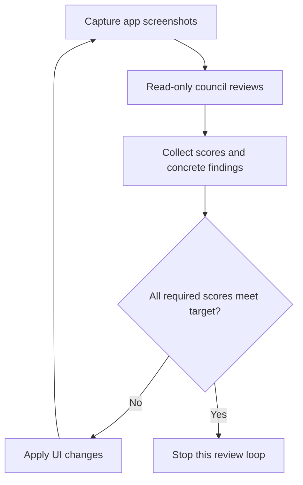

# The review council and hill-climbing loop

## Council setup

- The generic council skill calls three strong models from different providers. Theo's version names Opus 5.5, Muse Wonderful, and Codex GPT 6.1; the transcript also calls the Codex reviewer "Soul." [`6:52`](https://www.youtube.com/watch?v=xq0eB8vxeqk&t=412) [`7:30`](https://www.youtube.com/watch?v=xq0eB8vxeqk&t=450) [`7:53`](https://www.youtube.com/watch?v=xq0eB8vxeqk&t=473)
- Each delegate receives the request and relevant context. Review work stays read-only, and the parent collects findings, disagreements, recommended next steps, and scores out of ten. [`7:30`](https://www.youtube.com/watch?v=xq0eB8vxeqk&t=450)
- One complete review pass counts as a round. After fixes, a fresh review starts the next round. The loop continues until the required reviewers meet the target. [`7:53`](https://www.youtube.com/watch?v=xq0eB8vxeqk&t=473)
- Gemini is an optional extra reviewer whose score Theo initially instructs the agent to ignore. His anecdotes include reviewing an unintended commit and citing line 173 in a 72-line file; these are examples from his experience, not a controlled model comparison. [`9:56`](https://www.youtube.com/watch?v=xq0eB8vxeqk&t=596) [`10:10`](https://www.youtube.com/watch?v=xq0eB8vxeqk&t=610) [`10:37`](https://www.youtube.com/watch?v=xq0eB8vxeqk&t=637)

## Why this is hill climbing

- The agent repeatedly changes an artifact and uses evaluation feedback to pursue a higher score. Theo contrasts UI ratings with easier-to-verify goals such as faster functions, passing an MCP evaluation with less context, or sending four times less client data without UI regressions. [`8:42`](https://www.youtube.com/watch?v=xq0eB8vxeqk&t=522)
- UI scores are subjective. The same model can assign different ratings to the same screenshot across repeated reviews. Theo treats agreement among several high-scoring reviewers as useful evidence of improvement. [`9:08`](https://www.youtube.com/watch?v=xq0eB8vxeqk&t=548)

The core review loop is: [`7:30`](https://www.youtube.com/watch?v=xq0eB8vxeqk&t=450) [`7:53`](https://www.youtube.com/watch?v=xq0eB8vxeqk&t=473)

