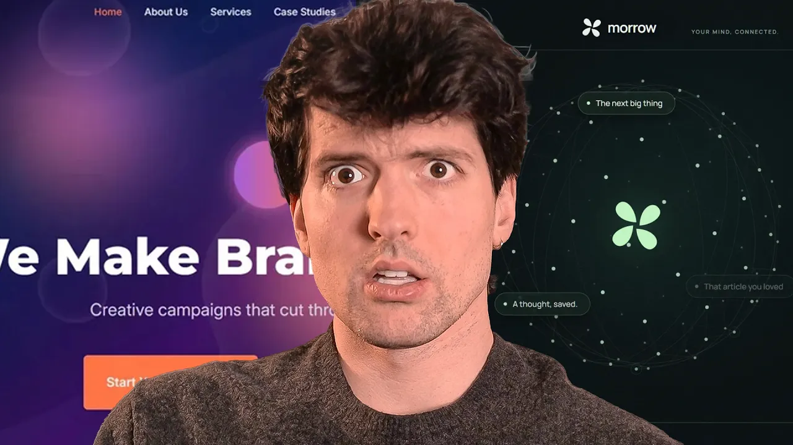

# Agents Sucked At UI (Until Today)

Theo walks through an experiment in improving T3 Code's UI through repeated screenshot reviews by multiple models. He shows the design changes, rising scores, cost estimates, and problems with subjective evaluation, then contrasts this process with a programmatic evaluation that reduced MCP context usage. This is an opinion and experiment walkthrough, rather than a reproducible coding tutorial. [`1:31`](https://www.youtube.com/watch?v=xq0eB8vxeqk&t=91) [`26:48`](https://www.youtube.com/watch?v=xq0eB8vxeqk&t=1608)

## Topic breakdown

1. [The UI problem and experiment](./01-the-ui-problem.md)
2. [Sponsor demo: Magic Patterns](./02-magic-patterns.md)
3. [The review council and hill-climbing loop](./03-review-council.md)
4. [First pass: reaching nine out of ten](./04-first-ui-pass.md)
5. [Comparing against Claude Code and Codex](./05-comparative-review.md)
6. [Stricter targets, score bias, and costs](./06-targets-bias-and-costs.md)
7. [Final design pass and human judgment](./07-final-design-pass.md)
8. [MCP evaluations and context reduction](./08-mcp-evaluations.md)

The [verbatim transcript](./transcript.md) is included for detailed lookup.

## Key takeaways

- The initial council reached 9/10 after three rounds, but fresh context and competitor screenshots reset Codex's assessment of the same improved UI to 7.4/10. Passing a subjective threshold did not settle design quality. [`12:28`](https://www.youtube.com/watch?v=xq0eB8vxeqk&t=748) [`15:05`](https://www.youtube.com/watch?v=xq0eB8vxeqk&t=905)
- Raising the target to at least 9.5 in every category required ten additional runs. Ratings of unchanged competitor screenshots also rose, which Theo identifies as possible goal-induced bias. [`20:04`](https://www.youtube.com/watch?v=xq0eB8vxeqk&t=1204) [`20:30`](https://www.youtube.com/watch?v=xq0eB8vxeqk&t=1230) [`20:49`](https://www.youtube.com/watch?v=xq0eB8vxeqk&t=1249)
- Theo reports about 17.6 hours of parallel agent runtime and roughly $400 in estimated usage, including a later refinement pass. The work shown before that pass accounted for about $250, and subscription use makes these estimates different from cash spending. [`20:49`](https://www.youtube.com/watch?v=xq0eB8vxeqk&t=1249) [`21:43`](https://www.youtube.com/watch?v=xq0eB8vxeqk&t=1303) [`22:56`](https://www.youtube.com/watch?v=xq0eB8vxeqk&t=1376)
- Human direction still mattered. Asking the agent to restore color produced clearer buttons, more visible icons, and contrast changes Theo preferred; Muse eventually gave the design 10/10. [`23:43`](https://www.youtube.com/watch?v=xq0eB8vxeqk&t=1423) [`24:00`](https://www.youtube.com/watch?v=xq0eB8vxeqk&t=1440) [`25:51`](https://www.youtube.com/watch?v=xq0eB8vxeqk&t=1551)
- For MCP descriptions, Theo first targeted perfect evaluation results, then reduced context while preserving correctness. He reports 52% less context for T3 Code and 78% less with tool search enabled. [`29:07`](https://www.youtube.com/watch?v=xq0eB8vxeqk&t=1747) [`29:51`](https://www.youtube.com/watch?v=xq0eB8vxeqk&t=1791)
