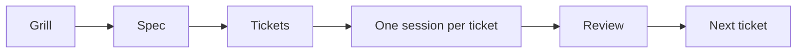

# The smart zone vs the dumb zone

- Matt's next problem after Grill Me was turning a good planning conversation into reliable code. [`40:46`](https://www.youtube.com/watch?v=4DhcSPkEbwI&t=2446)
- He uses Dex Horthy's "smart zone" and "dumb zone" idea: adding more context makes every token compete for attention. [`41:14`](https://www.youtube.com/watch?v=4DhcSPkEbwI&t=2474)
- Matt estimates the smart zone of frontier models at about the first 150,000 tokens, regardless of a larger advertised context window. [`41:34`](https://www.youtube.com/watch?v=4DhcSPkEbwI&t=2494)
- The practical problem is how to divide work that exceeds that useful context range across sessions. [`42:03`](https://www.youtube.com/watch?v=4DhcSPkEbwI&t=2523)
- Ralph loops aimed to stay inside the smart zone by making the smallest useful change toward a goal, then clearing context. [`42:31`](https://www.youtube.com/watch?v=4DhcSPkEbwI&t=2551)
- Matt keeps persistent state in the codebase and file system, not in one overloaded model context. [`42:31`](https://www.youtube.com/watch?v=4DhcSPkEbwI&t=2551)
- His skill flow turns a grilling session into a destination spec, then breaks that spec into tickets, one ticket per session. [`42:56`](https://www.youtube.com/watch?v=4DhcSPkEbwI&t=2576)
- The intended workflow is plan during the "day shift" and let agents execute during the "night shift." [`43:42`](https://www.youtube.com/watch?v=4DhcSPkEbwI&t=2622)
- The goal is fewer context switches for the human and longer blocks where agents can work unattended. [`44:05`](https://www.youtube.com/watch?v=4DhcSPkEbwI&t=2645)

