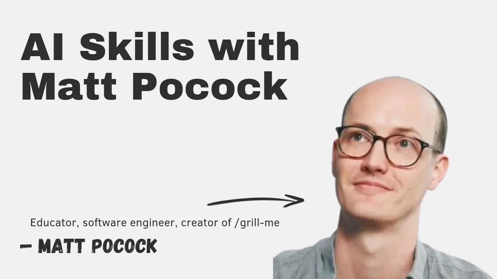
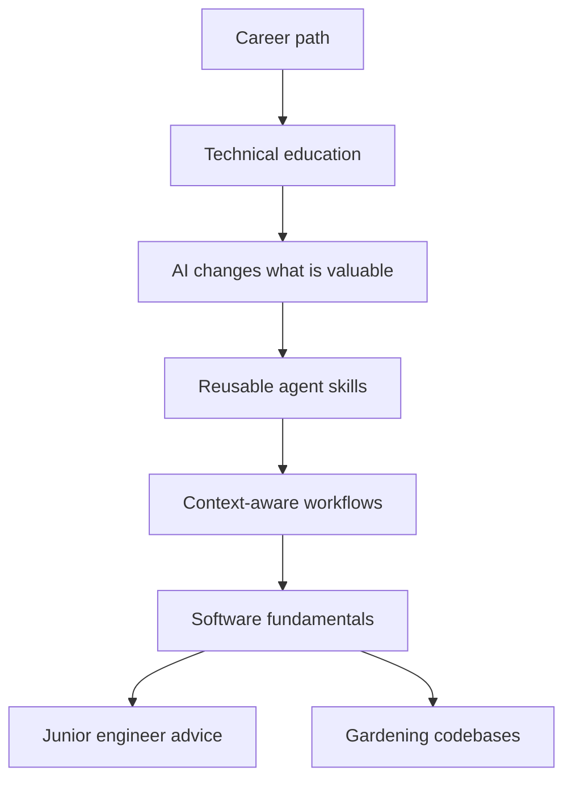

# AI Skills with Matt Pocock

This is a podcast-style interview with Matt Pocock about his path from voice coaching to software education, the rise of Total TypeScript, and why AI coding agents make software fundamentals more important. The strongest parts of the conversation are about how to work with agents: use questions to align intent, keep tasks inside the model's effective context range, encode team judgment as reusable skills, and make codebases easier for fresh sessions to understand.

## Topics

1. [Intro](01-intro.md)
2. [How Matt got into tech](02-how-matt-got-into-tech.md)
3. [How Matt got into open source](03-how-matt-got-into-open-source.md)
4. [Joining Vercel](04-joining-vercel.md)
5. [Total TypeScript](05-total-typescript.md)
6. [AI's impact on technical education](06-ai-impact-on-technical-education.md)
7. [Building reusable skills for AI coding agents](07-building-reusable-skills-for-ai-coding-agents.md)
8. [The smart zone vs the dumb zone](08-smart-zone-vs-dumb-zone.md)
9. [The Wayfinder skill](09-wayfinder-skill.md)
10. [Why agents excel at software engineering](10-why-agents-excel-at-software-engineering.md)
11. [Leading words](11-leading-words.md)
12. [Learning the fundamentals](12-learning-the-fundamentals.md)
13. [Local vs cloud agents](13-local-vs-cloud-agents.md)
14. [Planning vs course-correcting](14-planning-vs-course-correcting.md)
15. [TDD and agents](15-tdd-and-agents.md)
16. [Living in the UK](16-living-in-the-uk.md)
17. [Teaching: the human part](17-teaching-the-human-part.md)
18. [Advice for junior engineers](18-advice-for-junior-engineers.md)
19. [Gardeners and great engineers](19-gardeners-and-great-engineers.md)
20. [Book recommendation](20-book-recommendation.md)

## Key takeaways

- AI has made tactical programming cheaper, but strategic programming, the long-term judgment about structure, feedback loops, and tradeoffs, has become more valuable. [`26:22`](https://www.youtube.com/watch?v=4DhcSPkEbwI&t=1582)
- Matt frames effective agent work as communication: agents cannot infer a developer's values, so tools like Grill Me surface scope, constraints, and priorities before implementation. [`37:11`](https://www.youtube.com/watch?v=4DhcSPkEbwI&t=2231)
- The useful context window is smaller than headline context limits: Matt cites roughly the first 150,000 tokens as the "smart zone" for frontier models. [`41:34`](https://www.youtube.com/watch?v=4DhcSPkEbwI&t=2494)
- Large agent tasks should be split into specs, tickets, and multiple sessions so each session can stay focused and preserve quality. [`42:56`](https://www.youtube.com/watch?v=4DhcSPkEbwI&t=2576)
- Classic software engineering ideas like tracer bullets, vertical slices, feedback loops, deep modules, and ubiquitous language help agents produce better code because they give the model compact, meaningful concepts to follow. [`53:16`](https://www.youtube.com/watch?v=4DhcSPkEbwI&t=3196)
- A clean codebase matters more with agents because each new run behaves like a new starter that has no durable memory of the project. [`1:00:10`](https://www.youtube.com/watch?v=4DhcSPkEbwI&t=3610)
- Agent adoption needs measurement, shared workflows, and observability across agent runs so organizations can learn which repos, skills, and practices produce better results. [`1:06:08`](https://www.youtube.com/watch?v=4DhcSPkEbwI&t=3968)
- Matt's practical rule for planning is scope-sensitive: skip planning for tiny fixes, use Grill Me for substantial single-session work, and use Wayfinder when the work spans many sessions. [`1:14:39`](https://www.youtube.com/watch?v=4DhcSPkEbwI&t=4479)
- TDD still helps because agents need feedback loops and proof that a change works, but agents can write weak or tautological tests, so review still matters. [`1:19:08`](https://www.youtube.com/watch?v=4DhcSPkEbwI&t=4748)
- The most valuable engineer in an agent-heavy workflow is a "gardener" who improves the environment agents work in and turns human process into reusable instructions. [`1:31:52`](https://www.youtube.com/watch?v=4DhcSPkEbwI&t=5512)
