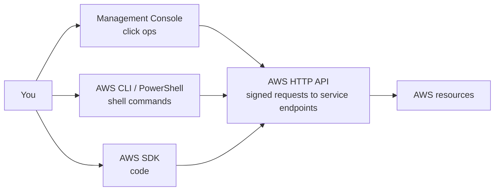

# Management and Development Tools

How you actually interact with AWS: the underlying HTTP API and every layer built on top of it — Management Console, CLI, SDKs, PowerShell tools, CloudShell, Cloud9 — plus identifiers (Account ID, ARNs), access keys, and Infrastructure as Code (CloudFormation vs CDK).

### AWS API

- An API is software that allows two applications or services to talk to each other; the most common type works via HTTP requests. The AWS API is an HTTP API you can call by sending HTTPS requests (e.g. with Postman) [`2:35:37`](https://www.youtube.com/watch?v=7HKot-brXFE&t=9337)
- Each AWS service has a **service endpoint** (e.g. `monitoring` = CloudWatch); requests must be **signed** — a separate request with your AWS credentials returns a temporary token to authorize the call [`2:36:09`](https://www.youtube.com/watch?v=7HKot-brXFE&t=9369)
- Requests carry an **action** (e.g. `DescribeInstances`, `ListBuckets`) plus parameters — the same action names you see in IAM policies [`2:36:34`](https://www.youtube.com/watch?v=7HKot-brXFE&t=9394)
- You rarely call the API directly; instead you use the Management Console, the SDK, or the CLI — all powered by the API [`2:36:58`](https://www.youtube.com/watch?v=7HKot-brXFE&t=9418)
- Endpoints are **regional** (you specify the region code + service code) or **global** for global services like CloudFront; S3 is called global but isn't truly global since buckets live in a chosen region [`2:37:58`](https://www.youtube.com/watch?v=7HKot-brXFE&t=9478)
- **Signing**: your access key and secret are turned into a signature passed in the `Authorization` header, letting AWS know the request comes from you [`2:38:50`](https://www.youtube.com/watch?v=7HKot-brXFE&t=9530)
- Raw API calls are low-level (build canonical request, compute signature, set `Amz-Date`, pass signed Authorization header) — only worth it when you need full control; SDKs and other layers make it easier [`2:40:14`](https://www.youtube.com/watch?v=7HKot-brXFE&t=9614)

### AWS Management Console

- Web-based unified console to build, manage and monitor everything from simple web apps to complex cloud deployments; what you use when you log into your AWS account [`2:41:38`](https://www.youtube.com/watch?v=7HKot-brXFE&t=9698)
- Accessed at `console.aws.amazon.com` [`2:42:10`](https://www.youtube.com/watch?v=7HKot-brXFE&t=9730)
- Lets you point-and-click to launch/configure resources with limited programming knowledge — known as **click ops** [`2:42:25`](https://www.youtube.com/watch?v=7HKot-brXFE&t=9745)
- "Console" does not mean terminal: a console is any place that controls a system — both a terminal and a web UI qualify [`2:42:45`](https://www.youtube.com/watch?v=7HKot-brXFE&t=9765)
- "Dashboard" and "management console" are interchangeable terms (EC2 dashboard = EC2 console); the top bar also holds CloudShell, notifications, support center, light/dark mode, region selector and account info [`2:43:40`](https://www.youtube.com/watch?v=7HKot-brXFE&t=9820)

### Service consoles

- Each AWS service has its own customized console, reached by searching the service name ("go to the EC2 console") [`2:45:17`](https://www.youtube.com/watch?v=7HKot-brXFE&t=9917)
- Some act as **umbrella consoles** containing many services: VPC, EC2, Systems Manager, SageMaker, CloudWatch. E.g. security groups have no console of their own — they live under the EC2 console [`2:45:48`](https://www.youtube.com/watch?v=7HKot-brXFE&t=9948)
- EC2 started as just virtual machines and grew into an umbrella for images, EBS, load balancing, auto scaling [`2:46:48`](https://www.youtube.com/watch?v=7HKot-brXFE&t=10008)
- SDK structure often does NOT map to service consoles for historical reasons — e.g. in the Ruby SDK, VPC lives under the EC2 client because EC2 existed before VPCs [`2:48:52`](https://www.youtube.com/watch?v=7HKot-brXFE&t=10132)

### AWS Account ID

- Every AWS account has a unique **12-digit** Account ID, found by dropping down the current user in the global navigation [`2:49:40`](https://www.youtube.com/watch?v=7HKot-brXFE&t=10180)
- Used when: logging in as a non-root user (many set an alias instead), creating **cross-account roles** (source/target account IDs), and identifying your account in support cases [`2:49:40`](https://www.youtube.com/watch?v=7HKot-brXFE&t=10180)
- Keep it private when convenient — it's one of the components a malicious actor can use to target an account, though you needn't be overly sensitive about it [`2:50:06`](https://www.youtube.com/watch?v=7HKot-brXFE&t=10206)
- Appears in IAM policy conditions (`aws:PrincipalAccount`), in resource ARNs, and as the "owner" of resources like EC2 instances [`2:51:57`](https://www.youtube.com/watch?v=7HKot-brXFE&t=10317)

### AWS Tools for PowerShell

- PowerShell is a task-automation and configuration-management framework: a command-line shell + scripting language built on the .NET CLR — it accepts and returns **.NET objects** instead of text [`2:55:08`](https://www.youtube.com/watch?v=7HKot-brXFE&t=10508)
- AWS Tools for PowerShell lets you hit the AWS API via **cmdlets** — capitalized Verb-Noun commands, e.g. `New-S3Bucket` [`2:55:38`](https://www.youtube.com/watch?v=7HKot-brXFE&t=10538)
- Runs on Linux too: launch `pwsh` inside CloudShell, then install the AWS.Tools installer module and per-service modules [`2:56:38`](https://www.youtube.com/watch?v=7HKot-brXFE&t=10598)
- People like PowerShell because of its very consistent inputs/outputs and chaining — big in the Microsoft/Azure ecosystem [`3:00:39`](https://www.youtube.com/watch?v=7HKot-brXFE&t=10839)

### Amazon Resource Names (ARNs)

- ARNs **uniquely identify AWS resources**, unambiguously across all of AWS [`3:01:02`](https://www.youtube.com/watch?v=7HKot-brXFE&t=10862)
- Format parts: **partition** (`aws`, `aws-cn` China, `aws-us-gov` GovCloud — fully separated portals), **service** (ec2, s3, iam...), **region** (us-east-1), **12-digit account ID**, **resource ID** (name or path, e.g. `user/Bob`) [`3:01:24`](https://www.youtube.com/watch?v=7HKot-brXFE&t=10884)
- S3 bucket ARNs are short (`arn:aws:s3:::my_bucket`) — no region/account needed for the global namespace; a load balancer ARN carries everything including a path [`3:02:22`](https://www.youtube.com/watch?v=7HKot-brXFE&t=10942)
- Paths in ARNs can include a **wildcard** (`*`) — very useful in IAM policies to target groups of resources [`3:02:45`](https://www.youtube.com/watch?v=7HKot-brXFE&t=10965)
- Common uses: referencing resources from CLI/SDK, restricting an IAM policy to one bucket (e.g. allow `PutObject` on a specific bucket ARN), and pointing AWS Support to an exact resource [`3:03:13`](https://www.youtube.com/watch?v=7HKot-brXFE&t=10993)

### AWS CLI

- Terminology: a **terminal** is a text input/output environment, a **console** is the physical computer, a **shell** is the command-line program you interact with (bash, zsh, MS-DOS prompt). People use the three interchangeably, but they technically differ [`3:05:53`](https://www.youtube.com/watch?v=7HKot-brXFE&t=11153)
- The AWS CLI lets you programmatically interact with the AWS API via single or multi-line commands in a shell [`3:06:36`](https://www.youtube.com/watch?v=7HKot-brXFE&t=11196)
- It is a **Python executable program** (Python required to install); works on Windows, Mac, Linux/Unix; the program's name is `aws` [`3:07:01`](https://www.youtube.com/watch?v=7HKot-brXFE&t=11221)
- Easiest way to try it: **CloudShell** — credentials already loaded for your logged-in account (not available in every region) [`3:07:20`](https://www.youtube.com/watch?v=7HKot-brXFE&t=11240)
- The CLI reference docs list every command with options and examples; oddly there are both `aws s3` and `aws s3api` command groups [`3:11:28`](https://www.youtube.com/watch?v=7HKot-brXFE&t=11488)
- Typical flow demoed: `aws s3api create-bucket`, `aws s3 cp hello.txt s3://bucket-name/hello.txt` to upload, reverse the args to download [`3:12:37`](https://www.youtube.com/watch?v=7HKot-brXFE&t=11557)
- Manual install (Linux): curl the zip, unzip, run the installer; then `aws configure` prompts for access key ID, secret, default region, and output format (JSON default) [`3:14:56`](https://www.youtube.com/watch?v=7HKot-brXFE&t=11696)
- Credentials are stored in a hidden `~/.aws` directory: a `config` file (defaults, e.g. region) and a `credentials` file (TOML-like) [`3:17:13`](https://www.youtube.com/watch?v=7HKot-brXFE&t=11833)
- Multiple accounts = multiple named profiles in the credentials file; select one with `--profile <name>`. Without a `[default]` profile, commands fail with "unable to locate credentials" [`3:18:41`](https://www.youtube.com/watch?v=7HKot-brXFE&t=11921)

### AWS SDK

- A software development kit is a collection of software development tools in one installable package; the AWS SDK lets you programmatically create, modify, delete or interact with AWS resources [`3:19:28`](https://www.youtube.com/watch?v=7HKot-brXFE&t=11968)
- Offered in Java, Python, Node.js, Ruby, Go, .NET, PHP, JavaScript, C++ [`3:20:03`](https://www.youtube.com/watch?v=7HKot-brXFE&t=12003)
- Demo uses **Cloud9** (AWS's built-in cloud IDE, runs on an EC2 instance — T2 Micro is free tier, auto-stops after 30 min idle) [`3:20:53`](https://www.youtube.com/watch?v=7HKot-brXFE&t=12053)
- Cloud9 already has credentials on the machine — no `aws configure` needed [`3:24:35`](https://www.youtube.com/watch?v=7HKot-brXFE&t=12275)
- Ruby flow: Gemfile with `aws-sdk-s3`, `bundle install`, create `Aws::S3::Client.new(region: 'us-east-1')`, call `list_buckets`; "when coding for the cloud you can pretty much copy-paste everything" from the API reference examples [`3:26:50`](https://www.youtube.com/watch?v=7HKot-brXFE&t=12410)
- Credential options, from worst to best: hardcode in code (**never** — it gets committed), the machine's credentials file (auto-loaded), or **environment variables** (`AWS_ACCESS_KEY_ID`, `AWS_SECRET_ACCESS_KEY`, set via `export`) — usually what you want [`3:32:17`](https://www.youtube.com/watch?v=7HKot-brXFE&t=12737)

### AWS CloudShell

- Browser-based shell built into the Management Console; **scoped per region**, uses the same credentials as the logged-in user, and is a **free service** [`3:35:06`](https://www.youtube.com/watch?v=7HKot-brXFE&t=12906)
- Pre-installed tools: AWS CLI, Python, Node.js, git, make, pip, sudo, tar, tmux, vim, wget, and more [`3:36:01`](https://www.youtube.com/watch?v=7HKot-brXFE&t=12961)
- **1 GB of free storage per region**; home-directory files persist across sessions in the same region; supports bash, PowerShell, and zsh; only available in select regions [`3:36:01`](https://www.youtube.com/watch?v=7HKot-brXFE&t=12961)

### Infrastructure as Code (IaC)

- IaC = writing a configuration script to automate creating, updating or destroying cloud infrastructure — a **blueprint** you can share, version, and inventory [`3:36:32`](https://www.youtube.com/watch?v=7HKot-brXFE&t=12992)
- AWS has two IaC offerings: **CloudFormation (CFN)** — declarative — and **Cloud Development Kit (CDK)** — imperative [`3:37:07`](https://www.youtube.com/watch?v=7HKot-brXFE&t=13027)
- **Declarative**: what you see is what you get; explicit, more verbose, near-zero chance of misconfiguration; written in JSON/YAML/XML [`3:37:07`](https://www.youtube.com/watch?v=7HKot-brXFE&t=13027)
- **Imperative**: say what you want and the rest is filled in; implicit, less verbose, misconfiguration possible, but more powerful and in your favorite programming language [`3:37:40`](https://www.youtube.com/watch?v=7HKot-brXFE&t=13060)

#### CloudFormation

- Templates in JSON or YAML (YAML added later because it's far more concise); simple, but can produce large files and is limited for dynamic/repeatable infrastructure vs CDK [`3:38:13`](https://www.youtube.com/watch?v=7HKot-brXFE&t=13093)
- Easier for DevOps engineers without a programming background; since CDK *generates* CloudFormation, you still must read CFN to debug stacks — knowing CFN is a cloud essential and required inside-out for associate/professional certs [`3:38:35`](https://www.youtube.com/watch?v=7HKot-brXFE&t=13115)
- Every template needs `AWSTemplateFormatVersion` (unchanged since 2010); a minimal S3-bucket template is just that plus a `Resources` block [`3:40:59`](https://www.youtube.com/watch?v=7HKot-brXFE&t=13259)
- Templates support pseudo-parameters like stack name and account ID for dynamically generated resource names [`3:43:59`](https://www.youtube.com/watch?v=7HKot-brXFE&t=13439)
- Demo gotcha: deploy failed because the injected stack name had uppercase characters — S3 bucket names can't contain them [`3:45:42`](https://www.youtube.com/watch?v=7HKot-brXFE&t=13542)
- Once a stack manages a resource, don't delete/modify it directly — update the template code (ideally in a repo) and re-deploy [`3:47:33`](https://www.youtube.com/watch?v=7HKot-brXFE&t=13653)

#### CDK

- Write IaC in your favorite programming language: TypeScript (first and most up-to-date), Node.js, Python, Java, .NET — no Ruby [`3:48:28`](https://www.youtube.com/watch?v=7HKot-brXFE&t=13708)
- Powered by CloudFormation — it generates CFN templates as an intermediate step (can feel slow) [`3:48:45`](https://www.youtube.com/watch?v=7HKot-brXFE&t=13725)
- Large library of reusable components: **CDK Constructs** at constructs.dev (analogous to Terraform modules); CDK has its own CLI (CFN does too) [`3:48:45`](https://www.youtube.com/watch?v=7HKot-brXFE&t=13725)
- **CDK Pipelines** quickly set up CI/CD for CDK projects (a big pain point in raw CFN); CDK also ships a unit/integration testing framework (possibly TypeScript-only) [`3:49:11`](https://www.youtube.com/watch?v=7HKot-brXFE&t=13751)
- **CDK vs SDK (exam-worthy)**: both programmatically work with AWS in your language, but CDK ensures **idempotency** — asking for one VM always yields exactly one VM because state is managed; re-running SDK code keeps creating more servers since it manages no state [`3:50:05`](https://www.youtube.com/watch?v=7HKot-brXFE&t=13805)

### AWS Toolkit for VS Code

- Open-source VS Code plugin to create, debug, and deploy AWS resources. Four features [`3:50:33`](https://www.youtube.com/watch?v=7HKot-brXFE&t=13833):
  - **AWS Explorer** — browse (and sometimes view/delete) resources linked to your account [`3:50:33`](https://www.youtube.com/watch?v=7HKot-brXFE&t=13833)
  - **CDK Explorer** — explore stacks defined by CDK; **ECS IntelliSense** — autocompletion + descriptions for ECS task-definition files [`3:51:01`](https://www.youtube.com/watch?v=7HKot-brXFE&t=13861)
  - **Serverless applications** — the main reason to install it: create/debug/deploy serverless apps via SAM and CFN [`3:51:32`](https://www.youtube.com/watch?v=7HKot-brXFE&t=13892)

### Access Keys

- An access key = key + secret required for **programmatic access** to AWS outside the Management Console; "AWS credentials" usually means the access key, not your login username/password [`3:51:52`](https://www.youtube.com/watch?v=7HKot-brXFE&t=13912)
- Never share access keys — like handing over your house keys — and **never commit them to a codebase** (prime way they leak) [`3:52:22`](https://www.youtube.com/watch?v=7HKot-brXFE&t=13942)
- Max **two active keys** at a time; keys can be deactivated, reactivated, or deleted; a key has exactly the permissions of its user [`3:52:43`](https://www.youtube.com/watch?v=7HKot-brXFE&t=13963)
- Stored in `~/.aws/credentials` (hidden folder in your home dir, TOML-like): a `[default]` profile used when none is specified, plus optional named profiles [`3:53:03`](https://www.youtube.com/watch?v=7HKot-brXFE&t=13983)
- With the SDK, prefer environment variables — the safest way to access keys in code [`3:53:54`](https://www.youtube.com/watch?v=7HKot-brXFE&t=14034)
- Practice: create dedicated "machine users" per project for programmatic access (no console access) [`3:54:48`](https://www.youtube.com/watch?v=7HKot-brXFE&t=14088)
- The secret is shown **only once** at creation — if lost, create a new key; security trick: fill both key slots so an intruder can't create a new one [`3:56:39`](https://www.youtube.com/watch?v=7HKot-brXFE&t=14199)
- Keys must be deactivated before they can be deleted, and deletion requires typing the full key name [`3:57:35`](https://www.youtube.com/watch?v=7HKot-brXFE&t=14255)

### AWS Documentation

- Large collection of technical docs at docs.aws.amazon.com — guides and API references per service, available as HTML, PDF, and Kindle [`3:58:29`](https://www.youtube.com/watch?v=7HKot-brXFE&t=14309)
- Every AWS certification (including this course) derives mostly from the AWS documentation — thorough but very dense [`3:58:55`](https://www.youtube.com/watch?v=7HKot-brXFE&t=14335)
- Per service you'll find a user guide, developer guide, and API reference; instructor's view: AWS has the best documentation of all providers [`4:00:24`](https://www.youtube.com/watch?v=7HKot-brXFE&t=14424)
- Docs used to be open-source on GitHub and accepted community contributions, but AWS changed that practice a few years back [`4:01:18`](https://www.youtube.com/watch?v=7HKot-brXFE&t=14478)
