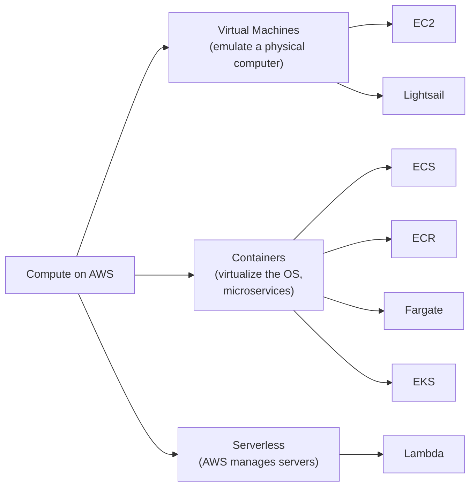

# Compute

Covers EC2 and virtual machines, the container and serverless compute families, the Nitro system, high-performance computing (ParallelCluster), edge/hybrid options, and the cost & capacity management services — plus hands-on demos of all three compute types.

### EC2 and Virtual Machines

- A **virtual machine (VM)** is an emulation of a physical computer using software; server virtualization lets you easily create, copy, resize, or migrate servers, and multiple VMs can run on one physical server, sharing cost with other customers [`4:20:32`](https://www.youtube.com/watch?v=7HKot-brXFE&t=15632)
- A launched VM is called an **instance**. EC2 is highly configurable via the **AMI (Amazon Machine Image)** — a predefined VM configuration affecting vCPUs, RAM, network bandwidth, OS, and attachable virtual hard drives (EBS) [`4:21:00`](https://www.youtube.com/watch?v=7HKot-brXFE&t=15660)
- **EC2 is the backbone of AWS**: most AWS services (S3, RDS, DynamoDB, Lambda) use EC2 as their underlying servers [`4:21:35`](https://www.youtube.com/watch?v=7HKot-brXFE&t=15695)

### The Three Compute Categories

- **Amazon Lightsail** — managed virtual server service, the "friendly" beginner version of EC2 (e.g., launch WordPress and hook up a domain without much knowledge) [`4:22:12`](https://www.youtube.com/watch?v=7HKot-brXFE&t=15732)
- **Containers** virtualize an OS to run multiple workloads on a single OS instance; generally used in microservice architectures [`4:22:40`](https://www.youtube.com/watch?v=7HKot-brXFE&t=15760)
- **ECS (Elastic Container Service)** — container orchestration supporting Docker; launches a cluster of EC2 instances with Docker installed. **ECR (Elastic Container Registry)** — repository of container images (image = saved copy; repository = storage with version control) [`4:23:08`](https://www.youtube.com/watch?v=7HKot-brXFE&t=15788)
- **Fargate** — serverless container orchestration on ECS: pay on-demand per running container; unlike plain ECS you don't keep an EC2 server running or scale/upgrade it [`4:23:37`](https://www.youtube.com/watch?v=7HKot-brXFE&t=15817)
- **EKS (Elastic Kubernetes Service)** — fully managed Kubernetes; Kubernetes (K8s) is Google-created open-source orchestration software, the standard for managing microservices [`4:24:03`](https://www.youtube.com/watch?v=7HKot-brXFE&t=15843)
- **Lambda** — serverless function service: upload small pieces of code, choose memory and max run time, charged on runtime **rounded to the nearest 100 ms** [`4:24:37`](https://www.youtube.com/watch?v=7HKot-brXFE&t=15877)

### Demo: Launching All Three Compute Types

- EC2: launched a free-tier T3.micro Amazon Linux instance, connected with EC2 Instance Connect, installed Apache (`yum install httpd`) [`4:25:18`](https://www.youtube.com/watch?v=7HKot-brXFE&t=15918), then opened inbound HTTP port 80 in the security group to serve the page to the internet via the public IP [`4:29:00`](https://www.youtube.com/watch?v=7HKot-brXFE&t=16140)
- Fargate: with a Fargate-only cluster you pay only for what runs; nothing running = nothing billed (vs. a managed cluster where you pay for the backing VM continuously) [`4:30:39`](https://www.youtube.com/watch?v=7HKot-brXFE&t=16239)
- ECS distinction: a **task** runs and stops; a **service** is intended to run long-term like a web server [`4:32:41`](https://www.youtube.com/watch?v=7HKot-brXFE&t=16361). Ran the Docker Hub `hello-world` image via a task definition and verified "Hello from Docker" in the logs [`4:38:28`](https://www.youtube.com/watch?v=7HKot-brXFE&t=16708)
- Lambda: created a Ruby 3.4 function in the built-in VS Code editor, deployed, and tested with a JSON payload, reading output from the logs [`4:39:24`](https://www.youtube.com/watch?v=7HKot-brXFE&t=16764). Above a certain code size you must upload a zip or provide an S3 location (S3 is the most common way) [`4:40:29`](https://www.youtube.com/watch?v=7HKot-brXFE&t=16829)

### Nitro System, Bare Metal & Bottlerocket

- The **Nitro system** is AWS-designed dedicated hardware plus a lightweight hypervisor; **all new EC2 instance types use it** [`4:42:23`](https://www.youtube.com/watch?v=7HKot-brXFE&t=16943)
- Components: **Nitro cards** (specialized cards for VPC, EBS, instance storage, controller), **Nitro security chips** (integrated into the motherboard, protect hardware resources), **Nitro hypervisor** (lightweight memory/CPU allocation, bare-metal-like performance); Nitro Enclaves exist for EC2 isolation but are out of scope [`4:42:55`](https://www.youtube.com/watch?v=7HKot-brXFE&t=16975)
- **Bare metal instances** (e.g., M5, R5) run with no hypervisor — workloads run directly on hardware for maximum performance and control. **Bottlerocket** is an AWS-purpose-built, Linux-based open-source OS for running containers on VMs or bare metal [`4:43:23`](https://www.youtube.com/watch?v=7HKot-brXFE&t=17003)

### High Performance Computing (HPC)

- **HPC** = a cluster of hundreds/thousands of servers with fast interconnects, for computational problems too large or slow for standard computers; **AWS ParallelCluster** is an AWS-supported open-source cluster management tool for deploying HPC clusters [`4:43:54`](https://www.youtube.com/watch?v=7HKot-brXFE&t=17034)
- HPC on AWS targets large complex simulations and deep learning/ML workloads and runs at least on C5n instances; you manage it with the `pcluster` CLI [`4:44:25`](https://www.youtube.com/watch?v=7HKot-brXFE&t=17065)
- Demo: `pcluster configure` (region, scheduler, OS, min/max cluster size, head/compute instance types, auto VPC creation) generates a CloudFormation stack [`4:48:25`](https://www.youtube.com/watch?v=7HKot-brXFE&t=17305); cluster creation builds nested stacks with SQS, SNS, network interface, a DynamoDB table, an EBS volume, log group, Elastic IP, and IAM roles [`4:51:46`](https://www.youtube.com/watch?v=7HKot-brXFE&t=17506); the cluster launched a master + compute node (T2.micros) [`4:53:27`](https://www.youtube.com/watch?v=7HKot-brXFE&t=17607); jobs are queued via a scheduler like Sun Grid Engine (`qsub`/`qstat`) [`4:58:03`](https://www.youtube.com/watch?v=7HKot-brXFE&t=17883)

### Edge & Hybrid Computing

- **Edge computing** = pushing compute workloads outside your network to run close to the destination (phones, IoT devices, external servers). **Hybrid computing** = running workloads on both your on-premise data center and the AWS VPC [`5:01:00`](https://www.youtube.com/watch?v=7HKot-brXFE&t=18060)
- **AWS Outposts** — a physical rack of servers placed in your own data center, letting you use AWS APIs and services (e.g., EC2) on-premise [`5:01:00`](https://www.youtube.com/watch?v=7HKot-brXFE&t=18060)
- **AWS Wavelength** — build/launch applications in a telecom data center for ultra-low latency over 5G (partners include Verizon and Vodafone) [`5:01:30`](https://www.youtube.com/watch?v=7HKot-brXFE&t=18090)
- **VMware Cloud on AWS** — manage on-premise VMs using VMware within EC2 instances; the data center must use VMware for virtualization. **AWS Local Zones** — edge data centers outside an AWS region, for faster compute/storage/databases in populated areas [`5:01:57`](https://www.youtube.com/watch?v=7HKot-brXFE&t=18117)
- Wavelength requires opting into Wavelength zone groups (EC2 dashboard → account attributes → Zones) and setting up a VPC with a **carrier gateway** and route tables to connect to the telecom network [`5:06:56`](https://www.youtube.com/watch?v=7HKot-brXFE&t=18416)
- **CloudFront Functions** (JavaScript-only) deploy to CloudFront edge locations — faster than Lambda because they run much closer to the user [`5:09:00`](https://www.youtube.com/watch?v=7HKot-brXFE&t=18540)

### Cost & Capacity Management

- **Cost management** = how do we save money; **capacity management** = how do we meet traffic/usage demand by adding or upgrading servers [`5:10:35`](https://www.youtube.com/watch?v=7HKot-brXFE&t=18635)
- **EC2 pricing models**: Spot instances, Reserved instances, Savings Plans — save by paying up-front (fully/partially), committing to 1+ year contracts, or tolerating interruptions [`5:10:35`](https://www.youtube.com/watch?v=7HKot-brXFE&t=18635)
- **AWS Batch** — plans, schedules, and executes batch compute workloads across AWS compute services; can use spot instances to save money. **AWS Compute Optimizer** — uses ML on your usage history to suggest cost reductions and performance improvements. **EC2 Auto Scaling Groups (ASGs)** — automatically add/remove EC2 servers to match current demand, saving money while meeting capacity [`5:11:07`](https://www.youtube.com/watch?v=7HKot-brXFE&t=18667)
- **ELB (Elastic Load Balancer)** — distributes traffic to multiple instances, reroutes from unhealthy to healthy instances, and can route across availability zones. **Elastic Beanstalk** — a Platform as a Service (similar to Heroku) for deploying web apps without understanding the underlying AWS services [`5:11:37`](https://www.youtube.com/watch?v=7HKot-brXFE&t=18697)
