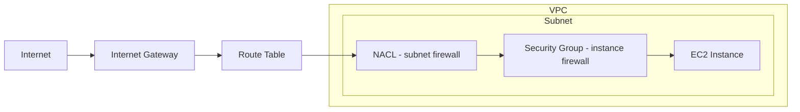

# Networking

Core AWS networking building blocks (VPC, subnets, gateways, firewalls), hybrid connectivity options, a hands-on VPC build, and CloudFront as the CDN service.

### Cloud-Native Networking Components

- **VPC (Virtual Private Cloud)** — a logically isolated section of the AWS cloud where you launch AWS resources; some managed services don't require you to select a VPC [`6:28:34`](https://www.youtube.com/watch?v=7HKot-brXFE&t=23314)
- **Internet Gateway (IGW)** — needed for the internet to reach your services; **route tables** route traffic to your subnets [`6:28:53`](https://www.youtube.com/watch?v=7HKot-brXFE&t=23333)
- **Region** — geographical location of your network; **Availability Zones** — the data centers where resources reside; **subnets** — logical partitions of an IP network into smaller segments, usually mapped one per AZ [`6:29:23`](https://www.youtube.com/watch?v=7HKot-brXFE&t=23363)
- **NACLs** — firewall at the *subnet* level; **Security Groups** — firewall at the *instance* level [`6:29:49`](https://www.youtube.com/watch?v=7HKot-brXFE&t=23389)

### Enterprise / Hybrid Networking

- **AWS VPN** — secure connection between on-premise/remote offices/mobile employees and AWS [`6:29:49`](https://www.youtube.com/watch?v=7HKot-brXFE&t=23389)
- **Direct Connect** — dedicated gigabit connection from on-premise data center to AWS; it is *private but not encrypted in transit*, so it's commonly combined with a VPN [`6:30:15`](https://www.youtube.com/watch?v=7HKot-brXFE&t=23415)
- **PrivateLink (VPC Interface Endpoints)** — keeps traffic within the AWS network so it never traverses the public internet; "PrivateLink" is the marketing name for VPC interface endpoints [`6:30:42`](https://www.youtube.com/watch?v=7HKot-brXFE&t=23442)

### VPCs and Subnets

- A VPC is a logically isolated network section where you choose an IP range via a **CIDR range** (IP address + netmask determining how many IPs) [`6:31:11`](https://www.youtube.com/watch?v=7HKot-brXFE&t=23471)
- Subnets partition the VPC's IP range into smaller networks — "cutting up a pie"; a subnet's CIDR must be smaller than the VPC's [`6:31:36`](https://www.youtube.com/watch?v=7HKot-brXFE&t=23496)
- Counter-intuitively, the *higher* the CIDR number the *smaller* the network: a /24 allocates 256 IPs, smaller than a /16 [`6:31:56`](https://www.youtube.com/watch?v=7HKot-brXFE&t=23516)
- **Public subnet** = can reach the internet; **private subnet** = cannot. Not strictly enforced by AWS — it's mostly whether public IPs are auto-assigned by default [`6:31:56`](https://www.youtube.com/watch?v=7HKot-brXFE&t=23516)
- You can still launch an EC2 in a "private" subnet and manually enable a public IP, so extra measures are needed to keep subnets truly private [`6:32:26`](https://www.youtube.com/watch?v=7HKot-brXFE&t=23546)

### Security Groups vs NACLs (exam favorite)

| | NACL | Security Group |
|---|---|---|
| Level | Subnet | Instance |
| Rules | **Allow AND deny** rules | Only **allow** rules (implicit deny all) |
| Key use case | Block a specific abusive IP | Allow port access (e.g., port 22 for SSH) |

- NACLs can create allow *and* deny rules — useful to block a specific IP known for abuse [`6:32:26`](https://www.youtube.com/watch?v=7HKot-brXFE&t=23546)
- Security groups implicitly deny all traffic and only accept allow rules; you *cannot* block a single IP with one [`6:32:59`](https://www.youtube.com/watch?v=7HKot-brXFE&t=23579)
- To "block" one IP in a security group you'd have to allow every other IP in the world — not feasible. Remember this example to keep the two straight. (Stateless vs stateful is asked at higher-level exams, not CCP) [`6:33:31`](https://www.youtube.com/watch?v=7HKot-brXFE&t=23611)

### Follow-Along: Building a VPC

- Create VPC `10.0.0.0/16` — the /16 gives lots of address room (visualized as blocks; /24 is much smaller) [`6:34:10`](https://www.youtube.com/watch?v=7HKot-brXFE&t=23650)
- Create a subnet with a smaller CIDR, e.g. `10.0.0.0/24` [`6:34:54`](https://www.youtube.com/watch?v=7HKot-brXFE&t=23694)
- The default route table only routes `local`; create an Internet Gateway and attach it to the VPC to reach the internet [`6:35:21`](https://www.youtube.com/watch?v=7HKot-brXFE&t=23721)
- Add a route `0.0.0.0/0` → internet gateway in the route table [`6:36:41`](https://www.youtube.com/watch?v=7HKot-brXFE&t=23801)
- Naming an AWS resource is actually just applying a `Name` tag [`6:36:09`](https://www.youtube.com/watch?v=7HKot-brXFE&t=23769)
- Enable "auto-assign public IP" on the subnet so instances get a public IP on launch [`6:37:57`](https://www.youtube.com/watch?v=7HKot-brXFE&t=23877)
- Security group rules demo: port 22 for SSH, port 80 from anywhere for a website, or DB ports like Postgres 5432; you can restrict source to "My IP"; outbound rules default to all traffic and rarely need changes [`6:40:19`](https://www.youtube.com/watch?v=7HKot-brXFE&t=24019)
- Demonstrated live that a security group has **no deny option** — you can only allow [`6:41:09`](https://www.youtube.com/watch?v=7HKot-brXFE&t=24069)
- NACLs come free with each subnet; rules are numbered — use hundreds/powers of ten so you can insert rules between them; a deny rule for a single IP (`/32`-style entry, stated as "forward slash zero" in the video) blocks that IP for *everything in the subnet*, not one instance [`6:42:28`](https://www.youtube.com/watch?v=7HKot-brXFE&t=24148)
- Cleanup gotchas: security groups referencing other security groups block deletion; keep the default security groups (they come with the VPC); the instance must be terminated before the VPC can be deleted [`6:44:34`](https://www.youtube.com/watch?v=7HKot-brXFE&t=24274)

### CloudFront (CDN)

- CloudFront is a **content delivery network** used to cache your data all over the world [`6:47:21`](https://www.youtube.com/watch?v=7HKot-brXFE&t=24441)
- You must choose an **origin** (S3 bucket, load balancer, MediaStore) — where the CDN sources content to cache everywhere [`6:48:11`](https://www.youtube.com/watch?v=7HKot-brXFE&t=24491)
- Supports protocol/caching rules and **Lambda@Edge functions** that read and modify the request/response — very powerful [`6:48:33`](https://www.youtube.com/watch?v=7HKot-brXFE&t=24513)
- **Geo restriction**: allow list or block list by geographical region (e.g., exclude the UK to avoid GDPR obligations) [`6:49:05`](https://www.youtube.com/watch?v=7HKot-brXFE&t=24545)
- **Invalidations**: since it's a cache, content can go stale — create an invalidation (e.g., `image.jpg`) to purge it so the next request fetches fresh content [`6:49:56`](https://www.youtube.com/watch?v=7HKot-brXFE&t=24596)
