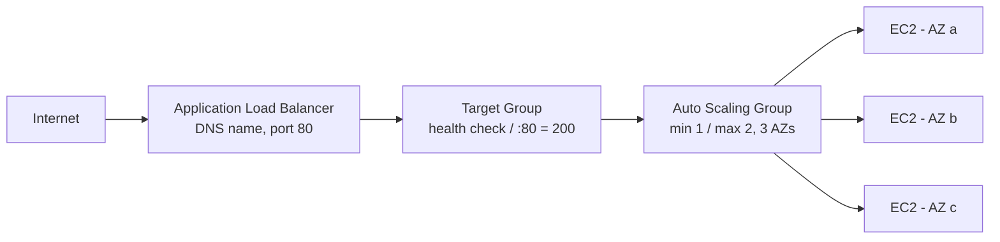

# EC2

Elastic Compute Cloud: AWS's configurable virtual machines — instance families/types/sizes, tenancy options, and a full hands-on lab covering AMIs, key pairs, Sessions Manager, Elastic IPs, launch templates, auto scaling groups, and load balancers.

### What is EC2

- EC2 (Elastic Compute Cloud) is a highly configurable virtual server (virtual machine) with resizable compute capacity; instances launch in minutes, and everything on AWS uses EC2 underneath — the "backbone" of AWS services [`6:50:23`](https://www.youtube.com/watch?v=7HKot-brXFE&t=24623)
- Launching requires choosing: an OS via the **AMI** (Red Hat, Ubuntu, Windows, Amazon Linux, SUSE), an **instance type** (vCPUs, memory), **storage** (EBS — SSD/HDD/virtual magnetic tape, or EFS; multiple volumes possible), and **configuration** (security groups, key pairs, user data, IAM roles, placement groups) [`6:50:46`](https://www.youtube.com/watch?v=7HKot-brXFE&t=24646)

### Instance Families

Instance families = different combinations of CPU, memory, storage, and networking capacity, differing by underlying hardware [`6:51:42`](https://www.youtube.com/watch?v=7HKot-brXFE&t=24702)

| Family category | Example names | Use cases |
|---|---|---|
| General purpose | T2, Mac (run a Mac server) | Web servers, code repositories [`6:52:11`](https://www.youtube.com/watch?v=7HKot-brXFE&t=24731) |
| Compute optimized | C* | Scientific modeling, dedicated gaming servers, ad server engines [`6:52:42`](https://www.youtube.com/watch?v=7HKot-brXFE&t=24762) |
| Memory optimized | R*, etc. | In-memory caches/databases, real-time big data analytics [`6:53:10`](https://www.youtube.com/watch?v=7HKot-brXFE&t=24790) |
| Accelerated computing | P2, P3, P4 | ML, computational finance, seismic analysis, speech recognition (hardware accelerators/co-processors) [`6:53:10`](https://www.youtube.com/watch?v=7HKot-brXFE&t=24790) |
| Storage optimized | I3, I3en | High sequential read/write to large local datasets: NoSQL, transactional DBs, data warehousing [`6:53:39`](https://www.youtube.com/watch?v=7HKot-brXFE&t=24819) |

- **Exam tip (CCP)**: you only need to know the five categories, not the family names [`6:53:39`](https://www.youtube.com/watch?v=7HKot-brXFE&t=24819)
- AWS can run out of a family's hardware in a data center — that's why capacity reservation exists [`6:52:11`](https://www.youtube.com/watch?v=7HKot-brXFE&t=24731)

### Instance Types and Sizes

- An **instance type** = instance size + instance family (AWS docs blur this; the family/size language is normalized from Azure/GCP) [`6:54:06`](https://www.youtube.com/watch?v=7HKot-brXFE&t=24846)
- Common size pattern: nano, micro, small, medium, large, xlarge, 2xlarge, 4xlarge, 8xlarge — generally powers of two [`6:54:29`](https://www.youtube.com/watch?v=7HKot-brXFE&t=24869)
- Exceptions: **metal** = bare metal machine; oddballs like 9xlarge exist [`6:55:04`](https://www.youtube.com/watch?v=7HKot-brXFE&t=24904)
- Sizes generally **double in price and attributes** as you go up (e.g., ~$16 → $33 → $67 → $135); sometimes adding a second instance of the same size beats sizing up because you can spread across another AZ [`6:55:30`](https://www.youtube.com/watch?v=7HKot-brXFE&t=24930)

### Dedicated Host vs Dedicated Instance

Dedicated hosts are single-tenant EC2 designed for **Bring Your Own License (BYOL)** based on machine characteristics [`6:55:56`](https://www.youtube.com/watch?v=7HKot-brXFE&t=24956)

| | Dedicated Instance | Dedicated Host |
|---|---|---|
| Isolation | Instance-level (virtualized) | Physical server (whole machine) [`6:56:27`](https://www.youtube.com/watch?v=7HKot-brXFE&t=24987) |
| Billing | Per instance (+ $2/region fee) | Per host (more expensive) [`6:57:02`](https://www.youtube.com/watch?v=7HKot-brXFE&t=25022) |
| Physical characteristics visibility | None | Sockets, cores, host ID [`6:57:02`](https://www.youtube.com/watch?v=7HKot-brXFE&t=25022) |
| Host affinity / targeted placement | No | Yes [`6:57:28`](https://www.youtube.com/watch?v=7HKot-brXFE&t=25048) |
| Add capacity via allocation request | No | Yes [`6:57:28`](https://www.youtube.com/watch?v=7HKot-brXFE&t=25048) |

- Key point: dedicated host visibility of sockets/cores/host ID matters for BYOL licenses (e.g., Microsoft SQL Server licensed per cores/sockets) [`6:58:05`](https://www.youtube.com/watch?v=7HKot-brXFE&t=25085)
- **Three tenancy levels**: dedicated host (whole server, physical control) → dedicated instance (same slot on shared hardware guaranteed) → default/shared (instance can move to a different spot after reboot) [`6:58:28`](https://www.youtube.com/watch?v=7HKot-brXFE&t=25108)

### Follow-Along: Launching an EC2 Instance

- **AMI** = template containing the software configuration (OS, applications, binaries); Amazon Linux 2 is the most popular — free tier, minimal, hardened by AWS; also Marketplace and Community AMIs [`6:59:53`](https://www.youtube.com/watch?v=7HKot-brXFE&t=25193), [`7:00:16`](https://www.youtube.com/watch?v=7HKot-brXFE&t=25216)
- AMI IDs are **region-specific** (same AMI has a different ID per region) and come in x86 (64-bit) and ARM variants [`7:01:06`](https://www.youtube.com/watch?v=7HKot-brXFE&t=25266)
- Pricing math: on-demand hourly rate × 730 (hours/month); a t2.micro ≈ $8.46 USD/month without free tier; new accounts get 750 free hours [`7:02:17`](https://www.youtube.com/watch?v=7HKot-brXFE&t=25337)
- t2.micro: 1 **vCPU** (virtual CPU — you access one virtual CPU on shared hardware), 1 GB memory, low-to-moderate network performance [`7:02:36`](https://www.youtube.com/watch?v=7HKot-brXFE&t=25356)
- Without a public IP an instance cannot reach the internet; auto-assign is subnet-dependent but can always be overridden at launch [`7:03:24`](https://www.youtube.com/watch?v=7HKot-brXFE&t=25404)
- Other config: placement groups (place servers closely — not on CCP exam), capacity reservations, IAM role (created an SSM role so Sessions Manager can be used instead of key pairs) [`7:03:50`](https://www.youtube.com/watch?v=7HKot-brXFE&t=25430), [`7:04:37`](https://www.youtube.com/watch?v=7HKot-brXFE&t=25477)
- Shared tenancy default; Elastic Inference attaches a fractional GPU for ML; unlimited credit specification lets burstable instances burst beyond baseline; Nitro Enclaves create isolated compute environments for highly sensitive data [`7:05:36`](https://www.youtube.com/watch?v=7HKot-brXFE&t=25536), [`7:06:03`](https://www.youtube.com/watch?v=7HKot-brXFE&t=25563)
- **User data** script (shebang `#!/bin/bash`) installs Apache: `yum install -y httpd`, then `systemctl start httpd` and `systemctl enable httpd` (enable = keep running after restart) [`7:06:27`](https://www.youtube.com/watch?v=7HKot-brXFE&t=25587), [`7:07:07`](https://www.youtube.com/watch?v=7HKot-brXFE&t=25627)
- Storage: 8 GB default (free tier allows up to 30); GP2 is cost-effective; **always turn on encryption — same cost, no reason not to** [`7:07:07`](https://www.youtube.com/watch?v=7HKot-brXFE&t=25627), [`7:07:30`](https://www.youtube.com/watch?v=7HKot-brXFE&t=25650)
- Security groups **cannot be renamed after creation**; opened HTTP port 80 from anywhere (0.0.0.0/0 IPv4 + ::/0 IPv6) and SSH 22 [`7:07:53`](https://www.youtube.com/watch?v=7HKot-brXFE&t=25673), [`7:08:22`](https://www.youtube.com/watch?v=7HKot-brXFE&t=25702)
- Key pair downloads as a .pem file [`7:09:12`](https://www.youtube.com/watch?v=7HKot-brXFE&t=25752)
- Wait for the **two system status checks** (hardware + network) before trusting the instance [`7:09:52`](https://www.youtube.com/watch?v=7HKot-brXFE&t=25792)

### Connecting: SSH vs Sessions Manager

- SSH from CloudShell: upload .pem, `chmod 400` it (read-only — required for SSH), connect as `ec2-user@<dns>`; accept the fingerprint [`7:11:18`](https://www.youtube.com/watch?v=7HKot-brXFE&t=25878), [`7:11:47`](https://www.youtube.com/watch?v=7HKot-brXFE&t=25907)
- `ec2-user` is the user AWS creates for Amazon Linux; it varies per AMI [`7:12:43`](https://www.youtube.com/watch?v=7HKot-brXFE&t=25963)
- Apache serves files from `/var/www/html`; edited `index.html` with vim (i = insert, Esc, `:wq`) [`7:13:08`](https://www.youtube.com/watch?v=7HKot-brXFE&t=25988), [`7:14:30`](https://www.youtube.com/watch?v=7HKot-brXFE&t=26070)
- After installing anything, restart the server as a sanity check that services survive reboot; on **reboot the public IP stays the same** [`7:15:27`](https://www.youtube.com/watch?v=7HKot-brXFE&t=26127), [`7:15:56`](https://www.youtube.com/watch?v=7HKot-brXFE&t=26156)
- **Sessions Manager is the preferred way to connect** — no SSH key to leak, more secure, and tracked; it logs you in as `ssm-user`, so switch with `sudo su - ec2-user` [`7:17:30`](https://www.youtube.com/watch?v=7HKot-brXFE&t=26250), [`7:17:52`](https://www.youtube.com/watch?v=7HKot-brXFE&t=26272)

### Elastic IP (EIP)

- An Elastic IP is a **static IP that does not change**; on **stop/start (unlike reboot) the public IP changes** — demonstrated: 54.163.41.4 became 54.235.12.10 [`7:19:27`](https://www.youtube.com/watch?v=7HKot-brXFE&t=26367), [`7:20:42`](https://www.youtube.com/watch?v=7HKot-brXFE&t=26442)
- Allocated from Amazon's pool of IPv4 addresses, then associated with an instance [`7:20:20`](https://www.youtube.com/watch?v=7HKot-brXFE&t=26420)
- Why it matters: a domain pointing at a changing server IP becomes a dangling route [`7:21:14`](https://www.youtube.com/watch?v=7HKot-brXFE&t=26474)
- **Hidden cost**: an allocated but unused EIP charges ~$1/month — disassociate AND release it when done [`7:24:16`](https://www.youtube.com/watch?v=7HKot-brXFE&t=26656)

### AMIs and Launch Templates

- Creating an image from a running instance bakes an AMI (saves volume settings, tags); common naming: increment `my-ec2-000` [`7:22:37`](https://www.youtube.com/watch?v=7HKot-brXFE&t=26557), [`7:22:56`](https://www.youtube.com/watch?v=7HKot-brXFE&t=26576)
- Launching from an AMI alone still requires re-entering all config; a **launch template** stores AMI + instance type + key pair + security group + IAM instance profile so launches are one click [`7:24:32`](https://www.youtube.com/watch?v=7HKot-brXFE&t=26672), [`7:26:11`](https://www.youtube.com/watch?v=7HKot-brXFE&t=26771)
- User data is already baked into the AMI so the template doesn't need it; launch templates are versioned — create new versions to add tags or new AMI bakes [`7:26:35`](https://www.youtube.com/watch?v=7HKot-brXFE&t=26795), [`7:27:54`](https://www.youtube.com/watch?v=7HKot-brXFE&t=26874)

### Auto Scaling Groups (ASG)

- An ASG ensures a set number of servers is always running and can increase capacity with demand [`7:28:41`](https://www.youtube.com/watch?v=7HKot-brXFE&t=26921)
- Select a launch template + version, a VPC, and **three subnets — high availability requires running in at least 3 AZs** [`7:29:05`](https://www.youtube.com/watch?v=7HKot-brXFE&t=26945), [`7:29:25`](https://www.youtube.com/watch?v=7HKot-brXFE&t=26965)
- Capacity settings: min 1, max 2, desired capacity; **target tracking scaling policy** e.g. launch another server when CPU utilization exceeds 50%; scale-in protection available [`7:30:07`](https://www.youtube.com/watch?v=7HKot-brXFE&t=27007), [`7:30:28`](https://www.youtube.com/watch?v=7HKot-brXFE&t=27028)
- Default **EC2 health check** only verifies the server is running (not that the app loads); if unhealthy, the ASG kills it and starts a new one [`7:32:04`](https://www.youtube.com/watch?v=7HKot-brXFE&t=27124)
- If you terminate an ASG-managed instance, the ASG launches a replacement to meet capacity [`7:32:54`](https://www.youtube.com/watch?v=7HKot-brXFE&t=27174)

### Load Balancers

- Even with a single server you should have a load balancer: easier scaling, and it's an intermediate layer where you can attach a Web Application Firewall and a free SSL certificate [`7:33:25`](https://www.youtube.com/watch?v=7HKot-brXFE&t=27205)
- Four options: Application LB, Network LB, Gateway LB, Classic LB — chose an **ALB** (internet-facing, IPv4) for a web application, using the same AZs/subnets as the ASG [`7:34:03`](https://www.youtube.com/watch?v=7HKot-brXFE&t=27243), [`7:34:21`](https://www.youtube.com/watch?v=7HKot-brXFE&t=27261)
- ALB listens on port 80 and forwards to a **target group** (types: instance, IP, Lambda, ALB) [`7:34:49`](https://www.youtube.com/watch?v=7HKot-brXFE&t=27289), [`7:35:09`](https://www.youtube.com/watch?v=7HKot-brXFE&t=27309)
- Target group health check hits `/` (index.html) on port 80 expecting HTTP 200 [`7:36:00`](https://www.youtube.com/watch?v=7HKot-brXFE&t=27360)
- Associate the ASG with the target group directly and switch the ASG health check to **ELB** — a more sophisticated check than the plain EC2 one [`7:37:36`](https://www.youtube.com/watch?v=7HKot-brXFE&t=27456), [`7:37:51`](https://www.youtube.com/watch?v=7HKot-brXFE&t=27471)
- Access instances through the load balancer's **DNS name**; with a Route 53 domain you'd point the domain at the load balancer [`7:39:11`](https://www.youtube.com/watch?v=7HKot-brXFE&t=27551)

### Teardown Order

- Delete the **ASG first** — it deletes its EC2 instances; terminating instances directly just makes the ASG spin up replacements [`7:39:35`](https://www.youtube.com/watch?v=7HKot-brXFE&t=27575)
- ELB **connection draining** delays ASG deletion (it waits so terminations don't interrupt requests) [`7:40:55`](https://www.youtube.com/watch?v=7HKot-brXFE&t=27655)
- Also release Elastic IPs and clean up key pairs [`7:40:18`](https://www.youtube.com/watch?v=7HKot-brXFE&t=27618)
