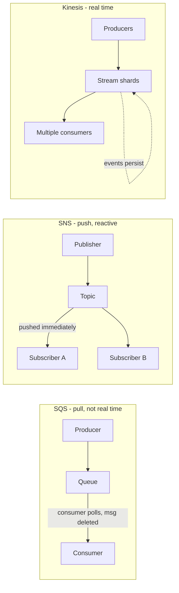

# Application Integration

How independent, loosely coupled applications communicate through intermediate systems: queuing, streaming, pub/sub, API gateways, state machines, and event buses — plus the AWS service for each pattern. [`8:46:05`](https://www.youtube.com/watch?v=7HKot-brXFE&t=31565)

### Core concept

- Application integration = letting two independent applications communicate and work with each other, commonly through an intermediate system; cloud workloads strongly encourage loosely coupled systems [`8:46:05`](https://www.youtube.com/watch?v=7HKot-brXFE&t=31565)
- A messaging system provides asynchronous communication and decouples processes via messages/events between a producer and a consumer [`8:46:36`](https://www.youtube.com/watch?v=7HKot-brXFE&t=31596)

### Queuing — Amazon SQS

- A queuing system generally deletes messages once consumed; it is for simple communication, NOT real time, and you must pull (poll) for data — it is not reactive [`8:46:36`](https://www.youtube.com/watch?v=7HKot-brXFE&t=31596)
- SQS (Simple Queue Service): fully managed queuing service to decouple and scale microservices, distributed systems, and serverless apps; common use case: queueing transactional emails (sign-up, password reset) [`8:47:05`](https://www.youtube.com/watch?v=7HKot-brXFE&t=31625)
- Why decouple: too many long-running tasks could hang your application; a separate compute service handles them instead [`8:47:36`](https://www.youtube.com/watch?v=7HKot-brXFE&t=31656)

### Streaming — Amazon Kinesis

- In streaming, messages are called events; multiple consumers can react, events live in the stream for long periods so complex operations can be applied, and streaming is for real-time use cases [`8:47:58`](https://www.youtube.com/watch?v=7HKot-brXFE&t=31678)
- Kinesis: AWS fully managed solution for collecting, processing, and analyzing streaming data; producers (EC2, mobile devices, servers) send events into a data stream (auto-scaling shards) consumed by e.g. Redshift, DynamoDB, S3, EMR [`8:48:37`](https://www.youtube.com/watch?v=7HKot-brXFE&t=31717)
- Because it is real time and does more work than a queue, streaming costs more [`8:48:37`](https://www.youtube.com/watch?v=7HKot-brXFE&t=31717)

### Pub/Sub — Amazon SNS

- Publish-subscribe pattern: publishers do not send messages directly to receivers; they send to an event bus which categorizes messages into groups, and subscribers to those groups receive messages immediately [`8:49:07`](https://www.youtube.com/watch?v=7HKot-brXFE&t=31747)
- Publisher has no knowledge of subscribers; subscribers do NOT poll — messages are pushed to them automatically; "messages" and "events" are interchangeable in pub/sub [`8:49:40`](https://www.youtube.com/watch?v=7HKot-brXFE&t=31780)
- Common practical uses: real-time chat systems and webhook systems [`8:50:04`](https://www.youtube.com/watch?v=7HKot-brXFE&t=31804)
- SNS (Simple Notification Service): highly available, durable, secure, fully managed pub/sub messaging to decouple microservices; publishers include SDK/CLI/CloudWatch/AWS services → SNS topic (with filtering/fan-out) → subscribers like Lambda, SQS, email, HTTPS [`8:50:31`](https://www.youtube.com/watch?v=7HKot-brXFE&t=31831)
- SNS vs Kinesis: SNS is a more constrained managed service (just publishers → subscribers); Kinesis lets you do a lot more [`8:50:50`](https://www.youtube.com/watch?v=7HKot-brXFE&t=31850)

### API Gateway — Amazon API Gateway

- An API gateway sits between a single entry point and multiple backends; allows throttling, logging, routing, and logic/formatting of HTTPS requests and responses [`8:51:21`](https://www.youtube.com/watch?v=7HKot-brXFE&t=31881)
- Amazon API Gateway: create secure APIs at any scale that act as a "front door" for apps to access data, business logic, or backend services; define API calls and route them (e.g., some routes to Lambda, others to RDS, Kinesis, EC2) and change routes on the fly [`8:51:41`](https://www.youtube.com/watch?v=7HKot-brXFE&t=31901)

### State Machines — AWS Step Functions

- A state machine is an abstract model deciding how one state moves to another based on conditions — think of it like a flowchart [`8:52:39`](https://www.youtube.com/watch?v=7HKot-brXFE&t=31959)
- Step Functions: coordinates multiple AWS services into a serverless workflow with a graphical console; automatically triggers and tracks each step, retries on error, and logs the state of each step so you can diagnose and debug quickly [`8:52:39`](https://www.youtube.com/watch?v=7HKot-brXFE&t=31959)

### Event Bus — Amazon EventBridge

- An event bus receives events from a source and routes them to a target based on rules [`8:53:35`](https://www.youtube.com/watch?v=7HKot-brXFE&t=32015)
- EventBridge was formerly known as Amazon CloudWatch Events — renamed with extended capabilities; many AWS services already emit events into it, so it is much easier than rolling your own integration [`8:54:04`](https://www.youtube.com/watch?v=7HKot-brXFE&t=32044)
- Components: every AWS account gets a default event bus; custom event buses (can be scoped to multiple/other AWS accounts); SaaS event bus (scoped to third-party SaaS providers); producers (AWS services emitting events); events (JSON objects traveling the bus); partner sources (third-party apps); rules (determine what events to capture and pass); targets (AWS services consuming events) [`8:54:29`](https://www.youtube.com/watch?v=7HKot-brXFE&t=32069)

### Services at a glance

- SNS — pub/sub messaging; sends notifications via plain text email, HTTPS/webhooks, SMS, SQS, and Lambda; pushes messages to subscribers [`8:55:27`](https://www.youtube.com/watch?v=7HKot-brXFE&t=32127)
- SQS — queueing service; applications pull the queue; commonly used for background jobs [`8:55:27`](https://www.youtube.com/watch?v=7HKot-brXFE&t=32127)
- Step Functions — state machine service; share data among Lambdas, have Lambdas wait for each other, create logical steps; also works with Fargate tasks [`8:55:56`](https://www.youtube.com/watch?v=7HKot-brXFE&t=32156)
- EventBridge — serverless event bus connecting your own apps, third-party services, and AWS services [`8:55:56`](https://www.youtube.com/watch?v=7HKot-brXFE&t=32156)
- Kinesis — real-time streaming; used for real-time analytics, click streams, ingesting data from IoT fleets [`8:56:24`](https://www.youtube.com/watch?v=7HKot-brXFE&t=32184)
- Amazon MQ — managed message broker using Apache ActiveMQ [`8:56:24`](https://www.youtube.com/watch?v=7HKot-brXFE&t=32184)
- MSK (note the initialism: MSK, not MKS) — fully managed Apache Kafka; similar to Kinesis but more robust and very popular [`8:56:43`](https://www.youtube.com/watch?v=7HKot-brXFE&t=32203)
- API Gateway — fully managed service to create, publish, maintain, monitor, and secure APIs; route endpoints to AWS services [`8:56:43`](https://www.youtube.com/watch?v=7HKot-brXFE&t=32203)
- AppSync — fully managed GraphQL service; GraphQL is an open-source agnostic query adapter for querying many data sources [`8:57:13`](https://www.youtube.com/watch?v=7HKot-brXFE&t=32233)

### AWS Amplify

- Opinionated framework + fully managed infrastructure so developers focus on building web/mobile apps; an umbrella of tools: CLI, client-side SDK, Amplify UI components, Amplify Hosting (static/web hosting), Amplify Studio (visual full-stack dev environment), and Gen 2 [`8:57:32`](https://www.youtube.com/watch?v=7HKot-brXFE&t=32252)
- Direct integrations with Cognito, API Gateway, AppSync, S3, DynamoDB, Lambda, and more; positions itself as JavaScript-framework-first [`8:58:36`](https://www.youtube.com/watch?v=7HKot-brXFE&t=32316)
- Gen 2 (in preview at recording, heavily marketed) is meant to be "code first" and improve developer experience [`8:59:05`](https://www.youtube.com/watch?v=7HKot-brXFE&t=32345)
- Instructor's caveat: the developer experience is historically poor, but note that to integrate Amazon Cognito client-side you must now use the Amplify client-side SDK (the old standalone Cognito library was folded in); Amplify is modular [`8:59:49`](https://www.youtube.com/watch?v=7HKot-brXFE&t=32389)

### AWS AppSync (deep dive)

- Fully managed GraphQL service: you define a schema (data model with models); resolvers pull data from data sources and implement state-changing operations mapping to queries, mutations, or subscriptions [`9:00:30`](https://www.youtube.com/watch?v=7HKot-brXFE&t=32430)
- Use the Amplify SDK to pull data from AppSync — it generates scaffolding for your models; AppSync supports real-time APIs via the GraphQL subscription feature [`9:01:11`](https://www.youtube.com/watch?v=7HKot-brXFE&t=32471)
- Two API types: GraphQL APIs and Merged APIs (merging multiple GraphQL APIs into one — useful when multiple teams each manage their own API but end users want a single API) [`9:01:11`](https://www.youtube.com/watch?v=7HKot-brXFE&t=32471)
- Data sources: DynamoDB tables, Amazon OpenSearch, Lambda functions, HTTP endpoints, Amazon EventBridge, relational databases (RDS, which includes Aurora) [`9:01:36`](https://www.youtube.com/watch?v=7HKot-brXFE&t=32496)
- Caching options: none, request caching, or per-resolver caching — but you provision an instance type, so caching is NOT serverless and is an ongoing cost [`9:02:05`](https://www.youtube.com/watch?v=7HKot-brXFE&t=32525)
- Authorization types: API key, AWS IAM, Cognito user pools; supports custom domains; built-in query editor; two resolver runtimes: AppSync JS (JavaScript) and VTL [`9:02:05`](https://www.youtube.com/watch?v=7HKot-brXFE&t=32525)
