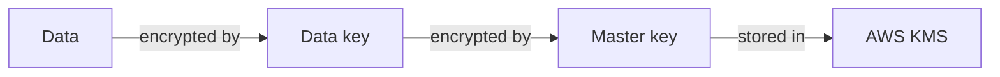

# Security

Security fundamentals (defense in depth, CIA triad, encryption, hashing, digital signatures) followed by AWS security services: compliance programs, pen testing rules, Artifact, Inspector, Shield, GuardDuty, VPN, WAF, KMS/CloudHSM, Security Hub, Audit Manager, and Firewall Manager.

### Defense in Depth (7 layers)

- From outermost to innermost: **Physical** (data center access for authorized personnel only) → **Identity & Access** (control of infrastructure and change control) → **Perimeter** (DDoS protection filtering large-scale attacks) → **Network** (segmentation and access controls between resources) → **Compute** (access to VMs, ports, on-premise and cloud) → **Applications** (secure and vulnerability-free) → **Data** (access to business/customer data, encryption) [`12:43:06`](https://www.youtube.com/watch?v=7HKot-brXFE&t=45786) [`12:43:21`](https://www.youtube.com/watch?v=7HKot-brXFE&t=45801)
- **Identity & Access is considered the new primary perimeter** from the customer's perspective, especially under the zero-trust model [`12:44:12`](https://www.youtube.com/watch?v=7HKot-brXFE&t=45852)

### CIA Triad

- Model describing foundational security principles and their trade-offs [`12:44:41`](https://www.youtube.com/watch?v=7HKot-brXFE&t=45881):
  - **Confidentiality**: protect data from unauthorized viewers — in practice, encryption keys and keys-encrypting-keys (envelope encryption)
  - **Integrity**: accuracy/completeness of data over its lifecycle — ACID-compliant databases, tamper-evident/tamper-proof HSMs [`12:45:15`](https://www.youtube.com/watch?v=7HKot-brXFE&t=45915)
  - **Availability**: information available when needed — high availability, DDoS mitigation
- First mentioned in a NIST publication in 1977; you rarely get all three — trade-offs per scenario [`12:45:15`](https://www.youtube.com/watch?v=7HKot-brXFE&t=45915) [`12:45:47`](https://www.youtube.com/watch?v=7HKot-brXFE&t=45947)

### Vulnerabilities

- A **vulnerability** is a hole/weakness in an application (design flaw or implementation bug) allowing an attacker to harm stakeholders [`12:46:22`](https://www.youtube.com/watch?v=7HKot-brXFE&t=45982)
- OWASP catalogs many: broken/risky cryptographic algorithms, memory leaks, least-privilege violations, improper data validation, buffer overflows [`12:46:50`](https://www.youtube.com/watch?v=7HKot-brXFE&t=46010)

### Cryptography, Encryption and Keys

- **Cryptography**: techniques for secure communication in the presence of adversaries. **Encryption**: encoding information with a key and a cipher; plaintext in → ciphertext out (classic example: WWII Enigma machine with daily rotor keys) [`12:47:25`](https://www.youtube.com/watch?v=7HKot-brXFE&t=46045)
- **Cipher** = the algorithm performing encryption/decryption; **ciphertext** = the encrypted result (historical example: code books mapping words to codes) [`12:47:59`](https://www.youtube.com/watch?v=7HKot-brXFE&t=46079) [`12:48:28`](https://www.youtube.com/watch?v=7HKot-brXFE&t=46108)
- **Cryptographic key**: a variable used with an encryption algorithm to encrypt/decrypt [`12:49:15`](https://www.youtube.com/watch?v=7HKot-brXFE&t=46155)
  - **Symmetric**: the SAME key encrypts and decrypts — e.g. **AES** (the one you'll see on AWS) [`12:49:15`](https://www.youtube.com/watch?v=7HKot-brXFE&t=46155)
  - **Asymmetric**: two keys, one encodes and one decodes — e.g. **RSA** [`12:49:42`](https://www.youtube.com/watch?v=7HKot-brXFE&t=46182)

### Hashing and Salting

- A hash function maps arbitrary-size input to a fixed-size value; **one-way** and **deterministic** (same input → same output) [`12:50:16`](https://www.youtube.com/watch?v=7HKot-brXFE&t=46216)
- Used to store passwords so they never sit in plaintext: on login the input is hashed and compared with the stored hash — the original password is never known [`12:50:48`](https://www.youtube.com/watch?v=7HKot-brXFE&t=46248) [`12:51:14`](https://www.youtube.com/watch?v=7HKot-brXFE&t=46274)
- Popular functions: MD5, SHA-256, bcrypt. If an attacker knows the function and steals the DB they can enumerate a password dictionary — so add a **salt**: a random string unknown to the attacker that mitigates the deterministic nature of hashing [`12:51:42`](https://www.youtube.com/watch?v=7HKot-brXFE&t=46302)

### Digital Signatures and Signing

- A mathematical scheme verifying authenticity of digital messages/documents; provides **tamper evidence** (was data modified? is it from the expected sender?) [`12:52:21`](https://www.youtube.com/watch?v=7HKot-brXFE&t=46341)
- Three algorithms: key generation (public + private key), signing (**private key** signs), verification (**public key** verifies) [`12:52:48`](https://www.youtube.com/watch?v=7HKot-brXFE&t=46368)
- SSH uses public/private keys (commonly RSA) for remote machine access; `ssh-keygen` generates the pair on Linux. **Code signing** = digital signatures ensuring code was not tampered with [`12:53:19`](https://www.youtube.com/watch?v=7HKot-brXFE&t=46399)

### Encryption In Transit vs At Rest

- **In transit** (data moving between locations): TLS, SSL. **At rest** (data on storage/in a database): AES, RSA [`12:54:03`](https://www.youtube.com/watch?v=7HKot-brXFE&t=46443)
- **TLS** (Transport Layer Security): 1.0/1.1 no longer used; **TLS 1.2 and 1.3 are current best practice**. **SSL**: 1.0, 2.0 and 3.0 are all deprecated [`12:54:26`](https://www.youtube.com/watch?v=7HKot-brXFE&t=46466)

### Common Compliance Programs

- Internal policies/procedures to comply with laws, rules, regulations, or uphold reputation — know the popular ones [`12:55:17`](https://www.youtube.com/watch?v=7HKot-brXFE&t=46517):
- **ISO/IEC**: 27001 (control implementation guidance — the most popular), 27017 (cloud security), 27018 (personal data protection in cloud), 27701 (privacy information management / PII) [`12:55:43`](https://www.youtube.com/watch?v=7HKot-brXFE&t=46543) [`12:56:11`](https://www.youtube.com/watch?v=7HKot-brXFE&t=46571)
- **SOC**: SOC 1 (internal controls over financial reporting), SOC 2 (security controls at a service org — very popular), SOC 3 (freely distributable report) [`12:56:11`](https://www.youtube.com/watch?v=7HKot-brXFE&t=46571) [`12:56:48`](https://www.youtube.com/watch?v=7HKot-brXFE&t=46608)
- **PCI DSS**: security standards for companies that accept/process/store/transmit credit card information [`12:57:12`](https://www.youtube.com/watch?v=7HKot-brXFE&t=46632)
- **FIPS 140-2**: US/Canadian government standard for cryptographic modules protecting sensitive information [`12:57:12`](https://www.youtube.com/watch?v=7HKot-brXFE&t=46632)
- **HIPAA** (US federal law regulating patient health information) and **PHIPA** (Ontario, Canada equivalent) [`12:57:12`](https://www.youtube.com/watch?v=7HKot-brXFE&t=46632) [`12:57:45`](https://www.youtube.com/watch?v=7HKot-brXFE&t=46665)
- **CSA STAR** (third-party assessment of a cloud provider's security posture), **FedRAMP** (required to work with the US government), **CJIS** (required to access the FBI's CJIS database), **GDPR** (EU privacy law for anyone offering goods/services to or collecting data on EU residents) [`12:57:45`](https://www.youtube.com/watch?v=7HKot-brXFE&t=46665) [`12:58:20`](https://www.youtube.com/watch?v=7HKot-brXFE&t=46700) [`12:58:51`](https://www.youtube.com/watch?v=7HKot-brXFE&t=46731)

### Penetration Testing on AWS

- Pen testing = authorized simulated cyber attack to evaluate system security; allowed on AWS with restrictions [`12:59:45`](https://www.youtube.com/watch?v=7HKot-brXFE&t=46785)
- **Permitted services**: EC2, NAT gateways, ELBs, RDS, CloudFront, Aurora, API Gateway, Lambda & Lambda@Edge, Lightsail, Elastic Beanstalk [`13:00:14`](https://www.youtube.com/watch?v=7HKot-brXFE&t=46814)
- **Prohibited**: DNS zone walking via Route 53 hosted zones; DoS/DDoS (or simulated) attacks; port/protocol/request flooding [`13:00:14`](https://www.youtube.com/watch?v=7HKot-brXFE&t=46814) [`13:00:46`](https://www.youtube.com/watch?v=7HKot-brXFE&t=46846)
- Other simulated events (stress tests, phishing, malware analysis) require submitting a request form; replies can take up to 7 days [`13:00:46`](https://www.youtube.com/watch?v=7HKot-brXFE&t=46846) [`13:01:38`](https://www.youtube.com/watch?v=7HKot-brXFE&t=46898)

### AWS Artifact

- Self-serve portal for **on-demand access to AWS compliance reports** (e.g. Government of Canada partner package) — proves AWS meets compliance programs; reports download as PDFs with embedded downloadables (open in Adobe Acrobat) [`13:02:03`](https://www.youtube.com/watch?v=7HKot-brXFE&t=46923) [`13:03:15`](https://www.youtube.com/watch?v=7HKot-brXFE&t=46995)

### Amazon Inspector

- **Hardening** = eliminating as many security risks as possible, common for VMs via a security benchmark [`13:04:57`](https://www.youtube.com/watch?v=7HKot-brXFE&t=47097)
- Inspector runs a security benchmark against specific EC2 instances (network and host assessments): install the agent, run an assessment on the target, review findings, remediate [`13:04:57`](https://www.youtube.com/watch?v=7HKot-brXFE&t=47097) [`13:05:25`](https://www.youtube.com/watch?v=7HKot-brXFE&t=47125)
- Popular benchmark: **CIS** (Center for Internet Security) with **699 checks** [`13:05:25`](https://www.youtube.com/watch?v=7HKot-brXFE&t=47125)

### DDoS and AWS Shield

- **DDoS**: malicious attack flooding a website with fake traffic (attacker controls many compromised machines) so it stalls or becomes unavailable [`13:05:59`](https://www.youtube.com/watch?v=7HKot-brXFE&t=47159)
- Cloud providers have built-in DDoS protection: on AWS you get it for free via **Shield Standard** when routing through Route 53 or CloudFront (also Elastic IP, Global Accelerator) [`13:06:52`](https://www.youtube.com/watch?v=7HKot-brXFE&t=47212) [`13:07:23`](https://www.youtube.com/watch?v=7HKot-brXFE&t=47243)
- Shield protects against **layer 3 (network), 4 (transport), and 7 (application)** attacks (OSI model) [`13:07:50`](https://www.youtube.com/watch?v=7HKot-brXFE&t=47270) [`13:08:17`](https://www.youtube.com/watch?v=7HKot-brXFE&t=47297)
- **Shield Standard**: free, automatic on all AWS, protects against most common attacks. **Shield Advanced**: from **$3,000 USD/year** + usage costs; for specific services (Route 53, CloudFront, ELB, Global Accelerator, Elastic IP); adds L3/4/7 visibility reporting, access to the DDoS response team (only with Business/Enterprise support), DDoS cost protection, and an SLA [`13:08:17`](https://www.youtube.com/watch?v=7HKot-brXFE&t=47297) [`13:09:10`](https://www.youtube.com/watch?v=7HKot-brXFE&t=47350)
- Both plans integrate with AWS WAF for layer 7 protection — **no WAF, no layer 7 protection** [`13:09:32`](https://www.youtube.com/watch?v=7HKot-brXFE&t=47372)

### Amazon GuardDuty

- **IDS/IPS** = intrusion detection/protection system monitoring a network or systems for malicious activity or policy violations [`13:09:58`](https://www.youtube.com/watch?v=7HKot-brXFE&t=47398)
- GuardDuty is a threat detection service (IDS/IPS) that continuously monitors for malicious/suspicious activity; uses **machine learning** to analyze **CloudTrail logs, VPC Flow Logs, and DNS logs** [`13:09:58`](https://www.youtube.com/watch?v=7HKot-brXFE&t=47398)
- Example finding: root credential usage (you should never invoke API calls with root credentials); follow up investigations with Amazon Detective; automate incident response via CloudWatch Events (now EventBridge) [`13:10:40`](https://www.youtube.com/watch?v=7HKot-brXFE&t=47440)
- Demo: must be turned on; findings show who accessed what and from where; can centralize findings from all accounts into one account; supports trusted-IP and threat lists (whitelist/blacklist) [`13:11:35`](https://www.youtube.com/watch?v=7HKot-brXFE&t=47495) [`13:13:06`](https://www.youtube.com/watch?v=7HKot-brXFE&t=47586) [`13:13:28`](https://www.youtube.com/watch?v=7HKot-brXFE&t=47608)

### AWS VPN

- Establishes a **secure and private** tunnel from your network/device to the AWS global network — contrast with Direct Connect, which is private but does NOT secure data in transit by itself [`13:13:58`](https://www.youtube.com/watch?v=7HKot-brXFE&t=47638)
- Two options: **Site-to-Site VPN** (connect on-premise/branch office to a VPC) and **Client VPN** (connect users to AWS or on-premise networks) [`13:14:30`](https://www.youtube.com/watch?v=7HKot-brXFE&t=47670)
- Uses **IPsec** (Internet Protocol Security): authenticates and encrypts packets for secure communication between two computers over IP [`13:14:51`](https://www.youtube.com/watch?v=7HKot-brXFE&t=47691)

### AWS WAF (Web Application Firewall)

- Protects web applications from common web exploits: write your own allow/deny rules based on HTTP request contents, or use trusted partner rule sets from the WAF rule marketplace [`13:15:16`](https://www.youtube.com/watch?v=7HKot-brXFE&t=47716)
- Attaches to **CloudFront or an Application Load Balancer** [`13:15:16`](https://www.youtube.com/watch?v=7HKot-brXFE&t=47716)
- Protects against the **OWASP Top 10**: injection, broken authentication, sensitive data exposure, XML external entities (XXE), broken access control, security misconfigurations, cross-site scripting (XSS), insecure deserialization, components with known vulnerabilities, insufficient logging & monitoring [`13:15:44`](https://www.youtube.com/watch?v=7HKot-brXFE&t=47744) [`13:16:16`](https://www.youtube.com/watch?v=7HKot-brXFE&t=47776)
- Demo: WAF is a global service; you create **web ACLs** with managed rule groups (AWS-provided free/paid, plus third-party like Fortinet's OWASP Top 10) capped by capacity units; you can also allow/block specific IP addresses (e.g. whitelisting support engineers blocked by over-aggressive rules) [`13:17:08`](https://www.youtube.com/watch?v=7HKot-brXFE&t=47828) [`13:17:32`](https://www.youtube.com/watch?v=7HKot-brXFE&t=47852) [`13:18:28`](https://www.youtube.com/watch?v=7HKot-brXFE&t=47908)

### Hardware Security Modules (HSM), KMS and CloudHSM

- An **HSM** stores encryption keys **in memory, never written to disk** — shutting it down destroys the key, guaranteeing it can't be stolen from a drive; HSMs follow **FIPS** [`13:19:13`](https://www.youtube.com/watch?v=7HKot-brXFE&t=47953) [`13:19:55`](https://www.youtube.com/watch?v=7HKot-brXFE&t=47995)
- **FIPS 140-2 Level 2** = multi-tenant HSM (multiple customers virtually isolated; tamper-**evident**) → **AWS KMS**. **FIPS 140-2 Level 3** = single-tenant, dedicated HSM (tamper-**proof**) → **AWS CloudHSM** [`13:20:31`](https://www.youtube.com/watch?v=7HKot-brXFE&t=48031) [`13:21:01`](https://www.youtube.com/watch?v=7HKot-brXFE&t=48061) [`13:21:31`](https://www.youtube.com/watch?v=7HKot-brXFE&t=48091)
- Don't confuse FIPS 140-2 *Level 3* with FIPS 140-*3* (the newer standard) [`13:21:01`](https://www.youtube.com/watch?v=7HKot-brXFE&t=48061)

#### AWS KMS (Key Management Service)

- Managed service to create/control encryption keys; a **multi-tenant HSM**; many AWS services integrate with a simple encryption checkbox (e.g. RDS, EC2 EBS volumes, DynamoDB) [`13:22:04`](https://www.youtube.com/watch?v=7HKot-brXFE&t=48124) [`13:25:10`](https://www.youtube.com/watch?v=7HKot-brXFE&t=48310)
- Uses **envelope encryption**: a data key encrypts your data, and a master key encrypts the data key as an additional layer; the master key is stored in KMS [`13:22:29`](https://www.youtube.com/watch?v=7HKot-brXFE&t=48149) [`13:22:53`](https://www.youtube.com/watch?v=7HKot-brXFE&t=48173)

- AWS-managed default keys are free; customer-created keys cost **$1 each**; keys can be symmetric or asymmetric (encrypt/decrypt or sign/verify) and support rotation [`13:23:26`](https://www.youtube.com/watch?v=7HKot-brXFE&t=48206)
- Best practice: keep key **administrators** and key **users** as separate accounts [`13:23:52`](https://www.youtube.com/watch?v=7HKot-brXFE&t=48232)

#### AWS CloudHSM

- **Single-tenant HSM as a service**: automates hardware provisioning, patching, HA, backups; keys on **FIPS 140-2 Level 3** validated hardware [`13:25:36`](https://www.youtube.com/watch?v=7HKot-brXFE&t=48336)
- Built on open HSM standards (PKCS#11, Java Cryptography Extensions, Microsoft CryptoNG); keys are transferable to other commercial HSMs; can serve as a **custom key store for KMS** [`13:26:09`](https://www.youtube.com/watch?v=7HKot-brXFE&t=48369)
- Much more expensive than KMS (fixed monthly cost for dedicated hardware) and harder to use — only choose it if you're an enterprise needing FIPS 140-2 Level 3 compliance [`13:26:43`](https://www.youtube.com/watch?v=7HKot-brXFE&t=48403)

### AWS Security Hub

- A **CSPM** (Cloud Security Posture Management) system that generates a **security score**; you enable security standards → collections of security controls that are, underneath, **AWS Config rules** — with charts and per-finding investigation on top [`13:27:14`](https://www.youtube.com/watch?v=7HKot-brXFE&t=48434) [`13:27:38`](https://www.youtube.com/watch?v=7HKot-brXFE&t=48458)

### AWS Audit Manager

- Continually audits AWS usage to simplify **risk and compliance assessments**: choose a framework library (e.g. SOC 2) which sets up controls (also backed by AWS Config), create assessments, and generate assessment reports — similar in spirit to Vanta [`13:27:38`](https://www.youtube.com/watch?v=7HKot-brXFE&t=48458) [`13:28:31`](https://www.youtube.com/watch?v=7HKot-brXFE&t=48511)
- vs Security Hub: Security Hub produces a **security score**; Audit Manager creates **assessments against a specific compliance standard** [`13:28:31`](https://www.youtube.com/watch?v=7HKot-brXFE&t=48511)
- Caveat: implementing a framework does NOT make you compliant — you still need a third-party auditor [`13:29:01`](https://www.youtube.com/watch?v=7HKot-brXFE&t=48541)

### AWS Firewall Manager

- Centrally configure and manage firewall rules **across accounts and applications**: manages AWS WAF Classic, Shield Advanced, security groups, network ACLs, AWS Network Firewall, Route 53 Resolver DNS Firewall, and third-party firewalls [`13:29:36`](https://www.youtube.com/watch?v=7HKot-brXFE&t=48576)
- Configuration UI differs wildly per managed service; described as expensive [`13:30:10`](https://www.youtube.com/watch?v=7HKot-brXFE&t=48610)
- Prerequisites: account must be in an AWS Organization, be the Firewall Manager administrator, have AWS Config enabled (and possibly RAM for some services) — many AWS security services are layers on top of AWS Config [`13:30:41`](https://www.youtube.com/watch?v=7HKot-brXFE&t=48641)
