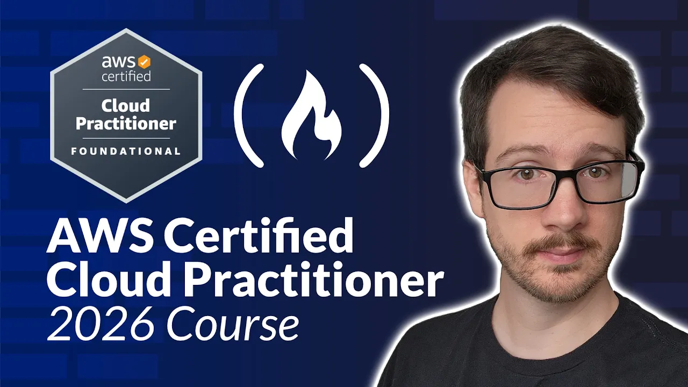
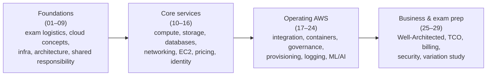

# AWS Certified Cloud Practitioner Certification Course 2026 (CLF-C02) - Pass the Exam!

- **Video**: [youtube.com/watch?v=7HKot-brXFE](https://www.youtube.com/watch?v=7HKot-brXFE)
- **Uploader**: freeCodeCamp.org — taught by Andrew Brown (ExamPro)
- **Duration**: 13:46:27
- **Type**: educational certification course

## Summary

A complete preparation course for the AWS Certified Cloud Practitioner exam (CLF-C02), combining lecture material to memorize key facts, hands-on labs in a real AWS account, and a free practice exam on exampro.co. It starts with exam logistics and cloud fundamentals, then walks through every exam-relevant AWS service area — global infrastructure, compute, storage, databases, networking, EC2 and its pricing models, identity, integration, containers, governance, logging, ML/AI, security — and closes with billing/support plans, the Well-Architected Framework, and a "variation study" that disambiguates similarly-named services, the classic trap of this exam.

## Topics

1. [Introduction](01-introduction.md) — Exam logistics for CLF-C02: audience, certification roadmap, study plan, exam domains, and exact scoring/format rules.
2. [Cloud Concepts](02-cloud-concepts.md) — Cloud computing definition, hosting evolution, AWS history, what defines a cloud service provider, compute abstraction levels, SaaS/PaaS/IaaS, and deployment models.
3. [Getting Started](03-getting-started.md) — Account creation, IAM users vs root, region choice, and billing protection: Budgets, Free Tier alerts, CloudWatch billing alarms, and root MFA.
4. [Digital Transformation](04-digital-transformation.md) — Innovation waves, the burning-platform concept, AWS product/pricing pages, and the CPU→GPU→quantum evolution with Inferentia and Braket.
5. [The Benefits of Cloud](05-the-benefits-of-cloud.md) — AWS's reworked benefits list vs the original Six Advantages, normalized into seven: cost-effective, global, secure, reliable, scalable, elastic, current.
6. [AWS Global Infrastructure](06-aws-global-infrastructure.md) — Regions, availability zones, edge locations/PoPs, Direct Connect, Local/Wavelength Zones, GovCloud, AWS China, data residency, and Outposts.
7. [Cloud Architecture](07-cloud-architecture.md) — Availability, scalability, elasticity, fault tolerance, durability; BCP with RTO/RPO; and the four disaster recovery options from backup & restore to multi-site.
8. [Management and Development Tools](08-management-and-development-tools.md) — The AWS API, Management Console, CLI, SDKs, CloudShell, Cloud9, ARNs, access keys, and Infrastructure as Code with CloudFormation vs CDK.
9. [Shared Responsibility Model](09-shared-responsibility-model.md) — Who secures what: security *in* the cloud (customer) vs *of* the cloud (AWS), and how responsibility shifts across IaaS/PaaS/SaaS and the compute spectrum.
10. [Compute](10-compute.md) — The three compute categories (VMs, containers, serverless), Nitro, HPC, edge/hybrid options, and cost/capacity services like ASG, ELB, and Elastic Beanstalk.
11. [Storage](11-storage.md) — Block vs file vs object storage, S3 and all its storage classes, the Snow family, EBS, EFS, Storage Gateway, and hands-on demos.
12. [Databases](12-databases.md) — Relational vs NoSQL, data warehouses, and the AWS catalog: DynamoDB, RDS, Aurora, Redshift, ElastiCache, Neptune, Timestream, QLDB, DMS.
13. [Networking](13-networking.md) — VPCs, subnets, CIDR, gateways, route tables, security groups vs NACLs, hybrid connectivity, and CloudFront.
14. [EC2](14-ec2.md) — Instance families/types/sizes, tenancy options, and a full lab covering AMIs, key pairs, Sessions Manager, Elastic IPs, launch templates, auto scaling, and load balancers.
15. [EC2 Pricing Models](15-ec2-pricing-models.md) — On-Demand, Spot, Reserved Instances (classes, attributes, regional vs zonal), Dedicated, and Savings Plans.
16. [Identity](16-identity.md) — Zero trust, directory services, federation (OpenID, OAuth 2.0, SAML), IAM policies/users/groups/roles, least privilege, and root-user-only tasks.
17. [Application Integration](17-application-integration.md) — Messaging patterns mapped to services: SQS, SNS, Kinesis, API Gateway, Step Functions, EventBridge, Amplify, and AppSync.
18. [Containers](18-containers.md) — VMs vs containers, monoliths vs microservices, Kubernetes/Docker/Podman, and the AWS container map: ECS, Fargate, EKS, App Runner, ECR.
19. [Governance](19-governance.md) — AWS Organizations and SCPs, Control Tower, AWS Config compliance-as-code, tagging, and the Cloud Adoption Framework.
20. [Provisioning](20-provisioning.md) — The provisioning lineup (Elastic Beanstalk, OpsWorks, CloudFormation, Quick Starts, CDK, Amplify, App Runner) and a full Beanstalk lab.
21. [Serverless Services](21-serverless-services.md) — The purest serverless services (DynamoDB, S3, Fargate, Lambda, Step Functions, Aurora Serverless) and serverless as a spectrum, not a boolean.
22. [Windows on AWS](22-windows-on-aws.md) — Windows Server on EC2, SQL Server on RDS, Directory Service, FSx, WorkSpaces, an RDP lab, and BYOL with License Manager.
23. [Logging](23-logging.md) — CloudTrail API auditing, the CloudWatch umbrella (Logs, Metrics, Alarms, Dashboards, Logs Insights), and X-Ray tracing.
24. [ML, AI and Big Data](24-ml-ai-and-big-data.md) — SageMaker, Bedrock, CodeWhisperer and the AI service catalog, plus analytics: Athena, EMR, Kinesis, Redshift, Glue, QuickSight.
25. [AWS Well-Architected Framework](25-aws-well-architected-framework.md) — The five pillars and their design principles, Amazon leadership principles, and the Well-Architected Tool.
26. [TCO and Migration](26-tco-and-migration.md) — Total Cost of Ownership and hidden on-prem costs, CAPEX vs OPEX, cloud's impact on IT staffing, and migration tooling (Pricing Calculator, VM Import/Export, DMS).
27. [Billing, Pricing and Support](27-billing-pricing-and-support.md) — Support plans and response times, free tier, cost tools (Budgets, Cost Explorer, CUR), consolidated billing, Trusted Advisor, SLAs, and Marketplace.
28. [Security](28-security.md) — Defense in depth, the CIA triad, encryption/hashing/TLS, plus AWS security services: Artifact, Inspector, Shield, GuardDuty, WAF, KMS/CloudHSM, Security Hub.
29. [Variation Study](29-variation-study.md) — Exam-prep disambiguation of similarly-named services: Config vs AppConfig, SNS vs SQS vs SES vs Pinpoint, the "Connect" services, and the four ELB types.

## Key takeaways

- The exam has 65 questions (50 scored, 15 unscored) with no penalty for wrong answers — answer everything; passing is ~70%, and you should aim for 85% on practice exams to land ~75% on the real one [`7:33`](https://www.youtube.com/watch?v=7HKot-brXFE&t=453), [`7:03`](https://www.youtube.com/watch?v=7HKot-brXFE&t=423).
- The core shared-responsibility rule: customers secure what's *in* the cloud (data, configuration), AWS secures what's *of* the cloud — if you can configure it, it's yours [`4:05:55`](https://www.youtube.com/watch?v=7HKot-brXFE&t=14755), [`4:18:44`](https://www.youtube.com/watch?v=7HKot-brXFE&t=15524).
- Choosing a region comes down to four factors: regulatory compliance, cost, service availability, and latency to end users [`1:33:21`](https://www.youtube.com/watch?v=7HKot-brXFE&t=5601).
- The four disaster recovery options from cold to hot: backup & restore (hours), pilot light (~10 min), warm standby (minutes), multi-site active-active (real-time, ~double the cost) [`2:20:28`](https://www.youtube.com/watch?v=7HKot-brXFE&t=8428).
- An S3 object can be 0 bytes to 5 TB (a real exam question), and Standard-IA only saves money if accessed less than once a month [`5:16:13`](https://www.youtube.com/watch?v=7HKot-brXFE&t=18973), [`5:17:41`](https://www.youtube.com/watch?v=7HKot-brXFE&t=19061).
- DynamoDB is AWS's flagship database — Amazon retail migrated 7,500 Oracle databases (75 PB) to it in 2019, cutting costs 60% and latency 40% [`5:58:59`](https://www.youtube.com/watch?v=7HKot-brXFE&t=21539).
- Security groups (instance-level) only have allow rules; NACLs (subnet-level) support allow *and* deny — the key networking exam distinction [`6:32:59`](https://www.youtube.com/watch?v=7HKot-brXFE&t=23579).
- EC2 pricing savings: Spot up to 90% (interruptible), Reserved up to 75% (1/3-year terms), Savings Plans up to 72%; regional RIs give flexibility but do NOT reserve capacity, zonal RIs do [`7:42:04`](https://www.youtube.com/watch?v=7HKot-brXFE&t=27724), [`7:50:23`](https://www.youtube.com/watch?v=7HKot-brXFE&t=28223).
- The root user can't be deleted or limited by IAM policies and is required for tasks like closing the account, changing the support plan, and enabling S3 MFA Delete [`8:42:13`](https://www.youtube.com/watch?v=7HKot-brXFE&t=31333).
- Support plans are heavily tested: Basic $0, Developer from $29/mo, Business from $100/mo, Enterprise $15,000/mo — production-down ≤1h needs Business+, and a TAM is Enterprise-only [`11:50:52`](https://www.youtube.com/watch?v=7HKot-brXFE&t=42652), [`11:51:24`](https://www.youtube.com/watch?v=7HKot-brXFE&t=42684).
- KMS is multi-tenant (FIPS 140-2 Level 2); CloudHSM is single-tenant dedicated hardware (Level 3) needed only for that compliance level [`13:20:31`](https://www.youtube.com/watch?v=7HKot-brXFE&t=48031).
- SNS is push-based pub/sub with no delivery guarantee; SQS is pull-based queuing with guaranteed delivery and up to 14-day retention — the most classic exam variation [`13:35:11`](https://www.youtube.com/watch?v=7HKot-brXFE&t=48911).
- Cloud doesn't make IT staff redundant — the exam answer is that companies shift people from managing infrastructure to revenue-generating work; a Gartner case saw a 55% cost reduction after migrating 2,500 VMs [`11:40:01`](https://www.youtube.com/watch?v=7HKot-brXFE&t=42001), [`11:35:44`](https://www.youtube.com/watch?v=7HKot-brXFE&t=41744).
