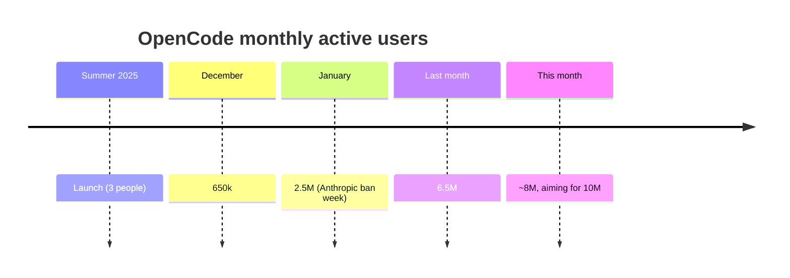

# 04 — OpenCode: Origin, Strategy, and Growth

## The setup (February 2025)

- The company was pushing for profitability on SST's monetization; in February they had one month of money left and broke even at the same time — oddly calm through it. That breathing room let them ask "what do we actually want to build?" [`16:14`](https://www.youtube.com/watch?v=1VqKUrxR2C8&t=974).
- On hype waves: anything with real potential attracts so much investment that *most* of it makes no sense, which makes it easy to dismiss the whole wave — but a few things in the wave make a lot of sense, and sitting out entirely means missing those [`17:09`](https://www.youtube.com/watch?v=1VqKUrxR2C8&t=1029).
- They took several AI swings that were abandoned before launch. Then Claude Code became the first AI coding tool that stuck for the team — and Dax's reaction was "why weren't we the ones that built this? We should feel bad about that" [`17:31`](https://www.youtube.com/watch?v=1VqKUrxR2C8&t=1051).

## The positioning thesis

- There was a market full of coding agents, but **nobody had claimed the open-source territory** — and in dev tools (databases, compilers…) the open-source option eventually becomes the default [`18:15`](https://www.youtube.com/watch?v=1VqKUrxR2C8&t=1095).
- Combined with brutal model-provider competition (billions invested; no one letting Anthropic win), a neutral open-source harness that works with *all* models is a super valuable position. Initial push: ignore the market noise and claim that spot [`18:40`](https://www.youtube.com/watch?v=1VqKUrxR2C8&t=1120).
- "If you get your positioning right, the world just keeps handing you wins you didn't even expect" — they never predicted the exact Anthropic scenario, but the fundamental read was right: companies with billions will use a neutral party to advance their own interests [`26:17`](https://www.youtube.com/watch?v=1VqKUrxR2C8&t=1577).

## Growth numbers

- Launched summer 2025 with 3 people (the co-founders); a friend joined to build the initial version (4th), and a designer joined in the fall [`19:13`](https://www.youtube.com/watch?v=1VqKUrxR2C8&t=1153).
- Monthly active users: **650k (Dec 2025) → 2.5M (Jan 2026) → 6.5M (last month) → ~8M projected; next milestone 10M** [`19:38`](https://www.youtube.com/watch?v=1VqKUrxR2C8&t=1178), [`19:59`](https://www.youtube.com/watch?v=1VqKUrxR2C8&t=1199).
- Unusual signal: growth *into* the December holidays — with every previous dev-tool product they'd seen a holiday dip and a January spike; this time usage rose even while people were off [`20:47`](https://www.youtube.com/watch?v=1VqKUrxR2C8&t=1247).
- The January explosion was amplified by Anthropic's ban attempt — "Anthropic accidentally put us and them in the same sentence" (see [05](05-anthropic-ban-and-the-counter-move.md)) [`21:08`](https://www.youtube.com/watch?v=1VqKUrxR2C8&t=1268).

