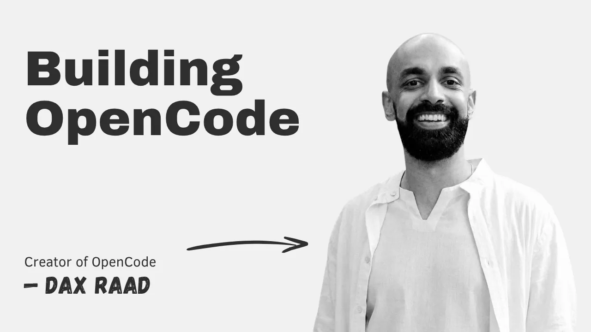

# Building OpenCode with Dax Raad

*The Pragmatic Engineer · 1:21:01 · [Watch on YouTube](https://www.youtube.com/watch?v=1VqKUrxR2C8)*

Interview with Dax Raad, co-founder of OpenCode — the most popular open-source coding harness, which grew from 650k to ~8M monthly active users in months. Despite building an AI coding tool, Dax is deeply skeptical of AI hype: he argues the bottleneck was never typing code, explains why inference is a wildly profitable business bottlenecked by GPU supply, walks through the Anthropic ban episode and the strategic playbook behind OpenCode's rise, and shares an internal memo admitting his team was shipping too much, absorbing too many hacks, and not actually moving faster.

## Topics

1. [The AI Productivity Paradox](01-the-ai-productivity-paradox.md) — using AI daily, still thinking as hard as ever; why more shipping ≠ better product.
2. [Dax's Path into Tech](02-dax-path-into-tech.md) — Minecraft modding, early startups, and why all-young founding teams are the exception.
3. [Open Source: SST and OpenNext](03-open-source-sst-and-opennext.md) — the "fill the gap, rally the competitors" origin of his playbook.
4. [OpenCode: Origin, Strategy, and Growth](04-opencode-origin-and-growth.md) — claiming the open-source territory; 650k → ~8M MAUs.
5. [The Anthropic Ban and the Counter-Move](05-anthropic-ban-and-the-counter-move.md) — the overnight OpenAI deal, and why thinking B2C won them share.
6. [From Terminal to GUI, and the Business Model](06-terminal-to-gui-and-business-model.md) — Tauri mistake, rejected growth hacks, Zen inference + enterprise control plane.
7. [Inference Economics and GPU Bottlenecks](07-inference-economics-and-gpu-bottlenecks.md) — 80–90% margins, disguised price increases, exponential demand vs. linear supply.
8. [AI Hype, Real Productivity, and AI Spending](08-ai-hype-productivity-and-spending.md) — where productivity gains actually go, and the CFO reckoning.
9. [Dax's Memo: Three Problems Turbocharged by LLMs](09-dax-memo-to-the-team.md) — needless features, the "muted prickle" of hacks, cleanup.
10. [Skepticism of Predictions](10-skepticism-of-predictions.md) — predictions as self-soothing mantras in a moment of great change.
11. [Engineering Culture at OpenCode](11-engineering-culture-at-opencode.md) — feedback loops, full-cycle ownership, emergent priorities.
12. [Taste and Quality](12-taste-and-quality.md) — quality as irrational investment and the startup's remaining moat.
13. [Work Setup, the Role of Engineers, Advice, and Books](13-setup-engineering-roles-advice-books.md) — guardrails for "idiot" agents, DDD's comeback, the engineer + industry-expert combo, Taleb.

## Key takeaways

- Even in the coding-agent space, where every company is maximally into AI, no competitor has opened a gap through better AI usage — evidence that AI tools alone are not a decisive advantage [`6:28`](https://www.youtube.com/watch?v=1VqKUrxR2C8&t=388).
- OpenCode grew from 650k monthly actives in December to 2.5M in January to ~8M now, with a team that started as 3 people — driven by open-source positioning, not a superior harness, which "wasn't very good for the first five months" [`19:59`](https://www.youtube.com/watch?v=1VqKUrxR2C8&t=1199), [`29:55`](https://www.youtube.com/watch?v=1VqKUrxR2C8&t=1795).
- When Anthropic banned Claude subscriptions in OpenCode, Dax messaged OpenAI that same night and announced official OpenAI support by the end of the next day — the deliberate "pick a temporary bad guy, galvanize their competitors" playbook [`24:25`](https://www.youtube.com/watch?v=1VqKUrxR2C8&t=1465), [`25:14`](https://www.youtube.com/watch?v=1VqKUrxR2C8&t=1514).
- OpenCode Zen, their inference service, hit a $50M run rate within ~5–6 months of launch [`33:37`](https://www.youtube.com/watch?v=1VqKUrxR2C8&t=2017).
- Inference is highly profitable: OpenCode sees ~80% margins between sticker price and their own hosting costs even while renting GPUs through middlemen, and Dax estimates Anthropic/OpenAI may run ~90% margins at current prices [`37:18`](https://www.youtube.com/watch?v=1VqKUrxR2C8&t=2238), [`38:04`](https://www.youtube.com/watch?v=1VqKUrxR2C8&t=2284).
- Model prices effectively went *up*: Opus was made cheap enough to become the default, but it still costs far more than the old default Sonnet, while hosting costs stayed flat [`37:44`](https://www.youtube.com/watch?v=1VqKUrxR2C8&t=2264).
- GPU supply is tight across the whole stack; big tech's tens of billions per year in spending dwarfs startup raises and vacuums up the supply chain [`39:11`](https://www.youtube.com/watch?v=1VqKUrxR2C8&t=2351), [`40:01`](https://www.youtube.com/watch?v=1VqKUrxR2C8&t=2401).
- In most companies, engineers cash in AI productivity gains as free time rather than extra output, while the few people who care about quality drown in slop PRs and burn out [`41:40`](https://www.youtube.com/watch?v=1VqKUrxR2C8&t=2500), [`42:41`](https://www.youtube.com/watch?v=1VqKUrxR2C8&t=2561).
- Dax's memo conclusion: shipping unneeded features and absorbing agent-generated hacks, "and the worst part is I don't think we're trading this off to move faster — we're moving at a normal pace" [`54:39`](https://www.youtube.com/watch?v=1VqKUrxR2C8&t=3279).
- Agents mute the "prickle" — the bad feeling that kept engineers' judgment about hacks calibrated — so teams ship far more hacks where they should have redesigned the system [`50:34`](https://www.youtube.com/watch?v=1VqKUrxR2C8&t=3034), [`51:37`](https://www.youtube.com/watch?v=1VqKUrxR2C8&t=3097).
- The counterweight: cleaning up tech debt is easier than ever, since an agent can implement a new pattern across the whole codebase [`53:40`](https://www.youtube.com/watch?v=1VqKUrxR2C8&t=3220).
- Verbose "enterprisey" patterns like domain-driven design are coming back: agents are tireless juniors that need guardrails, and since nobody types the boilerplate anymore, the old patterns' benefits come without their cost [`1:14:47`](https://www.youtube.com/watch?v=1VqKUrxR2C8&t=4487), [`1:15:07`](https://www.youtube.com/watch?v=1VqKUrxR2C8&t=4507).
- Pre-AI Dax spent 95% of his energy deciding what to build and 5% building; now it's 96/4 — "a 20% improvement, but day-to-day it feels as hard as ever" [`45:42`](https://www.youtube.com/watch?v=1VqKUrxR2C8&t=2742).
- Products are rotting faster than ever because of agent workflows, making quality — built from irrational investments like OpenCode's own terminal framework — the differentiator small companies still own [`1:09:15`](https://www.youtube.com/watch?v=1VqKUrxR2C8&t=4155), [`1:10:33`](https://www.youtube.com/watch?v=1VqKUrxR2C8&t=4233).
