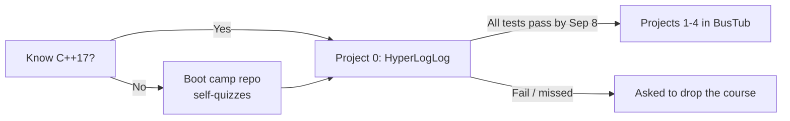

# 05 — Projects, BusTub & the C++ Requirement

## The project platform

- All projects are built in **BusTub**, the educational database system CMU has been developing for years, written in **C++** ([`10:04`](https://www.youtube.com/watch?v=otE2WvX3XdQ&t=604)).
- On the recurring "switch to Rust" request: there is too much existing code to move now; possibly considered in the future ([`10:04`](https://www.youtube.com/watch?v=otE2WvX3XdQ&t=604)).

## C++ is a prerequisite, not a topic

- You must already know C++ — the course does **not** teach it, and no CMU course strictly teaches C++ ("it's computer science, not a programming degree") ([`10:04`](https://www.youtube.com/watch?v=otE2WvX3XdQ&t=604)).
- Minimum: **C++17**, with some **C++23** elements appearing. If you don't know C++17, "stop what you're doing and start learning now" ([`11:49`](https://www.youtube.com/watch?v=otE2WvX3XdQ&t=709)).
- Support materials: a **boot camp repo**, a page of topics with self-quizzes, and a linked German (TUM) resource on systems programming in the context of databases ([`10:04`](https://www.youtube.com/watch?v=otE2WvX3XdQ&t=604), [`12:11`](https://www.youtube.com/watch?v=otE2WvX3XdQ&t=731), [`12:29`](https://www.youtube.com/watch?v=otE2WvX3XdQ&t=749)).
- Warning: don't plan to pick up C++ as you go — many have tried and failed, because the hard part is **debugging concurrent, multi-threaded C++**, not writing it ([`10:45`](https://www.youtube.com/watch?v=otE2WvX3XdQ&t=645)).

## Project 0 — the C++ gate

- Task: implement a **HyperLogLog** data structure. Deliberately simple; expected to take an hour or two ([`12:29`](https://www.youtube.com/watch?v=otE2WvX3XdQ&t=749), [`13:24`](https://www.youtube.com/watch?v=otE2WvX3XdQ&t=804)).
- Deadline: **Sunday, September 8** — within the first two weeks ([`10:45`](https://www.youtube.com/watch?v=otE2WvX3XdQ&t=645), [`12:29`](https://www.youtube.com/watch?v=otE2WvX3XdQ&t=749)).
- **Ungraded but mandatory**: you must pass all tests perfectly. Miss the deadline and you are asked to drop the course — no exceptions ([`12:29`](https://www.youtube.com/watch?v=otE2WvX3XdQ&t=749), [`13:24`](https://www.youtube.com/watch?v=otE2WvX3XdQ&t=804)).
- Outcome of this policy: after several years of running it, the course's **attrition rate has dropped significantly**, because students find out early whether they really know C++ ([`13:24`](https://www.youtube.com/watch?v=otE2WvX3XdQ&t=804)).

## Support

- Every project **except Project 0** gets an **online evening recitation** after release, covering key ideas and how to get started (CMU students only) ([`11:18`](https://www.youtube.com/watch?v=otE2WvX3XdQ&t=678)).

