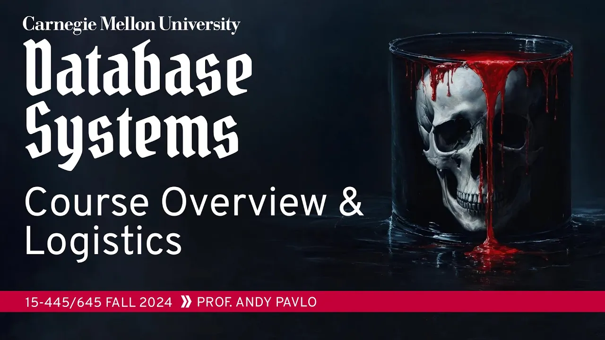
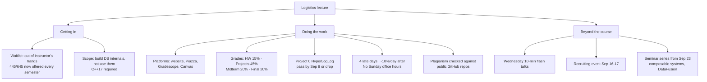

# #00 - Course Overview & Logistics (CMU Intro to Database Systems)

*CMU Database Group · 21:20 · [Watch on YouTube](https://www.youtube.com/watch?v=otE2WvX3XdQ)*

Andy Pavlov's logistics lecture for CMU 15-445/645 (Fall 2024), recorded ahead of the semester so the first real class can start immediately on the relational model. It covers what the course actually is — building the internals of a database system, not using or administering one — and every policy that governs it: waitlist reality, platforms (Piazza, Gradescope, Canvas), the 15/45/20/20 grade split, six homeworks, the BusTub C++ projects gated by a mandatory Project 0, office hours, late days, and plagiarism enforcement. It closes with the semester's extras: weekly industry flash talks, a September recruiting event, and an optional seminar series on composable database building blocks.

## Topics

1. [Waitlist & Enrollment](./01-waitlist-and-enrollment.md)
2. [Course Scope & Lecture Rules](./02-course-scope-and-lecture-rules.md)
3. [Platforms & Course Materials](./03-platforms-and-materials.md)
4. [Grading Breakdown & Homeworks](./04-grading-and-homeworks.md)
5. [Projects, BusTub & the C++ Requirement](./05-projects-bustub-and-cpp.md)
6. [Office Hours & Late Days](./06-office-hours-and-late-days.md)
7. [Academic Integrity](./07-academic-integrity.md)
8. [Industry Flash Talks & Recruiting](./08-flash-talks-and-recruiting.md)
9. ["Database Building Blocks" Seminar Series](./09-seminar-series-composable-systems.md)
10. [What Comes Next](./10-whats-next.md)

## Key takeaways

- The class is about implementing a DBMS, not operating one: after the SQL homework, students build their own database system, and applied "how to use/administer a database" courses live in Heinz College and SCS instead ([`4:09`](https://www.youtube.com/watch?v=otE2WvX3XdQ&t=249)).
- Enrollment pressure got resolved structurally, not individually: the instructor lost waitlist control to separate 445/645 administrators, but hiring Jignesh Patel means the course now runs **every semester** ([`1:39`](https://www.youtube.com/watch?v=otE2WvX3XdQ&t=99), [`2:09`](https://www.youtube.com/watch?v=otE2WvX3XdQ&t=129)).
- Grades are 15% homeworks, 45% projects, 20% midterm, 20% final — projects dominate because the course must qualify as a software systems elective; the class is curved, and leaderboard rank earns extra points ([`8:35`](https://www.youtube.com/watch?v=otE2WvX3XdQ&t=515), [`9:04`](https://www.youtube.com/watch?v=otE2WvX3XdQ&t=544)).
- The mandatory, ungraded Project 0 (a HyperLogLog in BusTub, all tests passing by **September 8**, or you're asked to drop) has **significantly reduced the course's attrition rate** over the years it has been used ([`12:29`](https://www.youtube.com/watch?v=otE2WvX3XdQ&t=749), [`13:24`](https://www.youtube.com/watch?v=otE2WvX3XdQ&t=804)).
- Plagiarism detection is concrete, not theoretical: public GitHub repos from non-CMU followers are collected and run through Gradescope's plagiarism checker — and those solutions are usually worse than CMU code anyway, per the leaderboards ([`7:26`](https://www.youtube.com/watch?v=otE2WvX3XdQ&t=446), [`15:45`](https://www.youtube.com/watch?v=otE2WvX3XdQ&t=945)).
- Deadline design deliberately discourages last-minute work: no Sunday office hours (only a TA power session the Saturday before each project), 4 automatic late days for projects only, -10%/day after that, and no exceptions for job interviews ([`14:08`](https://www.youtube.com/watch?v=otE2WvX3XdQ&t=848), [`14:56`](https://www.youtube.com/watch?v=otE2WvX3XdQ&t=896), [`15:26`](https://www.youtube.com/watch?v=otE2WvX3XdQ&t=926)).
