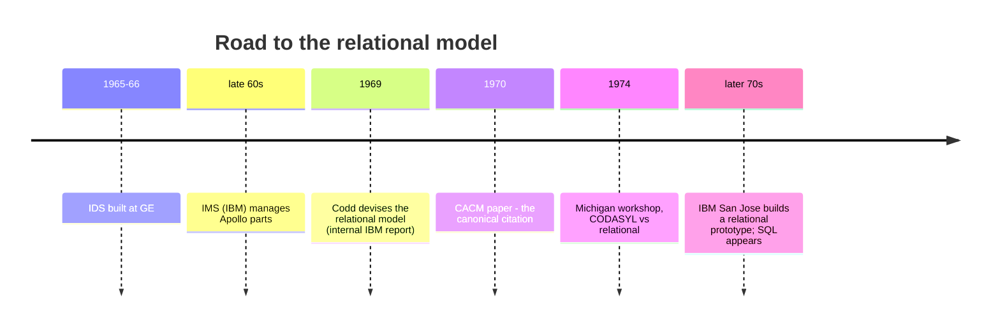

# 05 — Origins of the Relational Model

## The pre-relational world (1960s–early 70s)

| System | Year / origin | Notes |
| --- | --- | --- |
| **IDS** (Integrated Data Store) | Built by GE, ~1965–66 | The first database system ([`23:37`](https://www.youtube.com/watch?v=APqWIjtzNGE&t=1417)) |
| **IMS** | IBM, hierarchical | Built to manage the **Apollo moon mission** parts inventory ([`23:37`](https://www.youtube.com/watch?v=APqWIjtzNGE&t=1417)) |
| **CODASYL** | Out of the COBOL world, spun off IDS | Defined the API for interacting with a database ([`23:37`](https://www.youtube.com/watch?v=APqWIjtzNGE&t=1417)) |

Economics of the era: computers were expensive, human labor was cheap — so constant application rewrites were tolerable ([`23:37`](https://www.youtube.com/watch?v=APqWIjtzNGE&t=1417)).

## The core defect: logical/physical coupling

- Application code had to know the on-disk layout and manually traverse pointers between records ([`24:26`](https://www.youtube.com/watch?v=APqWIjtzNGE&t=1466)).
- Any schema change forced an application rewrite ([`24:26`](https://www.youtube.com/watch?v=APqWIjtzNGE&t=1466)).
- Concrete IMS example: you declared a table as a hash table *or* a B-tree. Realizing later that you need range scans (impossible on a hash table) meant dumping the data, reloading as a B-tree, **and rewriting all application code** because the table's API changed ([`24:26`](https://www.youtube.com/watch?v=APqWIjtzNGE&t=1466), [`25:07`](https://www.youtube.com/watch?v=APqWIjtzNGE&t=1507)).

## Ted Codd

- A mathematician (PhD in math) at IBM Research in New York, watching programmers repeat the same mundane rewrites ([`25:36`](https://www.youtube.com/watch?v=APqWIjtzNGE&t=1536)).
- Devised the **relational model in 1969**: an abstraction over a database based on *relations*, where connections between data are made through **values**, not physical pointers/offsets ([`25:36`](https://www.youtube.com/watch?v=APqWIjtzNGE&t=1536), [`26:11`](https://www.youtube.com/watch?v=APqWIjtzNGE&t=1571)).
- Papers: the 1969 internal IBM tech report, then the famous **1970 CACM paper** that people cite as the origin ([`26:11`](https://www.youtube.com/watch?v=APqWIjtzNGE&t=1571)).
- The first paper contained **no SQL at all** — pure mathematics and relational algebra ([`26:42`](https://www.youtube.com/watch?v=APqWIjtzNGE&t=1602)).

## IBM's reaction

- Academics loved it; IBM ignored it because IMS was hugely profitable and Codd was effectively telling them their cash cow was wrong ([`26:42`](https://www.youtube.com/watch?v=APqWIjtzNGE&t=1602)).
- IBM eventually acted — not in New York but in **San Jose**, building one of the first relational prototypes from Codd's paper ([`27:21`](https://www.youtube.com/watch?v=APqWIjtzNGE&t=1641)).

## The 1974 Michigan debate

- A famous workshop that put the CODASYL camp and the relational camp in one room to fight it out ([`28:09`](https://www.youtube.com/watch?v=APqWIjtzNGE&t=1689)).
- **Four Turing Award winners in databases were all present**, including Ted Codd; Bachman (the CODASYL/IDS side) and Jim Gray (two-phase locking) are both deceased ([`28:09`](https://www.youtube.com/watch?v=APqWIjtzNGE&t=1689)).
- Michael Stonebraker — Ingres, Postgres, and the instructor's PhD advisor — was there and is still alive, turning 81 ([`29:01`](https://www.youtube.com/watch?v=APqWIjtzNGE&t=1741)).

### Arguments exchanged

- **CODASYL side:** you cannot build a real system on relations; people won't understand relations/tables; a high-level language like SQL will never compile to an efficient program ([`29:01`](https://www.youtube.com/watch?v=APqWIjtzNGE&t=1741), [`29:29`](https://www.youtube.com/watch?v=APqWIjtzNGE&t=1769)).
- **Relational side:** walking records and physical data structures makes applications brittle — breaking one part of the database breaks everything relying on its physical integrity ([`29:43`](https://www.youtube.com/watch?v=APqWIjtzNGE&t=1783)).
- **Outcome:** nobody today has heard of CODASYL. The relational camp won ([`28:09`](https://www.youtube.com/watch?v=APqWIjtzNGE&t=1689), [`29:43`](https://www.youtube.com/watch?v=APqWIjtzNGE&t=1783)).
- Claim made in lecture: graph database advocates today are making the *same* arguments CODASYL made in the 70s ([`29:43`](https://www.youtube.com/watch?v=APqWIjtzNGE&t=1783)).

