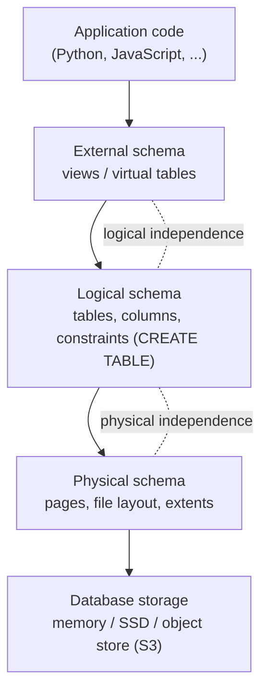

# 07 — Data Independence & Schema Levels

The idea: never expose the physical layout of data on a storage device to the application, which programs against a high-level abstraction instead ([`35:01`](https://www.youtube.com/watch?v=APqWIjtzNGE&t=2101)).

## The layer stack

| Level | What lives there |
| --- | --- |
| **Database storage** | Deliberately unspecified — in-memory, SSD, or an object store like S3; it does not matter ([`35:18`](https://www.youtube.com/watch?v=APqWIjtzNGE&t=2118)) |
| **Physical schema** | Page layouts and how bits sit within a page; how files are organized (one file? many? directories?); what extents look like and whether multiple pages pack into one ([`35:18`](https://www.youtube.com/watch?v=APqWIjtzNGE&t=2118), [`35:57`](https://www.youtube.com/watch?v=APqWIjtzNGE&t=2157)) |
| **Logical schema** | Tables, columns, constraints — typically declared via SQL `CREATE TABLE` ([`35:57`](https://www.youtube.com/watch?v=APqWIjtzNGE&t=2157)) |
| **External schema** | **Views** — virtual tables composed on top of real tables ([`36:16`](https://www.youtube.com/watch?v=APqWIjtzNGE&t=2176)) |
| **Application code** | Any language; interacts only with the abstractions above ([`36:59`](https://www.youtube.com/watch?v=APqWIjtzNGE&t=2219)) |

## Views: worked example

- One student-records table. Accounting needs the SSN but not the grades ([`36:16`](https://www.youtube.com/watch?v=APqWIjtzNGE&t=2176), [`36:37`](https://www.youtube.com/watch?v=APqWIjtzNGE&t=2197)).
- Create views so each application sees only its own subset of columns, even though physically it is the same table ([`36:37`](https://www.youtube.com/watch?v=APqWIjtzNGE&t=2197)).

## The two independences

- **Physical independence** — define tables and contents without caring how they are physically stored ([`36:59`](https://www.youtube.com/watch?v=APqWIjtzNGE&t=2219)).
- **Logical independence** — recompose logical tables differently per application/user, hiding the layer below ([`37:22`](https://www.youtube.com/watch?v=APqWIjtzNGE&t=2242)).

## Why this was radical

- CODASYL could not do it: application code had to follow the DBMS's pointers ([`37:38`](https://www.youtube.com/watch?v=APqWIjtzNGE&t=2258)).
- The relational model says there is **no notion of pointers** to the application — pointers still exist inside the implementation, they are just never exposed ([`37:38`](https://www.youtube.com/watch?v=APqWIjtzNGE&t=2258)).
- "It seems obvious now when you hear it, but back in the day this was groundbreaking" ([`37:58`](https://www.youtube.com/watch?v=APqWIjtzNGE&t=2278)).
