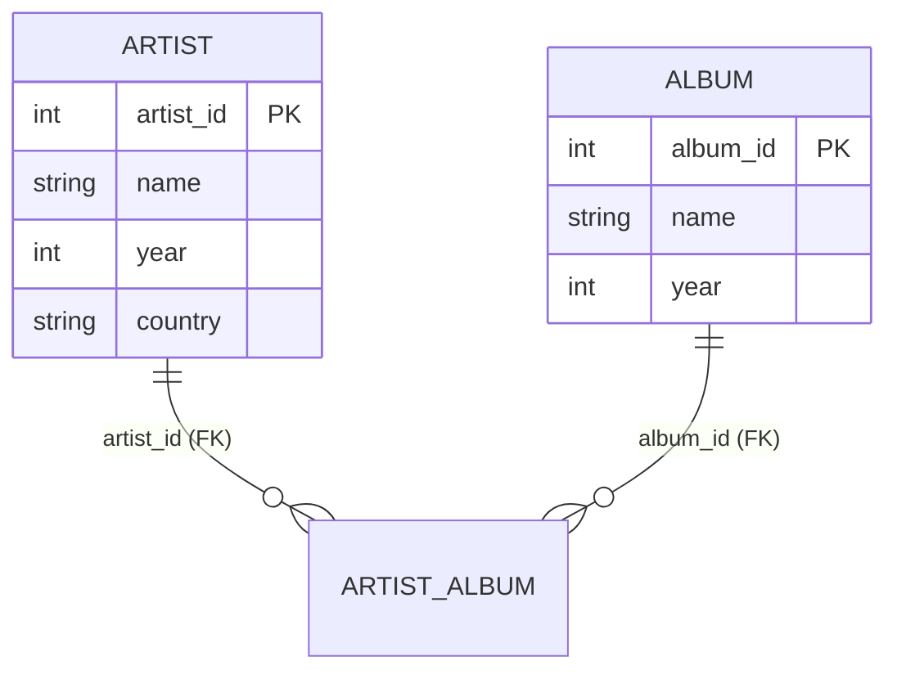

# 08 — Relations, Tuples, Keys & Constraints

## Relations and tuples

- A **relation** is an *unordered set* of attributes representing entities in the real world ([`37:58`](https://www.youtube.com/watch?v=APqWIjtzNGE&t=2278), [`38:24`](https://www.youtube.com/watch?v=APqWIjtzNGE&t=2304)).
- A **tuple** is one record — one entity instance (e.g. the Wu-Tang Clan in the artist relation) ([`38:24`](https://www.youtube.com/watch?v=APqWIjtzNGE&t=2304)).
  - The term "row" is avoided deliberately: "row" implies a row store, and column stores come later in the course ([`38:24`](https://www.youtube.com/watch?v=APqWIjtzNGE&t=2304)).
- **n-ary relation** = a relation with *n* attributes ≈ a table with *n* columns ([`39:22`](https://www.youtube.com/watch?v=APqWIjtzNGE&t=2362)).
- Original model: attribute values had to be **atomic/scalar** — no lists, no nested JSON. Since relaxed in the SQL standard and in most systems ([`39:01`](https://www.youtube.com/watch?v=APqWIjtzNGE&t=2341)).
- **NULL** is a special value meaning the attribute's value is *unknown*; relations may forbid it ([`39:22`](https://www.youtube.com/watch?v=APqWIjtzNGE&t=2362)).

## Primary keys

- A set of attributes that uniquely identifies one entity within a relation ([`39:59`](https://www.youtube.com/watch?v=APqWIjtzNGE&t=2399)).
- Using artist *name* as the primary key is convenient but wrong in the real world — artists share names ([`40:17`](https://www.youtube.com/watch?v=APqWIjtzNGE&t=2417), [`41:05`](https://www.youtube.com/watch?v=APqWIjtzNGE&t=2465)).
- Primary keys are optional in most relational DBMSs, and systems may quietly do their own thing ([`40:39`](https://www.youtube.com/watch?v=APqWIjtzNGE&t=2439)):
  - **SQLite** maintains its own internal incrementing primary key and treats *your* declared primary key as merely a unique constraint ([`41:05`](https://www.youtube.com/watch?v=APqWIjtzNGE&t=2465)).
- Fix: a **synthetic ID** — a monotonically incremented number (101, 102, 103) with no real-world meaning ([`41:28`](https://www.youtube.com/watch?v=APqWIjtzNGE&t=2488)).

### Naming across systems ([`41:28`](https://www.youtube.com/watch?v=APqWIjtzNGE&t=2488), [`41:53`](https://www.youtube.com/watch?v=APqWIjtzNGE&t=2513))

| System | Term |
| --- | --- |
| SQL standard | `IDENTITY` column |
| Postgres / Oracle | `SEQUENCE` |
| MySQL | `AUTO_INCREMENT` |

## Foreign keys

- Map attributes in one relation to another relation to declare that they are linked ([`41:53`](https://www.youtube.com/watch?v=APqWIjtzNGE&t=2513)).
- **Key contrast with CODASYL:** CODASYL followed literal pointers through memory or disk; the relational model links through **values** ([`42:17`](https://www.youtube.com/watch?v=APqWIjtzNGE&t=2537)).
- Many-to-many example: a mixtape has many artists, so the true relational form is a **cross-reference table** `(artist_id, album_id)`, with a foreign key to each side ([`42:17`](https://www.youtube.com/watch?v=APqWIjtzNGE&t=2537), [`42:48`](https://www.youtube.com/watch?v=APqWIjtzNGE&t=2568)).
- Enforcement cost: the DBMS typically needs an **index** on the referenced ID so it can quickly verify the referenced record exists on insert ([`43:22`](https://www.youtube.com/watch?v=APqWIjtzNGE&t=2602)).
- Foreign keys enable cascade deletes (remove an artist → find and remove their albums) or, conversely, blocking a delete that would break a reference ([`43:47`](https://www.youtube.com/watch?v=APqWIjtzNGE&t=2627)).
- Stated purpose: the DBMS "preventing you from shooting yourself in the foot" — everybody makes mistakes ([`44:09`](https://www.youtube.com/watch?v=APqWIjtzNGE&t=2649)).

## Constraints

- Define what data is allowed to look like — within one attribute, across attributes of a tuple, or across tuples in a relation ([`44:22`](https://www.youtube.com/watch?v=APqWIjtzNGE&t=2662)).
- Most common: **unique keys** and **foreign key references** ([`44:57`](https://www.youtube.com/watch?v=APqWIjtzNGE&t=2697)).
- Declared inline in the table definition, e.g. `name VARCHAR NOT NULL`, or `CHECK (year > 1900)` ([`44:57`](https://www.youtube.com/watch?v=APqWIjtzNGE&t=2697), [`45:33`](https://www.youtube.com/watch?v=APqWIjtzNGE&t=2733)).
- **Global assertions** (`CREATE ASSERTION`, SQL-1992) run a SQL statement on every modification. Rarely used and rarely implemented because they are extremely slow — a billion-tuple scan on every single update ([`44:57`](https://www.youtube.com/watch?v=APqWIjtzNGE&t=2697), [`45:33`](https://www.youtube.com/watch?v=APqWIjtzNGE&t=2733), [`46:07`](https://www.youtube.com/watch?v=APqWIjtzNGE&t=2767)).
