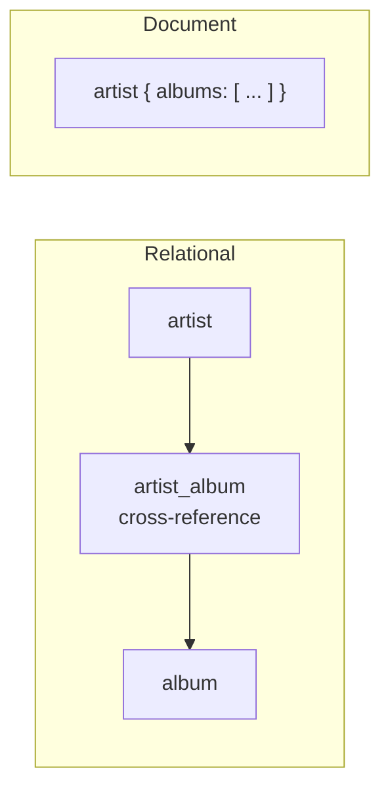

# 12 — Alternative Model: Document / JSON

## What it is

- A hierarchical collection of name/key–value pairs, where a document can nest arrays and other documents ([`1:05:04`](https://www.youtube.com/watch?v=APqWIjtzNGE&t=3904)).
- Lineage: **object-oriented databases** (late 80s / early 90s, mapping C++ objects into the database) → **XML** → **JSON** today ([`1:05:32`](https://www.youtube.com/watch?v=APqWIjtzNGE&t=3932), [`1:06:12`](https://www.youtube.com/watch?v=APqWIjtzNGE&t=3972)).
- Named systems: **MongoDB** (most famous), **Couchbase** second ([`1:06:12`](https://www.youtube.com/watch?v=APqWIjtzNGE&t=3972)).

## The problem it claims to solve

- **Relational-object impedance mismatch**: application code works in objects with rich structure, the database demands relations, and you must map back and forth ([`1:05:32`](https://www.youtube.com/watch?v=APqWIjtzNGE&t=3932)).
- Relational version of the music store needs `artist` → `artist_album` → `album`, i.e. a **join** to answer "give me this artist's albums" ([`1:06:26`](https://www.youtube.com/watch?v=APqWIjtzNGE&t=3986)).
- Document version embeds the album list inside the artist document, so the same question is **one lookup** ([`1:06:52`](https://www.youtube.com/watch?v=APqWIjtzNGE&t=4012), [`1:07:31`](https://www.youtube.com/watch?v=APqWIjtzNGE&t=4051)).

## Why the lecture rejects it as a default

Objections raised by students and confirmed ([`1:07:31`](https://www.youtube.com/watch?v=APqWIjtzNGE&t=4051)–[`1:08:38`](https://www.youtube.com/watch?v=APqWIjtzNGE&t=4118)):

- **You must predict the query pattern in advance** and model the database around it ([`1:07:55`](https://www.youtube.com/watch?v=APqWIjtzNGE&t=4075)).
- **Duplication**: if several artists appear on one album, the album is re-recorded inside each artist document ([`1:07:55`](https://www.youtube.com/watch?v=APqWIjtzNGE&t=4075)).
- **Reverse operations are painful**: deleting an album means finding every artist document containing it. An index helps, but the layout is still implicitly baked into the application ([`1:08:26`](https://www.youtube.com/watch?v=APqWIjtzNGE&t=4106)).

**Verdict:** sometimes you do want JSON in your database, but often you do not ([`1:08:38`](https://www.youtube.com/watch?v=APqWIjtzNGE&t=4118)).
