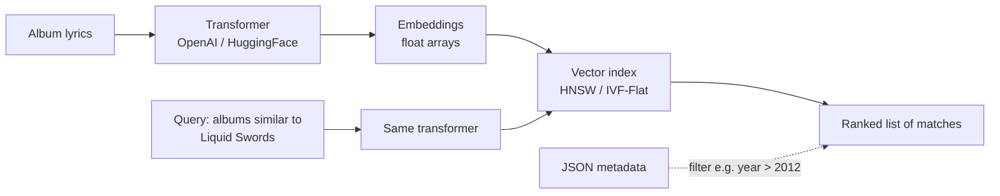

# 13 — Alternative Model: Vector Databases

## Definition given in lecture

> A vector database is really **a document database plus one extra data type** — a vector (embedding), i.e. a large array of floating-point numbers ([`1:09:11`](https://www.youtube.com/watch?v=APqWIjtzNGE&t=4151)).

- What it actually provides is **approximate nearest-neighbor (ANN) search** over those vectors ([`1:09:11`](https://www.youtube.com/watch?v=APqWIjtzNGE&t=4151), [`1:09:31`](https://www.youtube.com/watch?v=APqWIjtzNGE&t=4171)).
- "At the end of the day there's just a fast index to do approximate nearest neighbor search" ([`1:09:31`](https://www.youtube.com/watch?v=APqWIjtzNGE&t=4171)).

## The pipeline

- Index implementations named: **HNSW** (Hierarchical Navigable Small Worlds) — the most common — and **IVF-Flat**; libraries include Meta's **FAISS** and Spotify's **Annoy** ([`1:10:11`](https://www.youtube.com/watch?v=APqWIjtzNGE&t=4211), [`1:10:30`](https://www.youtube.com/watch?v=APqWIjtzNGE&t=4230)).
- Query flow: embed the query with the *same* transformer used at load time, run ANN search, get a ranked list ([`1:10:56`](https://www.youtube.com/watch?v=APqWIjtzNGE&t=4256)).
- Vector DBs also store metadata as JSON, letting you combine semantic search with predicates ("albums like Liquid Swords released after 2012") ([`1:10:56`](https://www.youtube.com/watch?v=APqWIjtzNGE&t=4256)).

## The argument against a separate system

- **Essentially all relational databases have added vector indexes in the past year** ([`1:11:30`](https://www.youtube.com/watch?v=APqWIjtzNGE&t=4290), [`1:16:11`](https://www.youtube.com/watch?v=APqWIjtzNGE&t=4571)).
- Nearest-neighbor search does not require throwing away everything the course teaches — it is an *extra thing* the relational model can accommodate ([`1:11:30`](https://www.youtube.com/watch?v=APqWIjtzNGE&t=4290)).
- Standards status: the SQL standard has **no** notion of nearest-neighbor search. Postgres shipped **pgvector** with its own API, Oracle copied it, and the lecturer expects it in the SQL standard within a few years ([`1:11:48`](https://www.youtube.com/watch?v=APqWIjtzNGE&t=4308)).

## Use cases (from Q&A)

- **Semantic search** rather than exact matching — "find albums similar to Liquid Swords" without defining what similar means ([`1:15:33`](https://www.youtube.com/watch?v=APqWIjtzNGE&t=4533)).
- The transformer supplies meaning: a query for "slinging rocks" can match content about dealing drugs ([`1:15:33`](https://www.youtube.com/watch?v=APqWIjtzNGE&t=4533)).
- Prior art was **fuzzy matching** (find albums containing the word "swords") — which has no understanding of semantics ([`1:16:11`](https://www.youtube.com/watch?v=APqWIjtzNGE&t=4571), [`1:16:49`](https://www.youtube.com/watch?v=APqWIjtzNGE&t=4609)).

## Is the transformer step too slow?

- Embedding generation takes **milliseconds, not seconds** ([`1:16:49`](https://www.youtube.com/watch?v=APqWIjtzNGE&t=4609), [`1:17:12`](https://www.youtube.com/watch?v=APqWIjtzNGE&t=4632)).
- Whether it beats an inverted index depends on the data, available memory, and many other factors — and on whether fuzzy search would have found the right answer at all ([`1:17:12`](https://www.youtube.com/watch?v=APqWIjtzNGE&t=4632), [`1:17:40`](https://www.youtube.com/watch?v=APqWIjtzNGE&t=4660)).
