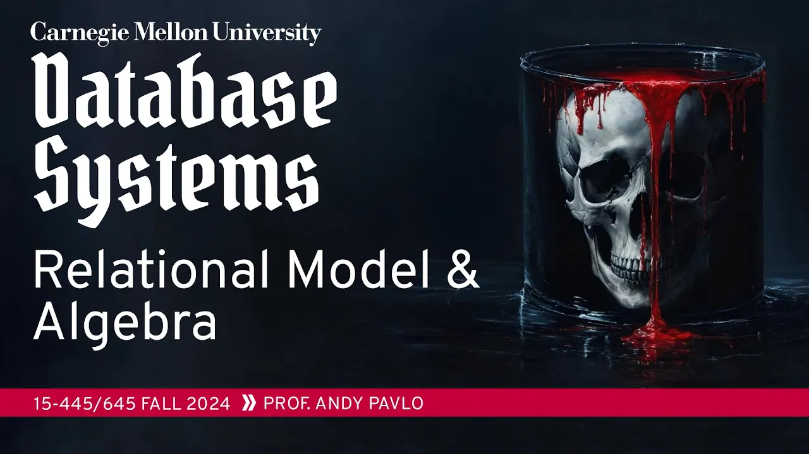
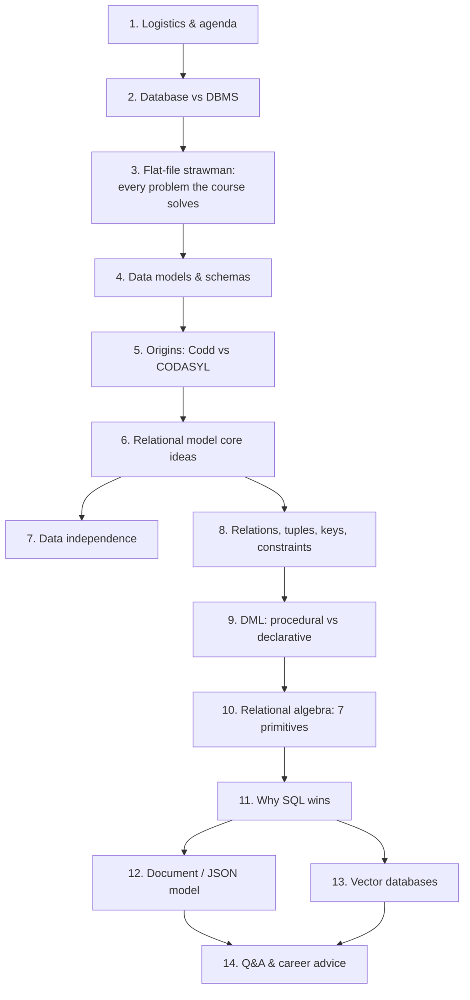

# #01 - Relational Model & Algebra (CMU Intro to Database Systems)

*CMU Database Group · 1:23:38 · [Watch on YouTube](https://www.youtube.com/watch?v=APqWIjtzNGE)*

## Summary

The opening technical lecture of CMU 15-445/645 (Fall 2024), taught by Andy Pavlo. It separates a *database* (an organized collection of data modeling the real world) from a *DBMS* (the software managing it), then uses a deliberately bad flat-CSV music store to enumerate every problem — scans, type errors, concurrency, crash recovery, replication — that the rest of the semester exists to solve. From there it traces the relational model from Ted Codd's 1970 paper through the CODASYL debates, explains data independence, relations, tuples, primary/foreign keys and constraints, and works through Codd's seven relational-algebra primitives with their SQL equivalents. It closes by arguing that declarative SQL beats hand-written relational algebra, and surveys the two live alternatives — document/JSON and vector databases — as things the relational model can absorb rather than replacements for it.

## Topic breakdown

1. [Course Logistics & Agenda](01-course-logistics-and-agenda.md) — housekeeping, tooling, and what the lecture will cover.
2. [Database vs. DBMS](02-database-vs-dbms.md) — definitions, why the distinction matters, SQLite's ubiquity.
3. [The Flat-File Strawman](03-flat-file-strawman.md) — the CSV music store and the eleven problems it exposes.
4. [DBMS, Data Models & Schemas](04-data-models-and-schemas.md) — what a general-purpose DBMS is, the catalogue of data models, and the NoSQL arc.
5. [Origins of the Relational Model](05-origins-of-the-relational-model.md) — IDS, IMS, CODASYL, Ted Codd, and the 1974 Michigan debate.
6. [The Relational Model: Core Ideas](06-relational-model-core-ideas.md) — three key ideas, three components, the compiler analogy.
7. [Data Independence & Schema Levels](07-data-independence.md) — physical/logical/external schemas and views.
8. [Relations, Tuples, Keys & Constraints](08-relations-tuples-and-keys.md) — tuples, NULL, primary keys, foreign keys, cross-reference tables, constraints.
9. [DML: Procedural vs. Declarative](09-dml-procedural-vs-declarative.md) — relational algebra vs. relational calculus.
10. [Relational Algebra: The Seven Primitives](10-relational-algebra-operators.md) — select, projection, union, intersection, difference, Cartesian product, join.
11. [Why SQL Beats Writing Relational Algebra](11-why-sql-wins-over-relational-algebra.md) — operator ordering, query-language history, keys at execution time.
12. [Alternative Model: Document / JSON](12-document-data-model.md) — impedance mismatch, embedding, and its costs.
13. [Alternative Model: Vector Databases](13-vector-databases.md) — embeddings, ANN indexes, pgvector.
14. [Q&A: Convergence, Career & Practical Advice](14-qa-and-career-advice.md) — DynamoDB's convergence, "always pick Postgres", the database job market.

## Key takeaways

- **The relational model's central innovation is linking data by *values*, not pointers.** CODASYL and IMS forced applications to traverse physical data structures, so any schema change — even switching a table from a hash table to a B-tree — required dumping the data and rewriting all application code ([`24:26`](https://www.youtube.com/watch?v=APqWIjtzNGE&t=1466), [`25:07`](https://www.youtube.com/watch?v=APqWIjtzNGE&t=1507), [`42:17`](https://www.youtube.com/watch?v=APqWIjtzNGE&t=2537)).
- **The relational camp won the 1974 Michigan debate outright.** Nobody today has heard of CODASYL, while the model Codd published in 1970 underpins nearly every system in production; the lecture claims graph-database advocates are now repeating CODASYL's arguments verbatim ([`28:09`](https://www.youtube.com/watch?v=APqWIjtzNGE&t=1689), [`29:43`](https://www.youtube.com/watch?v=APqWIjtzNGE&t=1783)).
- **Declarative beats procedural because only the DBMS can reorder operators.** The same join+filter expressed in relational algebra has dramatically different performance depending on whether the filter runs before or after the join — and relational algebra offers no way to let the system choose. The 1970s prediction that no optimizer could match a hand-written query plan failed exactly like the same prediction about C compilers ([`1:01:18`](https://www.youtube.com/watch?v=APqWIjtzNGE&t=3678), [`1:01:44`](https://www.youtube.com/watch?v=APqWIjtzNGE&t=3704), [`33:07`](https://www.youtube.com/watch?v=APqWIjtzNGE&t=1987)).
- **Codd's seven primitives are incomplete, and SQL diverges from the theory in practice.** They cover no sorting, aggregation, or `GROUP BY`; result ordering is undefined in both the model and SQL; and duplicate handling inverts — the relational model removes duplicates on union while SQL's `UNION ALL` keeps them ([`47:44`](https://www.youtube.com/watch?v=APqWIjtzNGE&t=2864), [`52:28`](https://www.youtube.com/watch?v=APqWIjtzNGE&t=3148), [`53:21`](https://www.youtube.com/watch?v=APqWIjtzNGE&t=3201)).
- **Joins are where DBMSs spend most of their query time**, making them the single largest optimization target of the course; explicit `JOIN ... ON` is preferred over `NATURAL JOIN`, which silently infers the condition and breaks when the schema evolves ([`58:32`](https://www.youtube.com/watch?v=APqWIjtzNGE&t=3512), [`59:49`](https://www.youtube.com/watch?v=APqWIjtzNGE&t=3589)).
- **Vector databases are a feature, not a category.** A vector database is a document database plus an embedding type and an ANN index (HNSW, IVF-Flat); within roughly a year essentially all relational databases added vector indexes, Postgres via pgvector, with Oracle copying that API and the SQL standard expected to follow ([`1:09:11`](https://www.youtube.com/watch?v=APqWIjtzNGE&t=4151), [`1:11:30`](https://www.youtube.com/watch?v=APqWIjtzNGE&t=4290), [`1:11:48`](https://www.youtube.com/watch?v=APqWIjtzNGE&t=4308)).
- **NoSQL systems converged back on relational features** — DynamoDB went key/value → JSON → tables queried with PartiQL — because customers wanted the guarantees the relational model provides. "NoSQL" itself was retconned from "no SQL" to "not only SQL" ([`1:13:33`](https://www.youtube.com/watch?v=APqWIjtzNGE&t=4413), [`1:14:00`](https://www.youtube.com/watch?v=APqWIjtzNGE&t=4440), [`20:53`](https://www.youtube.com/watch?v=APqWIjtzNGE&t=1253)).
- **Practical recommendation: default to Postgres**, in interviews and in startups alike, so you spend your time building the application instead of choosing a database — no user knows or cares what you run underneath ([`1:18:19`](https://www.youtube.com/watch?v=APqWIjtzNGE&t=4699)).

---

The full [transcript](transcript.md) is included in this folder.
