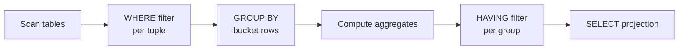

# 03 — Aggregations, GROUP BY and HAVING

## What an aggregate is

- A function that collapses a **bag of tuples into a single value** ([`11:23`](https://www.youtube.com/watch?v=MzigBKf84aY&t=683)).
- The **core five**: `AVG`, `MIN`, `MAX`, `SUM`, `COUNT`. Systems add extras (standard deviation, geometric mean, ...) ([`11:41`](https://www.youtube.com/watch?v=MzigBKf84aY&t=701)).
- **UDAs (user-defined aggregates)** let you extend the system with computations the standard lacks. This extensibility was one of PostgreSQL's original 1980s ideas and is a recurring theme in the course ([`11:41`](https://www.youtube.com/watch?v=MzigBKf84aY&t=701)).

## COUNT's argument is meaningless

- `COUNT(login)`, `COUNT(*)`, `COUNT(1)`, even `COUNT(1+1+1)` all produce the **same answer** — you are counting tuples, not evaluating the expression. A correct system just ignores the computation ([`12:32`](https://www.youtube.com/watch?v=MzigBKf84aY&t=752), [`12:59`](https://www.youtube.com/watch?v=MzigBKf84aY&t=779)).

## LIKE wildcards

- `%` matches **any substring, including the empty string**; `_` matches **exactly one character** ([`12:32`](https://www.youtube.com/watch?v=MzigBKf84aY&t=752), [`24:51`](https://www.youtube.com/watch?v=MzigBKf84aY&t=1491)).
- `LIKE '@cs'` without a wildcard attempts a **whole-string match**; `LIKE '%@cs'` is what finds the CS logins ([`14:26`](https://www.youtube.com/watch?v=MzigBKf84aY&t=866)).
- Regular expressions exist in some systems, but `LIKE` is the base SQL syntax ([`12:32`](https://www.youtube.com/watch?v=MzigBKf84aY&t=752)).

## The illegal-projection demo

The query `SELECT AVG(gpa), cid FROM enrolled AS e, student AS s WHERE ...` is **not valid**: the aggregate collapses every tuple to one value, so the system has no idea *which* `cid` you want ([`13:44`](https://www.youtube.com/watch?v=MzigBKf84aY&t=824), [`15:04`](https://www.youtube.com/watch?v=MzigBKf84aY&t=904)).

Modern SQL adds `ANY_VALUE(...)` to say explicitly "I don't care which one" ([`15:04`](https://www.youtube.com/watch?v=MzigBKf84aY&t=904)).

### Live results across seven systems

| System | Behavior on the illegal projection |
| --- | --- |
| PostgreSQL | **Errors**; accepts it with `ANY_VALUE` ([`16:00`](https://www.youtube.com/watch?v=MzigBKf84aY&t=960)) |
| MySQL | **Returns an answer anyway** — "one of the biggest offenders"; errors only in `ANSI` / strict `sql_mode` ([`16:26`](https://www.youtube.com/watch?v=MzigBKf84aY&t=986), [`16:43`](https://www.youtube.com/watch?v=MzigBKf84aY&t=1003)) |
| SQLite | **Returns an answer** ([`17:21`](https://www.youtube.com/watch?v=MzigBKf84aY&t=1041)) |
| DuckDB | Errors like Postgres, **and suggests `ANY_VALUE` in the error message** — praised as the best UX ([`17:21`](https://www.youtube.com/watch?v=MzigBKf84aY&t=1041)) |
| Oracle | Fails first on something unrelated: **`AS` for table aliases is rejected** ("SQL command not properly ended"); remove it and it then complains about the aggregate ([`17:44`](https://www.youtube.com/watch?v=MzigBKf84aY&t=1064)) |
| SQL Server | Errors (correct) ([`18:16`](https://www.youtube.com/watch?v=MzigBKf84aY&t=1096)) |
| ClickHouse | Errors (correct) ([`18:16`](https://www.youtube.com/watch?v=MzigBKf84aY&t=1096)) |

Takeaway: one trivial query, and the seven systems already diverge ([`18:16`](https://www.youtube.com/watch?v=MzigBKf84aY&t=1096)).

## GROUP BY

- `GROUP BY cid` buckets the rows by course, then computes the aggregate per bucket ([`18:16`](https://www.youtube.com/watch?v=MzigBKf84aY&t=1096), [`18:57`](https://www.youtube.com/watch?v=MzigBKf84aY&t=1137)).
- Multiple columns are allowed → multi-dimensional aggregation ([`19:10`](https://www.youtube.com/watch?v=MzigBKf84aY&t=1150)).
- **Rule**: anything in the output projection that is not aggregated must appear in the `GROUP BY` clause — otherwise you need `ANY_VALUE` ([`19:10`](https://www.youtube.com/watch?v=MzigBKf84aY&t=1150), [`19:29`](https://www.youtube.com/watch?v=MzigBKf84aY&t=1169)).

## HAVING

- `HAVING` is "a WHERE clause for GROUP BY" — it filters **after** aggregation ([`19:29`](https://www.youtube.com/watch?v=MzigBKf84aY&t=1169)).
- You **cannot** filter on an aggregate in `WHERE`, because when the engine evaluates tuples the aggregate has not been computed yet — it happens later in the query plan ([`20:02`](https://www.youtube.com/watch?v=MzigBKf84aY&t=1202)).
- **Aliases in HAVING are not portable**: MySQL lets you reference the `SELECT` alias (`avg_gpa`), PostgreSQL does not — you must repeat the whole `AVG(...)` expression ([`20:28`](https://www.youtube.com/watch?v=MzigBKf84aY&t=1228)).
- In theory the optimizer should recognize the repeated expression and compute it once ([`20:28`](https://www.youtube.com/watch?v=MzigBKf84aY&t=1228)).

## Why it matters

Aggregation is how you **derive new facts from data you already collected** — at a high level, this is what data scientists and analysts do to see larger trends ([`21:15`](https://www.youtube.com/watch?v=MzigBKf84aY&t=1275), [`21:42`](https://www.youtube.com/watch?v=MzigBKf84aY&t=1302)).
