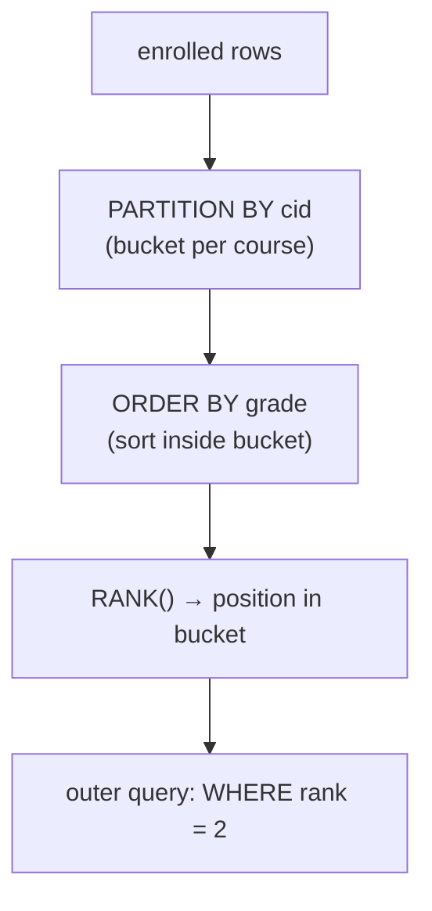

# 07 — Window functions

## The core idea

- An aggregation **that does not collapse the tuples**: you compute a rolling aggregate while still retaining every row in the output, updating the aggregate as you go ([`42:59`](https://www.youtube.com/watch?v=MzigBKf84aY&t=2579)).
- Added to the standard roughly in the last 20 years ([`42:59`](https://www.youtube.com/watch?v=MzigBKf84aY&t=2579)).
- Typical uses: **rankings, moving averages, running totals, row numbers** ([`43:34`](https://www.youtube.com/watch?v=MzigBKf84aY&t=2614)).
- Extremely common in **time-series analysis**, e.g. a moving average of a stock price ([`43:34`](https://www.youtube.com/watch?v=MzigBKf84aY&t=2614)).

## Anatomy

```sql
SELECT *, <func>() OVER (PARTITION BY <col> ORDER BY <col>)
FROM   <table>
```

- The function is either a normal aggregate (`MIN`, `MAX`, `AVG`, `SUM`, `COUNT`) or a **window-specific** one ([`44:13`](https://www.youtube.com/watch?v=MzigBKf84aY&t=2653)).
- The `OVER` clause specifies how to slice, group and sort — think of it as a `GROUP BY`, but the keyword is **`PARTITION BY`** ([`43:34`](https://www.youtube.com/watch?v=MzigBKf84aY&t=2614), [`44:59`](https://www.youtube.com/watch?v=MzigBKf84aY&t=2699)).
- `ORDER BY` inside `OVER` sorts the partition **before** the window function is computed ([`45:25`](https://www.youtube.com/watch?v=MzigBKf84aY&t=2725)).

## The two special functions

| Function | Meaning |
| --- | --- |
| `ROW_NUMBER()` | The **position of the tuple in the output**. Notable because SQL is bag-based and has no inherent order ([`44:13`](https://www.youtube.com/watch?v=MzigBKf84aY&t=2653)) |
| `RANK()` | The position **within the sort order** ([`44:13`](https://www.youtube.com/watch?v=MzigBKf84aY&t=2653)) |

- With `PARTITION BY cid`, the row number **resets** every time it crosses into a new bucket ([`45:25`](https://www.youtube.com/watch?v=MzigBKf84aY&t=2725)).
- `RANK` handles **ties by skipping**: in the live demo two students both got an A in course 721, so both received rank **1**, and the next record started at **3** — there is no rank 2 ([`48:40`](https://www.youtube.com/watch?v=MzigBKf84aY&t=2920)).
- Rank offsets **start at 1** ([`46:55`](https://www.youtube.com/watch?v=MzigBKf84aY&t=2815)).

## Why you need them: "second-highest grade per course"

- This query is **impossible without a window function**: inside SQL there is no way to say "I am the second one." `ORDER BY` sends ordered rows to the client, but the query itself cannot reference a position ([`45:53`](https://www.youtube.com/watch?v=MzigBKf84aY&t=2753), [`46:18`](https://www.youtube.com/watch?v=MzigBKf84aY&t=2778)).
- Construction: partition by `cid`, order by `grade`, compute `RANK()` in an inner query, then filter `WHERE rank = 2` in the **outer** query — i.e. it requires a nested query ([`46:30`](https://www.youtube.com/watch?v=MzigBKf84aY&t=2790), [`46:55`](https://www.youtube.com/watch?v=MzigBKf84aY&t=2815)).
- Sorting direction matters: since the demo grades are **letters** (A, B, C), `ASC` puts A first; a student pointed out `DESC` would be needed for numeric grades ([`47:14`](https://www.youtube.com/watch?v=MzigBKf84aY&t=2834), [`47:34`](https://www.youtube.com/watch?v=MzigBKf84aY&t=2854)).



## Support across the seven systems

Tested live ([`48:58`](https://www.youtube.com/watch?v=MzigBKf84aY&t=2938)–[`49:51`](https://www.youtube.com/watch?v=MzigBKf84aY&t=2991)):

| System | Works |
| --- | --- |
| PostgreSQL | Yes |
| SQLite | Yes |
| DuckDB | Yes |
| SQL Server | Yes |
| ClickHouse | Yes |
| **MySQL** | **No** |
| **Oracle** | **No** (again tripped by the `AS` alias) |

Historical note: when the course first ran this demo, **most** of these systems could not do it at all ([`48:58`](https://www.youtube.com/watch?v=MzigBKf84aY&t=2938)).
