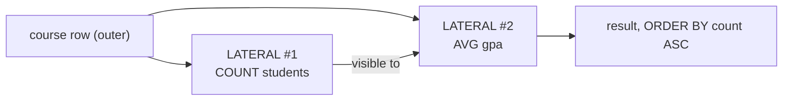

# 09 — Lateral joins

> Explicitly flagged as **required for Homework 1** ([`1:05:26`](https://www.youtube.com/watch?v=MzigBKf84aY&t=3926)).

## The limitation they solve

With ordinary nested queries ([`1:05:55`](https://www.youtube.com/watch?v=MzigBKf84aY&t=3955)):

- The **inner** query may reference the outer query's tuples.
- The **outer** query **cannot** reference the inner query's tuples — the inner runs first and nothing is materialized until it finishes.
- **Sibling** nested queries cannot see into each other. You are stuck with strict tree nesting.

## What LATERAL does

The `LATERAL` keyword lets a query in the `FROM` clause **reference attributes produced by the nested queries that appear before it** ([`1:05:55`](https://www.youtube.com/watch?v=MzigBKf84aY&t=3955)).

Minimal example ([`1:06:37`](https://www.youtube.com/watch?v=MzigBKf84aY&t=3997), [`1:07:45`](https://www.youtube.com/watch?v=MzigBKf84aY&t=4065)):

```sql
SELECT * FROM (SELECT 1 AS x) AS t1,
              LATERAL (SELECT t1.x + 1 AS y) AS t2;
```

- `(SELECT 1 AS x) AS t1` synthesizes a virtual one-row, one-column table.
- Without `LATERAL`, PostgreSQL errors because `t1` is not visible — and helpfully **tells you to use `LATERAL`** ([`1:08:15`](https://www.youtube.com/watch?v=MzigBKf84aY&t=4095)).

## The conceptual tension

`LATERAL` imposes an **ordering** on evaluation, which sits oddly with SQL's declarative nature. The point is only that *conceptually* one part must be computed before the other; the system remains free to run them in parallel or rewrite them as joins ([`1:06:57`](https://www.youtube.com/watch?v=MzigBKf84aY&t=4017), [`1:07:21`](https://www.youtube.com/watch?v=MzigBKf84aY&t=4041)).

Student question — "is it like creating a temp table from the subquery and then joining?" Answer: **conceptually yes**, but the essential part is the forced ordering, and the system may still rewrite it into joins. If you want to know what it really does, call `EXPLAIN` ([`1:11:26`](https://www.youtube.com/watch?v=MzigBKf84aY&t=4286), [`1:11:44`](https://www.youtube.com/watch?v=MzigBKf84aY&t=4304), [`1:12:25`](https://www.youtube.com/watch?v=MzigBKf84aY&t=4345)).

## Support across the seven systems

([`1:08:33`](https://www.youtube.com/watch?v=MzigBKf84aY&t=4113))

| System | Support |
| --- | --- |
| PostgreSQL | Yes |
| MySQL | Yes |
| DuckDB | Yes |
| **SQLite** | **No** |
| **Oracle** | **No** (the `AS` alias problem again) |
| SQL Server | No `LATERAL` keyword — uses **`CROSS APPLY`**, which is equivalent |
| **ClickHouse** | **No** |

### Syntax wrinkle

PostgreSQL (and the standard) require a **comma** before `LATERAL`; SQL Server's `CROSS APPLY` takes **no comma**. Speculation: SQL Server shipped this first and the standard later deviated ([`1:09:03`](https://www.youtube.com/watch?v=MzigBKf84aY&t=4143), [`1:09:16`](https://www.youtube.com/watch?v=MzigBKf84aY&t=4156)).

## The realistic example

Goal: per course, compute the **number of enrolled students** and the **average GPA** of those students, then sort by enrollment count ascending ([`1:09:29`](https://www.youtube.com/watch?v=MzigBKf84aY&t=4169), [`1:09:53`](https://www.youtube.com/watch?v=MzigBKf84aY&t=4193)).

Structure: **two lateral subqueries**.

1. The first references the outer `course` row to count students.
2. The second references **both** the outer row **and the output of the first lateral** to compute the average GPA.

Mental model: "a way to have **for-loops inside SQL** executed in order" ([`1:10:25`](https://www.youtube.com/watch?v=MzigBKf84aY&t=4225)).


