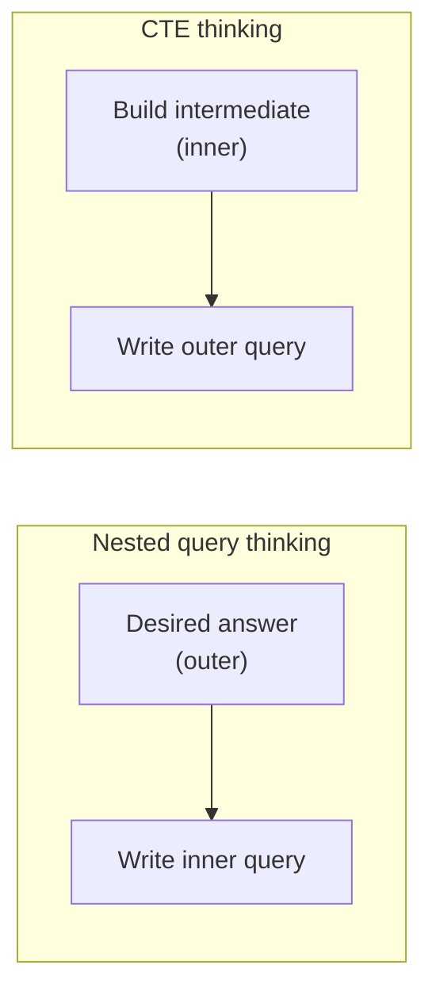

# 10 — Common table expressions (CTEs)

## What a CTE is

- A **temp table defined inside the query**, whose scope is only that query, referenceable from other parts of the same statement ([`1:10:51`](https://www.youtube.com/watch?v=MzigBKf84aY&t=4251)).
- Minimal example: a CTE whose body is `SELECT 1` produces a single unnamed-column tuple, which the main `SELECT` then references **as if it were a table** ([`1:10:51`](https://www.youtube.com/watch?v=MzigBKf84aY&t=4251), [`1:11:26`](https://www.youtube.com/watch?v=MzigBKf84aY&t=4286)).
- Syntax binds an **alias plus optional column names**: `WITH cte_name (col1, col2) AS (...)`, then reference `cte_name` below ([`1:14:14`](https://www.youtube.com/watch?v=MzigBKf84aY&t=4454)).
- PostgreSQL quirk: it lets you give a CTE the **same name** as an existing table and still works; MySQL does not. Advice: **don't do it** ([`1:14:36`](https://www.youtube.com/watch?v=MzigBKf84aY&t=4476)).

## CTEs vs temp tables

Student question: aren't temp tables the same thing? ([`1:12:44`](https://www.youtube.com/watch?v=MzigBKf84aY&t=4364))

| | Lifetime |
| --- | --- |
| **Temp table** | Persists for the **session** — create it, populate it, run many queries against it; destroyed when the session closes |
| **CTE / nested query** | Lifetime is **that single query only** |

Follow-up: if temp tables read cleaner (a "helper function" defined outside the query), why not always use them? Answer: **it depends** ([`1:13:17`](https://www.youtube.com/watch?v=MzigBKf84aY&t=4397), [`1:13:48`](https://www.youtube.com/watch?v=MzigBKf84aY&t=4428)):

- **Temp table wins** when several queries hit the same intermediate result — you avoid **re-materializing it over and over**.
- **Single query wins** when you want to hand the optimizer everything at once so it can find the best global plan.

## CTEs vs nested queries — a direction-of-thinking difference

Rewriting "find the student with the highest ID enrolled in at least one course" as a CTE: put `MAX(sid) FROM enrolled` in the CTE, then join against it. It gets rewritten as a join anyway ([`1:14:51`](https://www.youtube.com/watch?v=MzigBKf84aY&t=4491), [`1:15:06`](https://www.youtube.com/watch?v=MzigBKf84aY&t=4506)).

The real distinction is how you compose the query ([`1:15:06`](https://www.youtube.com/watch?v=MzigBKf84aY&t=4506)):

- **Nested query**: start from the **outer** query — state the answer you want, then work out the inner query.
- **CTE**: start from the **inner** query — build the intermediate result first, then write the outer part around it.

Same problem, different mental entry point ([`1:15:30`](https://www.youtube.com/watch?v=MzigBKf84aY&t=4530)).

