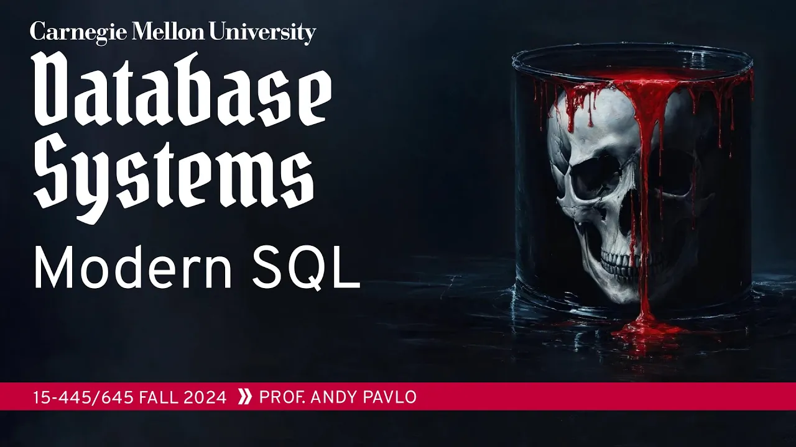
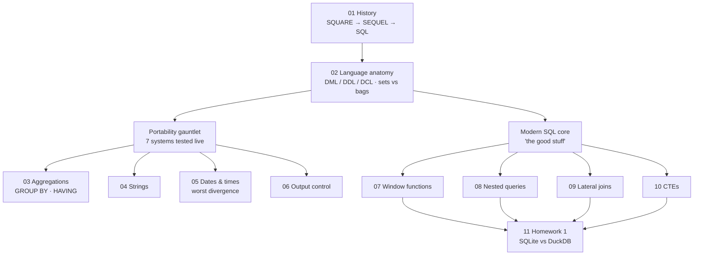

# #02 - Modern SQL (CMU Intro to Database Systems)

> **CMU Database Group** · 1:18:44 · [Watch on YouTube](https://www.youtube.com/watch?v=MzigBKf84aY)
> Content type: **university lecture (educational)** — CMU 15-445/645, Fall 2024, Lecture 02.

## Summary

The only lecture of the semester that looks at databases from the *application* side, this class covers "modern SQL": the features beyond SQL-92 that let you push complex computation into a single query instead of shuttling data back and forth to application code. After a short history of the language — SQUARE, SEQUEL, System R, the ANSI/ISO standards and the 2023 revision — it works through aggregations and `GROUP BY`/`HAVING`, string and date/time handling, window functions, nested queries, lateral joins and common table expressions. Every feature is demonstrated **live against seven database systems simultaneously** (PostgreSQL, MySQL, SQLite, DuckDB, SQL Server, Oracle, ClickHouse), which turns the lecture into a running exposé of how far real engines diverge from the standard and from each other.

## Topics

1. [History of SQL and why it is not dying](./01-history-of-sql.md)
2. [Anatomy of the SQL language: DML, DDL, DCL, and bags](./02-sql-language-anatomy.md)
3. [Aggregations, GROUP BY and HAVING](./03-aggregations-and-group-by.md)
4. [String operations](./04-string-operations.md)
5. [Date and time operations: the portability disaster](./05-date-and-time-operations.md)
6. [Output control and redirection](./06-output-control-and-redirection.md)
7. [Window functions](./07-window-functions.md)
8. [Nested queries](./08-nested-queries.md)
9. [Lateral joins](./09-lateral-joins.md)
10. [Common table expressions (CTEs)](./10-common-table-expressions.md)
11. [Conclusion and Homework 1](./11-conclusion-and-homework.md)

## Key takeaways

- **Standard compliance is a myth in practice.** A single illegal query — a non-aggregated `cid` next to `AVG(gpa)` — produced seven different outcomes: PostgreSQL, DuckDB, SQL Server and ClickHouse error correctly; **MySQL and SQLite silently return an answer**; Oracle fails first on the unrelated `AS` table alias. MySQL only errors once you switch its `sql_mode` to ANSI ([`16:00`](https://www.youtube.com/watch?v=MzigBKf84aY&t=960), [`17:21`](https://www.youtube.com/watch?v=MzigBKf84aY&t=1041), [`18:16`](https://www.youtube.com/watch?v=MzigBKf84aY&t=1096)).
- **Dates and times are the worst offender.** Counting the 240 days from Jan 1 to Aug 28 required a *different* idiom in each engine: Postgres/DuckDB cast-and-subtract, MySQL `DATEDIFF` or Unix timestamps (its raw date subtraction returns a nonsense number that concatenates month and day differences, decoded years later by a **YouTube commenter**), Oracle needs an explicit format mask and the magic **`DUAL`** table because it cannot run a `FROM`-less query, SQL Server needs `CAST` and returns negatives if the arguments are reversed, and SQLite needs conversion to the **Julian calendar** ([`27:03`](https://www.youtube.com/watch?v=MzigBKf84aY&t=1623), [`34:11`](https://www.youtube.com/watch?v=MzigBKf84aY&t=2051), [`30:35`](https://www.youtube.com/watch?v=MzigBKf84aY&t=1835), [`39:00`](https://www.youtube.com/watch?v=MzigBKf84aY&t=2340)).
- **Window functions are not optional syntax sugar — some queries are impossible without them.** Because SQL is bag-based with no notion of position, "the student with the second-highest grade per course" cannot be expressed without `RANK() OVER (PARTITION BY ... ORDER BY ...)`. Five of seven systems ran it; **MySQL and Oracle could not** ([`45:53`](https://www.youtube.com/watch?v=MzigBKf84aY&t=2753), [`49:51`](https://www.youtube.com/watch?v=MzigBKf84aY&t=2991)).
- **Correlated nested queries are what break query optimizers**, and only **two systems handle arbitrary subqueries correctly: Umbra/CedarDB and DuckDB** (which implemented Umbra's published techniques, with CMU students contributing lateral-join patches). The naive fallback — re-running the inner query once per outer tuple — is what MySQL historically did, and `EXPLAIN` shows PostgreSQL choosing a nested loop join while MySQL rewrites to an index nested loop join ([`52:19`](https://www.youtube.com/watch?v=MzigBKf84aY&t=3139), [`52:54`](https://www.youtube.com/watch?v=MzigBKf84aY&t=3174), [`57:22`](https://www.youtube.com/watch?v=MzigBKf84aY&t=3442), [`58:18`](https://www.youtube.com/watch?v=MzigBKf84aY&t=3498)).
- **The whole point of modern SQL is to keep computation inside one query** rather than round-tripping between application and server — and the claim is that SQL, top-ranked in the 2023 IEEE survey, is not being replaced: LLMs are useful for a *first approximation* of a query, but you still need the judgment to verify it ([`1:16:27`](https://www.youtube.com/watch?v=MzigBKf84aY&t=4587), [`1:16:00`](https://www.youtube.com/watch?v=MzigBKf84aY&t=4560), [`7:00`](https://www.youtube.com/watch?v=MzigBKf84aY&t=420)).
- **Homework 1 sets up the rest of the semester**: implement ~5 queries in both SQLite and DuckDB, starting with DuckDB. **DuckDB will be much faster**, and explaining why is what the internals half of the course is for ([`1:16:27`](https://www.youtube.com/watch?v=MzigBKf84aY&t=4587), [`1:16:55`](https://www.youtube.com/watch?v=MzigBKf84aY&t=4615)).

---

The full [transcript](./transcript.md) is kept alongside these notes.
