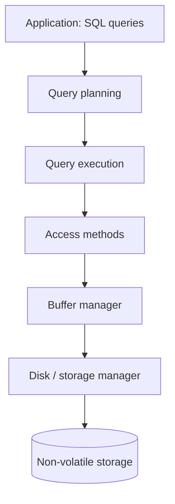

# 01 - Course Roadmap and System Layers

## Where this lecture sits

- From this lecture on, the course stops discussing the logical level (relational model, relational algebra, SQL) and starts building the **internals** of a DBMS, beginning at the very bottom: files and pages on disk ([`0:05`](https://www.youtube.com/watch?v=dSxV5Sob5V8&t=5)).
- The relational model is revisited only to understand how to implement something that supports it ([`1:54`](https://www.youtube.com/watch?v=dSxV5Sob5V8&t=114)).
- The course walks the system **in reverse implementation order**: disk/storage layer first, then upward to query execution and planning ([`2:21`](https://www.youtube.com/watch?v=dSxV5Sob5V8&t=141)).

## The layered system being built

- Each layer abstracts away details and exposes an API to the layers above and below — the same approach used by operating systems and applications ([`2:42`](https://www.youtube.com/watch?v=dSxV5Sob5V8&t=162), [`2:58`](https://www.youtube.com/watch?v=dSxV5Sob5V8&t=178)).
- Layers, bottom to top ([`2:58`](https://www.youtube.com/watch?v=dSxV5Sob5V8&t=178), [`3:19`](https://www.youtube.com/watch?v=dSxV5Sob5V8&t=199)):

- If all data is in memory the disk manager may be skipped, but the system can never assume that case ([`3:19`](https://www.youtube.com/watch?v=dSxV5Sob5V8&t=199), [`3:43`](https://www.youtube.com/watch?v=dSxV5Sob5V8&t=223)).

## Lecture plan

- This lecture and the next two cover the storage level: what the bits look like on disk, what files contain, what pages contain, what tuples look like ([`3:43`](https://www.youtube.com/watch?v=dSxV5Sob5V8&t=223), [`4:09`](https://www.youtube.com/watch?v=dSxV5Sob5V8&t=249)).
- Order for today: disk-oriented background → files → pages → tuples ([`4:09`](https://www.youtube.com/watch?v=dSxV5Sob5V8&t=249)).
- Every Wednesday there is a 10-minute **flash talk**; today's is Neon, presented by a former Postgres developer and Neon co-founder ([`4:30`](https://www.youtube.com/watch?v=dSxV5Sob5V8&t=270)).

## Class logistics

- Homework 1 (SQL queries in DuckDB and SQLite) and Project 0 are due Sunday at midnight; ~100 of 130 students had already finished Project 0 ([`0:41`](https://www.youtube.com/watch?v=dSxV5Sob5V8&t=41), [`1:06`](https://www.youtube.com/watch?v=dSxV5Sob5V8&t=66)).
- Project 1 — implementing a **buffer pool manager** — is released the following week and is graded ([`1:06`](https://www.youtube.com/watch?v=dSxV5Sob5V8&t=66)).
