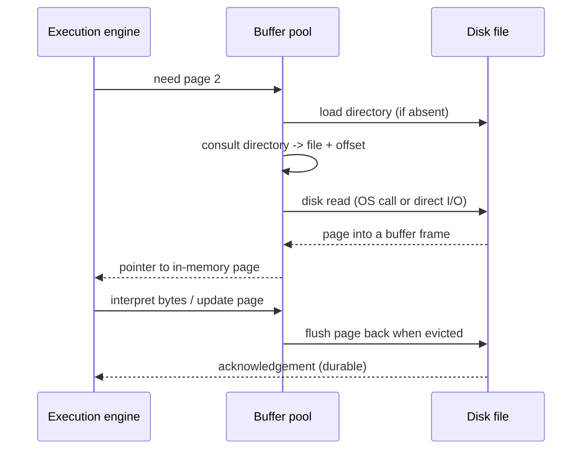

# 04 - Anatomy of a Disk-Oriented DBMS

## The pieces

- **Database file(s)** on disk: databases are just ordinary files; the OS sees nothing special about them ([`19:49`](https://www.youtube.com/watch?v=dSxV5Sob5V8&t=1189), [`20:11`](https://www.youtube.com/watch?v=dSxV5Sob5V8&t=1211)).
- **Directory**: metadata at the start of the file describing what the file contains — effectively a lookup table for locating a page ([`20:11`](https://www.youtube.com/watch?v=dSxV5Sob5V8&t=1211), [`20:26`](https://www.youtube.com/watch?v=dSxV5Sob5V8&t=1226), [`21:33`](https://www.youtube.com/watch?v=dSxV5Sob5V8&t=1293)).
- **Pages (a.k.a. blocks)**: the file split at typically fixed offsets so you can jump quickly ([`20:26`](https://www.youtube.com/watch?v=dSxV5Sob5V8&t=1226)).
- **Buffer pool** (buffer manager / cache manager, names vary by system): DBMS-managed memory holding pages brought in from disk ([`20:52`](https://www.youtube.com/watch?v=dSxV5Sob5V8&t=1252)).
- **Execution engine**: the query engine that reads and writes data through the buffer manager ([`21:20`](https://www.youtube.com/watch?v=dSxV5Sob5V8&t=1280)).
- File count varies: SQLite and DuckDB use one file; Postgres uses many files across directories ([`20:52`](https://www.youtube.com/watch?v=dSxV5Sob5V8&t=1252)).

## The read/write path

- The directory works like a CPU TLB: consult it to translate a page number into a file and offset ([`21:53`](https://www.youtube.com/watch?v=dSxV5Sob5V8&t=1313)).
- Once the page sits in a frame, the requesting worker gets a **pointer** to it; keeping it from being swapped out is covered later ([`22:19`](https://www.youtube.com/watch?v=dSxV5Sob5V8&t=1339)).
- The engine interprets the bytes according to page type — index pages vs table pages ([`22:19`](https://www.youtube.com/watch?v=dSxV5Sob5V8&t=1339), [`22:40`](https://www.youtube.com/watch?v=dSxV5Sob5V8&t=1360)).
- Writes go through the pointer; eventually the page is flushed, made durable, and acknowledged ([`22:40`](https://www.youtube.com/watch?v=dSxV5Sob5V8&t=1360), [`23:01`](https://www.youtube.com/watch?v=dSxV5Sob5V8&t=1381)).
- "The devil is in the details" — doing this safely and efficiently is the rest of the course ([`23:01`](https://www.youtube.com/watch?v=dSxV5Sob5V8&t=1381), [`23:20`](https://www.youtube.com/watch?v=dSxV5Sob5V8&t=1400)).

## Course sequencing

- Lectures 3–5: file contents, page contents, tuple layout, page hierarchy ([`23:20`](https://www.youtube.com/watch?v=dSxV5Sob5V8&t=1400)).
- Lecture 6: buffer manager — fetching, retaining, and keeping pages safe in memory; writing back is largely deferred until after the midterm because durability must be covered first ([`23:20`](https://www.youtube.com/watch?v=dSxV5Sob5V8&t=1400), [`23:44`](https://www.youtube.com/watch?v=dSxV5Sob5V8&t=1424)).
- Lectures 13–14 onward: query execution ([`23:58`](https://www.youtube.com/watch?v=dSxV5Sob5V8&t=1438)).

## The two storage problems

1. How to represent data in files on disk — today and next class ([`24:15`](https://www.youtube.com/watch?v=dSxV5Sob5V8&t=1455)).
2. How to move data between disk and memory — lecture 6, memory management ([`24:15`](https://www.youtube.com/watch?v=dSxV5Sob5V8&t=1455)).
