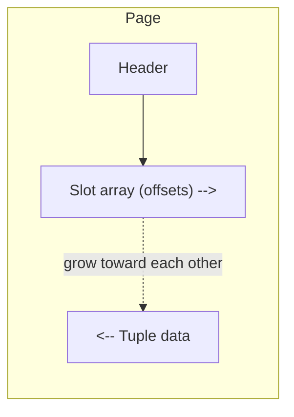

# 10 - Page Layout: Headers, Tuple Storage, and Slotted Pages

## Page header

Every page carries a header describing its contents ([`59:44`](https://www.youtube.com/watch?v=dSxV5Sob5V8&t=3584), [`1:01:09`](https://www.youtube.com/watch?v=dSxV5Sob5V8&t=3669)). Typical fields:

- Page size and **checksum** ([`1:00:08`](https://www.youtube.com/watch?v=dSxV5Sob5V8&t=3608))
- **DBMS version** that created the page, so an upgrade can detect older page formats and convert them ([`1:00:08`](https://www.youtube.com/watch?v=dSxV5Sob5V8&t=3608))
- Transaction visibility information (covered with transactions) ([`1:00:26`](https://www.youtube.com/watch?v=dSxV5Sob5V8&t=3626))
- Compression / encoding metadata ([`1:00:26`](https://www.youtube.com/watch?v=dSxV5Sob5V8&t=3626))
- Schema information — only in self-contained designs such as Oracle's; most systems do not ([`59:44`](https://www.youtube.com/watch?v=dSxV5Sob5V8&t=3584), [`1:00:08`](https://www.youtube.com/watch?v=dSxV5Sob5V8&t=3608))
- **Sketches / zone maps**, e.g. min-max values, so a range query can skip the page body entirely after reading the header — heavily used by column stores ([`1:00:26`](https://www.youtube.com/watch?v=dSxV5Sob5V8&t=3626), [`1:00:46`](https://www.youtube.com/watch?v=dSxV5Sob5V8&t=3646))

## Storage models (today's assumptions)

- **Tuple-oriented storage** is the focus today: attributes of one record stored contiguously as a row, then the next record ([`1:01:44`](https://www.youtube.com/watch?v=dSxV5Sob5V8&t=3704)).
- Assume all attributes of a tuple fit in one page — relaxed next week ([`1:01:44`](https://www.youtube.com/watch?v=dSxV5Sob5V8&t=3704)).
- Deferred alternatives ([`1:02:15`](https://www.youtube.com/watch?v=dSxV5Sob5V8&t=3735), [`1:02:27`](https://www.youtube.com/watch?v=dSxV5Sob5V8&t=3747), [`1:02:41`](https://www.youtube.com/watch?v=dSxV5Sob5V8&t=3761)):
  - **Log-structured storage**: store redundant tuple versions as a log.
  - **Index-organized storage** (MySQL, SQLite): the table *is* a tree, with data in the leaves and inner/leaf nodes mixed in the file.

## Straw-man layout (bad idea)

- Header counts the tuples; each insert computes the offset of the next free spot and appends until the page is full ([`1:03:01`](https://www.youtube.com/watch?v=dSxV5Sob5V8&t=3781)).
- Problems ([`1:03:23`](https://www.youtube.com/watch?v=dSxV5Sob5V8&t=3803), [`1:03:37`](https://www.youtube.com/watch?v=dSxV5Sob5V8&t=3817), [`1:04:05`](https://www.youtube.com/watch?v=dSxV5Sob5V8&t=3845)):
  - Deletes are fine only for fixed-length tuples; **variable-length** tuples (email addresses, IDs) make finding a fitting free slot hard.
  - Moving a tuple within the page forces updating everything pointing at it, e.g. indexes.
- Log-structured databases do use this append pattern, but with variable-size tuple support ([`1:03:37`](https://www.youtube.com/watch?v=dSxV5Sob5V8&t=3817)).

## Slotted pages (what row stores actually do)

- Essentially every row-oriented DBMS uses some variant of a **slot array** plus movable tuple data ([`1:04:05`](https://www.youtube.com/watch?v=dSxV5Sob5V8&t=3845), [`1:04:23`](https://www.youtube.com/watch?v=dSxV5Sob5V8&t=3863), [`1:08:40`](https://www.youtube.com/watch?v=dSxV5Sob5V8&t=4120)).
- Layout ([`1:04:41`](https://www.youtube.com/watch?v=dSxV5Sob5V8&t=3881), [`1:05:03`](https://www.youtube.com/watch?v=dSxV5Sob5V8&t=3903), [`1:05:19`](https://www.youtube.com/watch?v=dSxV5Sob5V8&t=3919)):
  - Slot array of fixed-length offsets grows from the **start** of the page forward.
  - Fixed- and variable-length tuple data grows from the **end** of the page backward.
  - The page is full when the two meet in the middle.

- **Delete**: mark the slot as empty in the slot array/header; the data can simply be left in place ([`1:05:38`](https://www.youtube.com/watch?v=dSxV5Sob5V8&t=3938), [`1:05:56`](https://www.youtube.com/watch?v=dSxV5Sob5V8&t=3956)).
- **Optional compaction**: move a later tuple into the hole, then update only its slot-array offset — external pointers stay valid because they reference the slot, not the byte offset ([`1:06:11`](https://www.youtube.com/watch?v=dSxV5Sob5V8&t=3971)).

### Is compaction worth it?

- Student objections: a small tuple might fit the hole anyway; shuffling many small tuples is wasteful ([`1:06:31`](https://www.youtube.com/watch?v=dSxV5Sob5V8&t=3991), [`1:06:53`](https://www.youtube.com/watch?v=dSxV5Sob5V8&t=4013), [`1:07:08`](https://www.youtube.com/watch?v=dSxV5Sob5V8&t=4028)).
- Instructor's answer — **it depends**, and the objections ignore disk ([`1:07:25`](https://www.youtube.com/watch?v=dSxV5Sob5V8&t=4045)):
  - In-memory shuffling is essentially free compared with fetching another page from disk ([`1:07:25`](https://www.youtube.com/watch?v=dSxV5Sob5V8&t=4045), [`1:07:52`](https://www.youtube.com/watch?v=dSxV5Sob5V8&t=4072)).
  - The real cost is concurrency: compaction holds the page **latch** (a lock) longer, blocking other readers/writers ([`1:07:52`](https://www.youtube.com/watch?v=dSxV5Sob5V8&t=4072), [`1:08:10`](https://www.youtube.com/watch?v=dSxV5Sob5V8&t=4090)).
- Who does what: **SQL Server and Oracle compact; Postgres does not** ([`1:08:22`](https://www.youtube.com/watch?v=dSxV5Sob5V8&t=4102)).
- Record IDs were pushed to the next lecture to make room for the flash talk ([`1:08:22`](https://www.youtube.com/watch?v=dSxV5Sob5V8&t=4102)).
