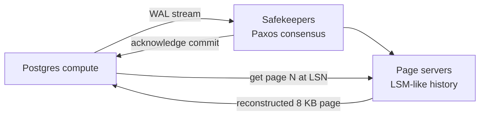

# 11 - Flash Talk: Neon, Serverless Postgres

Speaker: Heikki, long-time **Postgres committer** and co-founder of Neon, joining from Finland ([`1:08:55`](https://www.youtube.com/watch?v=dSxV5Sob5V8&t=4135), [`1:20:34`](https://www.youtube.com/watch?v=dSxV5Sob5V8&t=4834)).

## What Neon is

- Postgres delivered as a **serverless cloud service**, with branching and auto-scaling as the distinguishing features ([`1:09:20`](https://www.youtube.com/watch?v=dSxV5Sob5V8&t=4160)).
- Those features are enabled by the architecture: **separation of compute and storage** ([`1:09:45`](https://www.youtube.com/watch?v=dSxV5Sob5V8&t=4185)).
  - Compute = actual Postgres running in the cloud; users connect and run queries as against any Postgres ([`1:09:45`](https://www.youtube.com/watch?v=dSxV5Sob5V8&t=4185), [`1:10:10`](https://www.youtube.com/watch?v=dSxV5Sob5V8&t=4210)).
  - Storage = a new system written from scratch in **Rust** that understands Postgres' page format and write-ahead log ([`1:10:10`](https://www.youtube.com/watch?v=dSxV5Sob5V8&t=4210)).

## Architecture

- Neon **intercepts the WAL stream**: all Postgres modifications flow to the storage system instead of relying on local page writes ([`1:10:10`](https://www.youtube.com/watch?v=dSxV5Sob5V8&t=4210), [`1:10:40`](https://www.youtube.com/watch?v=dSxV5Sob5V8&t=4240)).
- **Safekeepers** receive the WAL first, running a **Paxos-based consensus**; a commit is acknowledged to Postgres once at least **three safekeepers** have the WAL ([`1:10:40`](https://www.youtube.com/watch?v=dSxV5Sob5V8&t=4240), [`1:11:02`](https://www.youtube.com/watch?v=dSxV5Sob5V8&t=4262)).
  - This reuses Postgres' synchronous replication machinery — the storage looks like a synchronous replica ([`1:11:22`](https://www.youtube.com/watch?v=dSxV5Sob5V8&t=4282)).
- **Page servers** hold most of the code and keep the **entire history** of the database, reorganized into something like an **LSM tree** for fast access to any page version ([`1:11:22`](https://www.youtube.com/watch?v=dSxV5Sob5V8&t=4282), [`1:11:47`](https://www.youtube.com/watch?v=dSxV5Sob5V8&t=4307)).
- Integration point is low-level: where Postgres would read/write an 8 KB page from disk, Neon substitutes a **network request to a page server**, which reconstructs the page from WAL plus page images ([`1:12:02`](https://www.youtube.com/watch?v=dSxV5Sob5V8&t=4322), [`1:12:27`](https://www.youtube.com/watch?v=dSxV5Sob5V8&t=4347)).
- Every request carries an **LSN** — "get page 123 at this LSN" — which is exactly what makes **time-travel queries** and branching possible ([`1:12:39`](https://www.youtube.com/watch?v=dSxV5Sob5V8&t=4359), [`1:11:47`](https://www.youtube.com/watch?v=dSxV5Sob5V8&t=4307), [`1:12:02`](https://www.youtube.com/watch?v=dSxV5Sob5V8&t=4322)).

## Consequences of the design

- **Page eviction is a no-op**: when Postgres would write a dirty page back to disk, Neon throws it away, because storage can reconstruct it from WAL ([`1:12:57`](https://www.youtube.com/watch?v=dSxV5Sob5V8&t=4377), [`1:13:15`](https://www.youtube.com/watch?v=dSxV5Sob5V8&t=4395)).
- Therefore **no checkpointing**: the checkpoint code still runs but does almost nothing; durability is handled continuously by the storage system ([`1:13:15`](https://www.youtube.com/watch?v=dSxV5Sob5V8&t=4395)).
- **Single-writer**: no distributed queries or distributed transactions — they are hard, full of performance/consistency trade-offs, and especially hard to retrofit onto Postgres. Multiple **readers** are supported, so reads scale out and the writer node keeps its capacity ([`1:13:38`](https://www.youtube.com/watch?v=dSxV5Sob5V8&t=4418), [`1:14:04`](https://www.youtube.com/watch?v=dSxV5Sob5V8&t=4444)).
- Storage is **multi-tenant, written in Rust, and open source** ([`1:14:04`](https://www.youtube.com/watch?v=dSxV5Sob5V8&t=4444), [`1:14:26`](https://www.youtube.com/watch?v=dSxV5Sob5V8&t=4466)).

## Making Postgres serverless

- Fast startup: **no WAL recovery on start** — Postgres just connects to page servers and asks for pages at the desired LSN instead of sequentially replaying logs ([`1:14:46`](https://www.youtube.com/watch?v=dSxV5Sob5V8&t=4486)).
- A **proxy** intercepts connections and orchestrates starting Postgres if it is not running ([`1:15:06`](https://www.youtube.com/watch?v=dSxV5Sob5V8&t=4506)).
- Postgres runs in **VMs on Kubernetes**, many VMs per large host, with auto-scaling orchestration ([`1:15:06`](https://www.youtube.com/watch?v=dSxV5Sob5V8&t=4506), [`1:15:22`](https://www.youtube.com/watch?v=dSxV5Sob5V8&t=4522)).

### Scaling difficulty ranking

| Resource | Difficulty | Why ([`1:15:39`](https://www.youtube.com/watch?v=dSxV5Sob5V8&t=4539), [`1:15:55`](https://www.youtube.com/watch?v=dSxV5Sob5V8&t=4555)) |
| --- | --- | --- |
| CPU | Easy | Insufficient CPU only makes things slower; nothing breaks |
| Disk | Harder | A query needing disk fails without it — just provision enough |
| Memory | **Unsolved** | No clean signal for when more memory is warranted |

### The open memory problem (three levels)

1. **About to run out** — add memory, except for runaway queries that would consume unbounded memory; when do you cut them off ([`1:16:22`](https://www.youtube.com/watch?v=dSxV5Sob5V8&t=4582))?
2. **Bigger cache** — Postgres runs large queries with little memory, just slowly (e.g. quicksort degrading to on-disk sorting). More memory might make the database fit in RAM and behave like an in-memory database, but there is no natural limit and cost matters ([`1:16:41`](https://www.youtube.com/watch?v=dSxV5Sob5V8&t=4601), [`1:17:02`](https://www.youtube.com/watch?v=dSxV5Sob5V8&t=4622), [`1:17:28`](https://www.youtube.com/watch?v=dSxV5Sob5V8&t=4648)).
3. **Different query plans** — with more memory the optimizer might choose a hash join over a merge join. You cannot just observe the running query; you must **predict what it would do with more memory**. Unsolved, and an active research interest ([`1:17:28`](https://www.youtube.com/watch?v=dSxV5Sob5V8&t=4648), [`1:17:49`](https://www.youtube.com/watch?v=dSxV5Sob5V8&t=4669)).

## Why stay compatible with Postgres

- Planner and executor are unchanged, and all **extensions work** ([`1:18:07`](https://www.youtube.com/watch?v=dSxV5Sob5V8&t=4687)).
- The Postgres ecosystem — tools, blog posts, tuning advice — should apply unchanged to Neon; the system aims to stay backward and forward compatible with upstream ([`1:18:07`](https://www.youtube.com/watch?v=dSxV5Sob5V8&t=4687), [`1:18:26`](https://www.youtube.com/watch?v=dSxV5Sob5V8&t=4706), [`1:18:41`](https://www.youtube.com/watch?v=dSxV5Sob5V8&t=4721)).
- **MVCC is untouched**: even though storage keeps the full history and could serve versions, Postgres still handles MVCC itself with row versions on pages ([`1:18:41`](https://www.youtube.com/watch?v=dSxV5Sob5V8&t=4721), [`1:18:56`](https://www.youtube.com/watch?v=dSxV5Sob5V8&t=4736)).

## Q&A: Neon vs PlanetScale

- Heikki: does not know PlanetScale in detail, but does not believe it offers this style of storage-level branching ([`1:19:10`](https://www.youtube.com/watch?v=dSxV5Sob5V8&t=4750), [`1:19:41`](https://www.youtube.com/watch?v=dSxV5Sob5V8&t=4781)).
- Instructor's answer — the distribution happens at **opposite ends of the stack** ([`1:19:55`](https://www.youtube.com/watch?v=dSxV5Sob5V8&t=4795), [`1:20:16`](https://www.youtube.com/watch?v=dSxV5Sob5V8&t=4816)):
  - **PlanetScale**: distribution at the **front**, via Vitess (originally built to scale MySQL at YouTube) — the query arrives, the front line decides where to route it and moves data.
  - **Neon**: distribution at the **bottom** — Postgres is fooled into thinking it talks to a regular file system while Neon storage does the distribution underneath.
