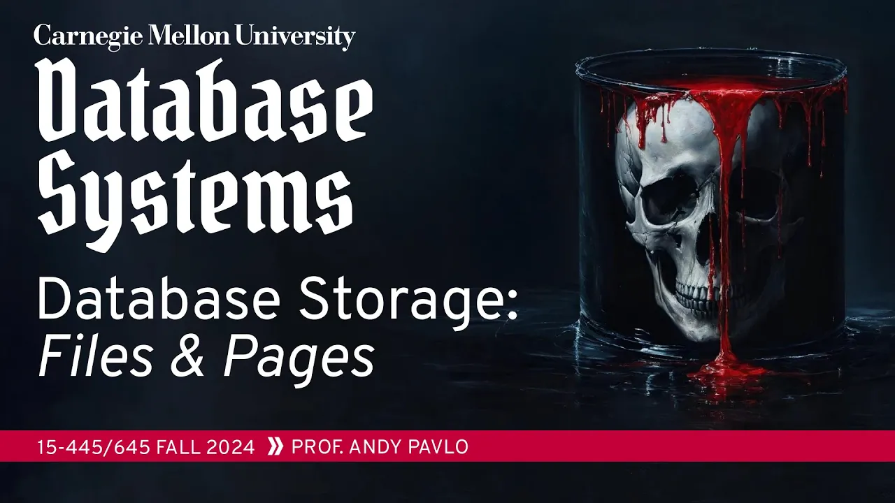
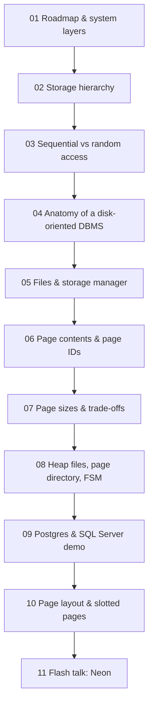

# #03 - Database Storage: Files & Pages ✸ Neon Database Talk (CMU Intro to Database Systems)

*CMU Database Group · 1:22:27 · [Watch on YouTube](https://www.youtube.com/watch?v=dSxV5Sob5V8)*

## Summary

Third lecture of CMU 15-445/645 (Fall 2024), and the first one that goes inside the database engine. It builds the bottom of the storage stack from the hardware upward: why a disk-oriented DBMS exists, how the storage hierarchy and the sequential-vs-random access gap dictate design, how databases are laid out as files of fixed-size pages, how heap files, page directories, and free space maps locate a page, and how tuples are laid out inside a page with the slotted-page design. A live Postgres demo exposes the on-disk files, the free space map, and `VACUUM`, contrasted with SQL Server's per-page metadata. The lecture closes with a flash talk by Heikki, a Postgres committer and Neon co-founder, on Neon's serverless Postgres architecture that separates compute from a Rust storage system driven by the write-ahead log.

**Classification:** university lecture (educational) with an embedded conference-style flash talk.

## Topics

1. [Course Roadmap and System Layers](01-course-roadmap-and-system-layers.md) — [`0:05`](https://www.youtube.com/watch?v=dSxV5Sob5V8&t=5)
2. [Storage Hierarchy and Disk-Oriented Design](02-storage-hierarchy-and-disk-oriented-design.md) — [`4:54`](https://www.youtube.com/watch?v=dSxV5Sob5V8&t=294)
3. [Sequential vs Random Access and Design Goals](03-sequential-vs-random-access-and-design-goals.md) — [`14:19`](https://www.youtube.com/watch?v=dSxV5Sob5V8&t=859)
4. [Anatomy of a Disk-Oriented DBMS](04-anatomy-of-a-disk-oriented-dbms.md) — [`19:49`](https://www.youtube.com/watch?v=dSxV5Sob5V8&t=1189)
5. [Database Files and the Storage Manager](05-database-files-and-the-storage-manager.md) — [`24:40`](https://www.youtube.com/watch?v=dSxV5Sob5V8&t=1480)
6. [Page Contents, Self-Containment, and Page IDs](06-pages-contents-and-page-ids.md) — [`29:58`](https://www.youtube.com/watch?v=dSxV5Sob5V8&t=1798)
7. [The Three Notions of a Page and Page-Size Trade-offs](07-three-notions-of-pages-and-page-size-tradeoffs.md) — [`36:39`](https://www.youtube.com/watch?v=dSxV5Sob5V8&t=2199)
8. [Heap Files, the Page Directory, and the Free Space Map](08-heap-files-page-directory-and-free-space-map.md) — [`42:42`](https://www.youtube.com/watch?v=dSxV5Sob5V8&t=2562)
9. [Demo: Postgres Free Space Map and SQL Server Page Metadata](09-postgres-and-sql-server-demo.md) — [`48:35`](https://www.youtube.com/watch?v=dSxV5Sob5V8&t=2915)
10. [Page Layout: Headers, Tuple Storage, and Slotted Pages](10-page-layout-and-slotted-pages.md) — [`59:44`](https://www.youtube.com/watch?v=dSxV5Sob5V8&t=3584)
11. [Flash Talk: Neon, Serverless Postgres](11-neon-flash-talk-serverless-postgres.md) — [`1:08:55`](https://www.youtube.com/watch?v=dSxV5Sob5V8&t=4135)

## Key takeaways

- A database is nothing but ordinary files on an off-the-shelf file system (EXT4, XFS); the DBMS layers a storage manager, fixed-size pages, and a page directory on top of them, and only high-end systems such as Oracle ASM bypass the OS file system to do direct I/O on raw blocks ([`19:49`](https://www.youtube.com/watch?v=dSxV5Sob5V8&t=1189), [`25:59`](https://www.youtube.com/watch?v=dSxV5Sob5V8&t=1559), [`26:20`](https://www.youtube.com/watch?v=dSxV5Sob5V8&t=1580)).
- Random access is orders of magnitude slower than sequential access on HDDs and still slower on SSDs, which is why MySQL writes dirty pages **twice** — sequentially to a side buffer to commit fast, then randomly to the real pages in the background ([`14:19`](https://www.youtube.com/watch?v=dSxV5Sob5V8&t=859), [`15:55`](https://www.youtube.com/watch?v=dSxV5Sob5V8&t=955), [`16:39`](https://www.youtube.com/watch?v=dSxV5Sob5V8&t=999), [`16:57`](https://www.youtube.com/watch?v=dSxV5Sob5V8&t=1017)).
- "Page" means three different things: the hardware page (4 KB, the largest atomic all-or-nothing write), the OS page (4 KB, or 2 MB/1 GB huge pages), and the database page — 4 KB in SQLite/RocksDB/WiredTiger, 8 KB in Postgres and SQL Server, 16 KB in MySQL, per-table in DB2 ([`36:39`](https://www.youtube.com/watch?v=dSxV5Sob5V8&t=2199), [`37:29`](https://www.youtube.com/watch?v=dSxV5Sob5V8&t=2249), [`39:07`](https://www.youtube.com/watch?v=dSxV5Sob5V8&t=2347)).
- Page size is a no-free-lunch trade-off: big pages win on sequential read-heavy scans but force rewriting the whole page for a 1 KB update; small pages win on many small writes ([`41:11`](https://www.youtube.com/watch?v=dSxV5Sob5V8&t=2471), [`41:41`](https://www.youtube.com/watch?v=dSxV5Sob5V8&t=2501), [`42:16`](https://www.youtube.com/watch?v=dSxV5Sob5V8&t=2536)).
- The Postgres demo showed the free space map is intentionally allowed to be stale — it reported all zeros for 7 pages until `VACUUM` corrected it — and that inserted tuples landed back in page 0 rather than at the end, a concrete demonstration that the relational model is unordered ([`50:32`](https://www.youtube.com/watch?v=dSxV5Sob5V8&t=3032), [`52:49`](https://www.youtube.com/watch?v=dSxV5Sob5V8&t=3169), [`53:43`](https://www.youtube.com/watch?v=dSxV5Sob5V8&t=3223), [`55:03`](https://www.youtube.com/watch?v=dSxV5Sob5V8&t=3303), [`55:21`](https://www.youtube.com/watch?v=dSxV5Sob5V8&t=3321)).
- The slotted page — slot array growing forward, tuple data growing backward until they meet — is how essentially every row store works; in-page compaction after deletes is cheap in CPU terms but holds the page latch longer, so SQL Server and Oracle do it while Postgres does not ([`1:04:23`](https://www.youtube.com/watch?v=dSxV5Sob5V8&t=3863), [`1:05:03`](https://www.youtube.com/watch?v=dSxV5Sob5V8&t=3903), [`1:07:52`](https://www.youtube.com/watch?v=dSxV5Sob5V8&t=4072), [`1:08:22`](https://www.youtube.com/watch?v=dSxV5Sob5V8&t=4102)).
- Neon separates Postgres compute from a Rust storage system fed by the intercepted WAL: safekeepers reach Paxos consensus (commit acknowledged after ≥3 receive the WAL) and page servers reconstruct any page at any LSN — which makes page eviction a no-op, eliminates checkpointing and startup WAL recovery, and enables branching and time-travel queries, at the cost of being single-writer ([`1:10:40`](https://www.youtube.com/watch?v=dSxV5Sob5V8&t=4240), [`1:11:02`](https://www.youtube.com/watch?v=dSxV5Sob5V8&t=4262), [`1:12:39`](https://www.youtube.com/watch?v=dSxV5Sob5V8&t=4359), [`1:12:57`](https://www.youtube.com/watch?v=dSxV5Sob5V8&t=4377), [`1:13:38`](https://www.youtube.com/watch?v=dSxV5Sob5V8&t=4418), [`1:14:46`](https://www.youtube.com/watch?v=dSxV5Sob5V8&t=4486)).
- Auto-scaling memory remains an open problem for Neon: CPU shortage only slows things down and disk can be provisioned, but deciding when more memory is worth it requires predicting what plan the optimizer *would* choose (hash join vs merge join) with more memory available ([`1:15:39`](https://www.youtube.com/watch?v=dSxV5Sob5V8&t=4539), [`1:15:55`](https://www.youtube.com/watch?v=dSxV5Sob5V8&t=4555), [`1:17:28`](https://www.youtube.com/watch?v=dSxV5Sob5V8&t=4648), [`1:17:49`](https://www.youtube.com/watch?v=dSxV5Sob5V8&t=4669)).
