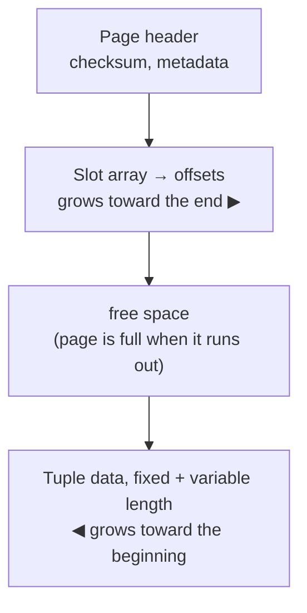

# 02 — Tuple-oriented architecture and slotted pages

## Disk-oriented DBMS architecture (recap)

- The primary storage location of the database is a non-volatile device (disk); the whole architecture assumes data must be brought disk → memory before use, because in-place updates on disk cannot be done directly [`3:31`](https://www.youtube.com/watch?v=IHtVWGhG0Xg&t=211)
- The architecture discussed so far is **tuple-oriented**: the system's job is knowing where tuples live inside pages, across unordered heap files [`4:18`](https://www.youtube.com/watch?v=IHtVWGhG0Xg&t=258)

## The slotted-page scheme

The canonical way to represent tuples inside a page [`4:39`](https://www.youtube.com/watch?v=IHtVWGhG0Xg&t=279):

- **Page header** — metadata about the page (checksums and related fields)
- **Slot array** — an indirection layer mapping slot numbers to offsets within the page
- **Tuple data** — the actual bytes

Growth directions [`5:08`](https://www.youtube.com/watch?v=IHtVWGhG0Xg&t=308):

- Slot array grows from the beginning toward the end
- Tuple data grows from the end toward the beginning
- When they meet, the page is considered full [`5:37`](https://www.youtube.com/watch?v=IHtVWGhG0Xg&t=337)

## Why the indirection matters

- With `(page number, slot number)` the rest of the system can address a tuple regardless of how the page is internally reorganized [`5:37`](https://www.youtube.com/watch?v=IHtVWGhG0Xg&t=337)
- Without it, addressing tuples by exact file offset would force an update of every index or structure pointing at a tuple whenever it moved [`5:37`](https://www.youtube.com/watch?v=IHtVWGhG0Xg&t=337)
- Indirection is a core systems idea; the cost is one extra lookup in the slot array instead of jumping straight to the offset — trivial compared to a disk read [`6:18`](https://www.youtube.com/watch?v=IHtVWGhG0Xg&t=378)
- Example: on delete, a system can slide the remaining tuples over to reclaim space and just update the slot array, telling nothing outside the page [`6:37`](https://www.youtube.com/watch?v=IHtVWGhG0Xg&t=397)
