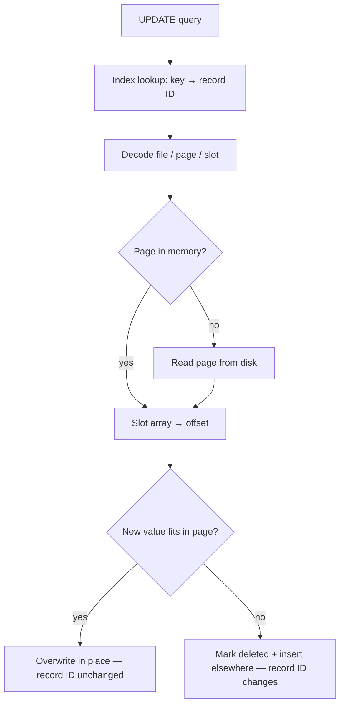

# 04 — Inserting and updating tuples

## Insert path

1. Consult the **page directory** to find a page with a free slot (it tracks free space per page) [`15:57`](https://www.youtube.com/watch?v=IHtVWGhG0Xg&t=957)
2. Retrieve that page from disk if it is not already in memory [`16:16`](https://www.youtube.com/watch?v=IHtVWGhG0Xg&t=976)
3. Find a free slot in the slot array and write the tuple, assuming it fits [`16:16`](https://www.youtube.com/watch?v=IHtVWGhG0Xg&t=976)
4. If no single page has enough contiguous space, allocate a new page [`18:28`](https://www.youtube.com/watch?v=IHtVWGhG0Xg&t=1108)

## Update path

1. Get the record ID — typically from an index mapping a logical key (email, Android ID) → record ID [`16:43`](https://www.youtube.com/watch?v=IHtVWGhG0Xg&t=1003) [`16:56`](https://www.youtube.com/watch?v=IHtVWGhG0Xg&t=1016)
2. Decode file/page number, ask the page directory where the page lives [`16:56`](https://www.youtube.com/watch?v=IHtVWGhG0Xg&t=1016)
3. Fetch the page into memory if needed [`17:16`](https://www.youtube.com/watch?v=IHtVWGhG0Xg&t=1036)
4. Use the slot number → slot array → offset → the tuple [`17:16`](https://www.youtube.com/watch?v=IHtVWGhG0Xg&t=1036)
5. **If the new data fits in the existing page**, overwrite in place [`17:33`](https://www.youtube.com/watch?v=IHtVWGhG0Xg&t=1053)
6. **Otherwise**, mark the old tuple deleted and insert the new version on another page [`17:59`](https://www.youtube.com/watch?v=IHtVWGhG0Xg&t=1079)

## Q&A points

- Why not update in the same page when it does not fit? Example: 1 KB free in the page, 2 KB new tuple — it physically cannot go there, so it becomes delete + insert, and the logical tuple's record ID changes [`18:44`](https://www.youtube.com/watch?v=IHtVWGhG0Xg&t=1124) [`19:25`](https://www.youtube.com/watch?v=IHtVWGhG0Xg&t=1165)
- If the update *can* be done in place, nothing pointing at the tuple needs updating [`19:25`](https://www.youtube.com/watch?v=IHtVWGhG0Xg&t=1165)
- Can the page be compacted to make room? Yes, an obvious optimization, but not all systems do it [`19:48`](https://www.youtube.com/watch?v=IHtVWGhG0Xg&t=1188)
- **Contrasting policies**: SQL Server compacts on every page update — it already holds the latch, so it optimizes while it can; Postgres gets in and out of the page as fast as possible and does not worry about compaction [`20:17`](https://www.youtube.com/watch?v=IHtVWGhG0Xg&t=1217)
- Multi-versioning complicates all of this; Postgres's MVCC approach is described as "the wrong way to do it" and may keep tuples around longer than necessary — covered later in the semester [`20:36`](https://www.youtube.com/watch?v=IHtVWGhG0Xg&t=1236)
