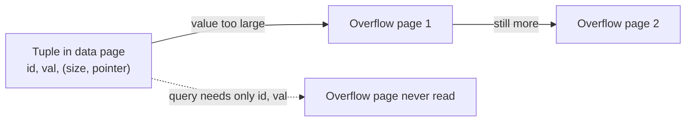

# 12 — Large values and overflow pages

## The constraint

- Most DBMSs will not store a tuple whose inlined data exceeds the size of a page — with Postgres's 8 KB pages you cannot make a table with a billion columns [`1:15:19`](https://www.youtube.com/watch?v=IHtVWGhG0Xg&t=4519) [`1:15:43`](https://www.youtube.com/watch?v=IHtVWGhG0Xg&t=4543)
- Individual values may still exceed a page, so they spill into **overflow pages** [`1:15:43`](https://www.youtube.com/watch?v=IHtVWGhG0Xg&t=4543)

## How it works

Example table: two integers plus an unbounded `TEXT`/`VARCHAR` column [`1:15:43`](https://www.youtube.com/watch?v=IHtVWGhG0Xg&t=4543)

- **Small value** → stored inline with the rest of the tuple [`1:16:14`](https://www.youtube.com/watch?v=IHtVWGhG0Xg&t=4574)
- **Large value** → the inline attribute becomes a `(size, pointer)` pair pointing at an overflow page; a scan that needs the column follows the pointer [`1:16:14`](https://www.youtube.com/watch?v=IHtVWGhG0Xg&t=4574)
- If the value exceeds even the overflow page, chain another pointer to the next chunk [`1:16:55`](https://www.youtube.com/watch?v=IHtVWGhG0Xg&t=4615) [`1:04:31`](https://www.youtube.com/watch?v=IHtVWGhG0Xg&t=3871)
- Same pattern applies to `VARBINARY`, Oracle `VARCHAR2`, BLOBs — different names, same mechanism [`1:16:55`](https://www.youtube.com/watch?v=IHtVWGhG0Xg&t=4615)
- The header layout is roughly: first four bytes = size, then a flag for inline vs. overflow. The DBMS never interprets the user's bytes — doing so "would be a huge security hole", so a blob that happens to look like a size/location struct is harmless [`1:17:56`](https://www.youtube.com/watch?v=IHtVWGhG0Xg&t=4676) [`1:18:14`](https://www.youtube.com/watch?v=IHtVWGhG0Xg&t=4694)

## Optimizations enabled by overflow pages

Because an overflow page is not a regular data page, systems can treat it specially [`1:18:38`](https://www.youtube.com/watch?v=IHtVWGhG0Xg&t=4718):

- **Skip it entirely** when the query only touches the other columns [`1:18:38`](https://www.youtube.com/watch?v=IHtVWGhG0Xg&t=4718)
- **Compress it** on disk with gzip, Snappy or Zstandard and decompress on read — text compresses very well (Postgres and others do this) [`1:18:38`](https://www.youtube.com/watch?v=IHtVWGhG0Xg&t=4718)
- **German strings**: store a prefix (say the first 8 bytes) alongside the size and location. A predicate like "emails starting with `pavlo`" can be answered against the inline prefix — which is fetched anyway — and the overflow page skipped on mismatch. Rare, more common in newer systems; the name was coined by the lecturer because it was invented by German researchers, and they adopted the name [`1:19:02`](https://www.youtube.com/watch?v=IHtVWGhG0Xg&t=4742) [`1:19:25`](https://www.youtube.com/watch?v=IHtVWGhG0Xg&t=4765)

## External files

- For very large files, store them on the local file system and keep only a pointer/URI in the database [`1:20:06`](https://www.youtube.com/watch?v=IHtVWGhG0Xg&t=4806)
- **Cost**: the DBMS no longer manages those pages — the OS does — so all the guarantees the database provides for its own data are out the door [`1:20:06`](https://www.youtube.com/watch?v=IHtVWGhG0Xg&t=4806)
