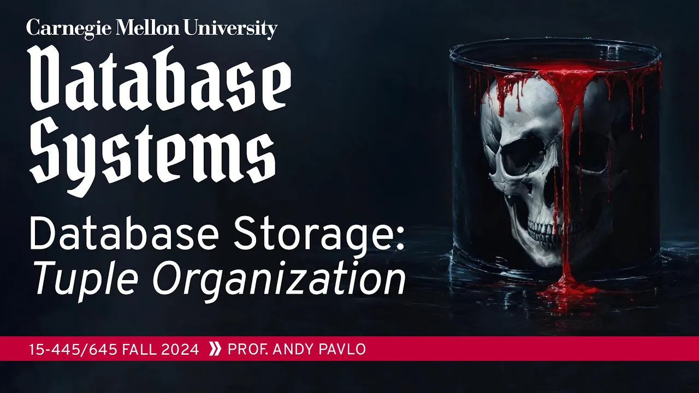
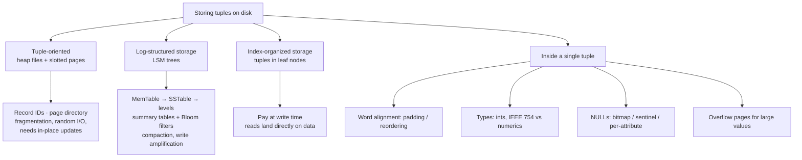

# #04 - Database Storage: Log-Structured Merge Trees & Tuples (CMU Intro to Database Systems)

*CMU Database Group · 1:22:41 · [Watch on YouTube](https://www.youtube.com/watch?v=IHtVWGhG0Xg)*

## Summary

University lecture (CMU 15-445/645, Fall 2024) that finishes the tuple-oriented storage model and then presents its two main alternatives. The first half completes slotted pages and record IDs — with live demos of `ctid`, `rowid` and `%%physloc%%` in PostgreSQL, SQLite, SQL Server and Oracle — and enumerates the problems of tuple-oriented storage: fragmentation, useless disk I/O, random I/O, and the fact that append-only storage layers such as S3 and HDFS cannot do in-place updates at all. That motivates **log-structured storage / LSM trees** (MemTable → SSTable → levels → compaction, as implemented by LevelDB and RocksDB) and **index-organized storage**, positioned as opposite ends of the write-cost vs. read-cost trade-off. The second half zooms into the bytes of a single tuple: word alignment, padding vs. attribute reordering, integer and fixed-point numeric representation, three ways to encode NULLs, and overflow pages for values larger than a page.

## Topics

1. [Course logistics and announcements](./01-course-logistics.md)
2. [Tuple-oriented architecture and slotted pages](./02-tuple-oriented-architecture-and-slotted-pages.md)
3. [Record IDs](./03-record-ids.md)
4. [Inserting and updating tuples](./04-inserting-and-updating-tuples.md)
5. [Problems with tuple-oriented storage](./05-problems-with-tuple-oriented-storage.md)
6. [Log-structured storage and LSM trees](./06-log-structured-storage-and-lsm-trees.md)
7. [Levels, reads, and summary tables](./07-levels-summary-tables-and-reads.md)
8. [Compaction, RocksDB, and the trade-offs](./08-compaction-and-rocksdb-tradeoffs.md)
9. [Index-organized storage](./09-index-organized-storage.md)
10. [What a tuple is: layout and word alignment](./10-tuple-layout-and-word-alignment.md)
11. [Representing attribute data types](./11-attribute-data-types.md)
12. [Large values and overflow pages](./12-large-values-and-overflow-pages.md)
13. [Conclusion and next class](./13-conclusion-and-next-class.md)

## Key takeaways

- **Real systems disagree on page compaction, and the demo proves it**: after deleting a tuple and re-inserting, SQL Server compacted the page and reused slot 1, while PostgreSQL, SQLite and Oracle all left the gap and appended at the end. SQL Server compacts because it already holds the latch; Postgres optimizes for getting in and out of the page fast [`13:23`](https://www.youtube.com/watch?v=IHtVWGhG0Xg&t=803) [`20:17`](https://www.youtube.com/watch?v=IHtVWGhG0Xg&t=1217)
- **The in-place update assumption is the real breaking point**: SSDs rewrite whole blocks, and HDFS, Amazon S3 and Google Colossus are append-only access methods where a written page can be deleted but never overwritten — which is what makes log-structured storage necessary rather than merely fashionable [`22:53`](https://www.youtube.com/watch?v=IHtVWGhG0Xg&t=1373) [`23:28`](https://www.youtube.com/watch?v=IHtVWGhG0Xg&t=1408)
- **LSM trees trade write speed for read cost, and pay it back as write amplification**: writes become blind inserts into the MemTable at near bare-metal SSD speed, but a single logical write can be physically rewritten dozens or hundreds of times as it is compacted down the levels — burning out SSDs or running up cloud bills. Index-organized storage is the exact mirror image: pay at insert, read cheaply [`39:52`](https://www.youtube.com/watch?v=IHtVWGhG0Xg&t=2392) [`47:19`](https://www.youtube.com/watch?v=IHtVWGhG0Xg&t=2839) [`50:13`](https://www.youtube.com/watch?v=IHtVWGhG0Xg&t=3013)
- **Bloom filters and min/max summaries are both required, for different query shapes**: a filter says only whether a key exists, which lets a read skip an entire level holding thousands of SSTables; min/max ranges are what make range scans possible, since you cannot probe unknown keys individually [`37:05`](https://www.youtube.com/watch?v=IHtVWGhG0Xg&t=2225) [`38:02`](https://www.youtube.com/watch?v=IHtVWGhG0Xg&t=2282)
- **The first thing Facebook did when forking LevelDB into RocksDB was remove `mmap`** and write a real buffer manager — letting the OS manage pages is called "a terrible idea", and rebuilding that manager is exactly Project 1 [`45:19`](https://www.youtube.com/watch?v=IHtVWGhG0Xg&t=2719)
- **Column order physically changes tuple size**: `pg_column_size` showed the same mixed char/integer columns taking **48 bytes** in one declaration order and **44 bytes** when reordered, because Postgres pads less. Casting three integers from 32-bit to 16-bit dropped a row from **36 to 30 bytes** [`1:01:28`](https://www.youtube.com/watch?v=IHtVWGhG0Xg&t=3688) [`1:01:45`](https://www.youtube.com/watch?v=IHtVWGhG0Xg&t=3705) [`1:01:10`](https://www.youtube.com/watch?v=IHtVWGhG0Xg&t=3670)
- **Exactness costs speed, deliberately**: IEEE 754 cannot represent `0.1 + 0.2` exactly, so every DBMS also ships fixed-point numerics — Postgres stores digits, weight, scale and sign, and its numeric addition is a branch-heavy routine that cannot match a single hardware float instruction [`1:05:57`](https://www.youtube.com/watch?v=IHtVWGhG0Xg&t=3957) [`1:07:27`](https://www.youtube.com/watch?v=IHtVWGhG0Xg&t=4047) [`1:08:20`](https://www.youtube.com/watch?v=IHtVWGhG0Xg&t=4100)
- **NULL encoding is settled by storage model**: bitmap in the tuple header for row stores, sentinel values for column stores (they preserve fixed-length offsets), and never a per-attribute null bit — it turns an 8-bit boolean into 16 bits. Only MemSQL shipped that, and dropped it on rebranding to SingleStore [`1:12:08`](https://www.youtube.com/watch?v=IHtVWGhG0Xg&t=4328) [`1:12:35`](https://www.youtube.com/watch?v=IHtVWGhG0Xg&t=4355)
- **Overflow pages unlock optimizations regular data pages cannot have**: skipping the read entirely when the query does not touch the column, compressing it with gzip/Snappy/Zstandard, or storing an inline prefix ("German strings") so prefix predicates are answered without ever following the pointer [`1:18:38`](https://www.youtube.com/watch?v=IHtVWGhG0Xg&t=4718) [`1:19:25`](https://www.youtube.com/watch?v=IHtVWGhG0Xg&t=4765)
