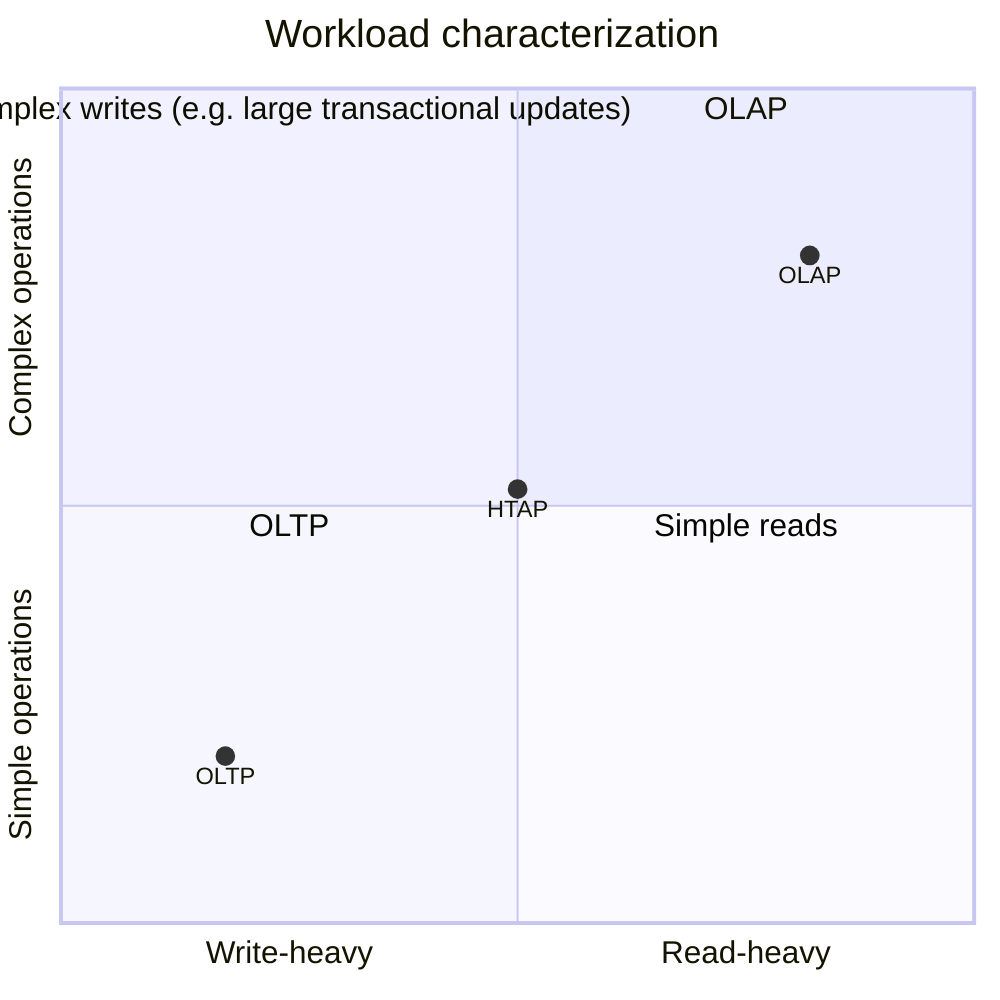

# 02 — Database workloads: OLTP, OLAP, HTAP

Three loose categories describe most database workloads ([`4:44`](https://www.youtube.com/watch?v=nhlpwmOBEiE&t=284)).

## OLTP — Online Transaction Processing

- Ingests new information from the outside world; typically the first thing a startup builds ([`4:44`](https://www.youtube.com/watch?v=nhlpwmOBEiE&t=284)).
- Insert / update / delete queries, **write-heavy** relative to OLAP ([`5:12`](https://www.youtube.com/watch?v=nhlpwmOBEiE&t=312)).
- Each query touches a **small amount of data** ([`5:12`](https://www.youtube.com/watch?v=nhlpwmOBEiE&t=312)).
- Amazon example: the whole database is massive (everything ever bought), but a purchase inserts one cart record and updates payment/delivery info ([`5:35`](https://www.youtube.com/watch?v=nhlpwmOBEiE&t=335), [`6:01`](https://www.youtube.com/watch?v=nhlpwmOBEiE&t=361)).

## OLAP — Online Analytical Processing

- Extrapolates **new** information from an existing dataset — what data scientists do, deriving patterns from data the OLTP system already collected ([`6:21`](https://www.youtube.com/watch?v=nhlpwmOBEiE&t=381)).
- Queries are far more complex than OLTP's `SELECT * FROM account WHERE username = 'Andy'` — e.g. "find the item customers bought most on a September day, in this city, at this temperature, at this time of day", usually joining several tables ([`6:57`](https://www.youtube.com/watch?v=nhlpwmOBEiE&t=417)).

## HTAP — Hybrid Transaction + Analytical Processing

- A Gartner marketing term: one system doing OLTP and OLAP at the same time ([`7:27`](https://www.youtube.com/watch?v=nhlpwmOBEiE&t=447)).
- In practice most applications already look like this; a few systems claim the HTAP label ([`7:27`](https://www.youtube.com/watch?v=nhlpwmOBEiE&t=447)).

## The quadrant chart

Two axes: write-heavy ↔ read-heavy, and simple ↔ complex operations ([`8:04`](https://www.youtube.com/watch?v=nhlpwmOBEiE&t=484)).

- OLTP: more writes, simple queries, small data touched ([`8:04`](https://www.youtube.com/watch?v=nhlpwmOBEiE&t=484)).
- OLAP: mostly read-only, complex queries ([`8:30`](https://www.youtube.com/watch?v=nhlpwmOBEiE&t=510)).
- HTAP sits in the middle ([`9:32`](https://www.youtube.com/watch?v=nhlpwmOBEiE&t=572)).
- The other quadrants exist but are blurry — e.g. write-heavy *and* complex would be updating a billion records transactionally safely ([`10:19`](https://www.youtube.com/watch?v=nhlpwmOBEiE&t=619), [`10:35`](https://www.youtube.com/watch?v=nhlpwmOBEiE&t=635)).

## The origin of "OLAP"

- Until the late 1990s essentially every database was OLTP — businesses just needed to collect information ([`8:30`](https://www.youtube.com/watch?v=nhlpwmOBEiE&t=510)).
- **Jim Gray** — inventor of two-phase locking, Turing Award in 1996 — wrote a ~1993/94 paper naming the OLAP category; he had to retract it after it emerged he was being paid by a company branding an OLAP system. The name stuck anyway ([`9:05`](https://www.youtube.com/watch?v=nhlpwmOBEiE&t=545)).

## Measuring query complexity

- No scientific metric. Rough proxies: number of joins, number of tables accessed, number of aggregates ([`9:42`](https://www.youtube.com/watch?v=nhlpwmOBEiE&t=582)).
- Simple: `SELECT *  ... WHERE name = 'Andy'`. Complex: the same plus many joins, an aggregation, a window function, and a CTE ([`10:06`](https://www.youtube.com/watch?v=nhlpwmOBEiE&t=606)).
- The OLTP/OLAP dichotomy alone is enough to choose which kind of system you want ([`10:56`](https://www.youtube.com/watch?v=nhlpwmOBEiE&t=656)).
