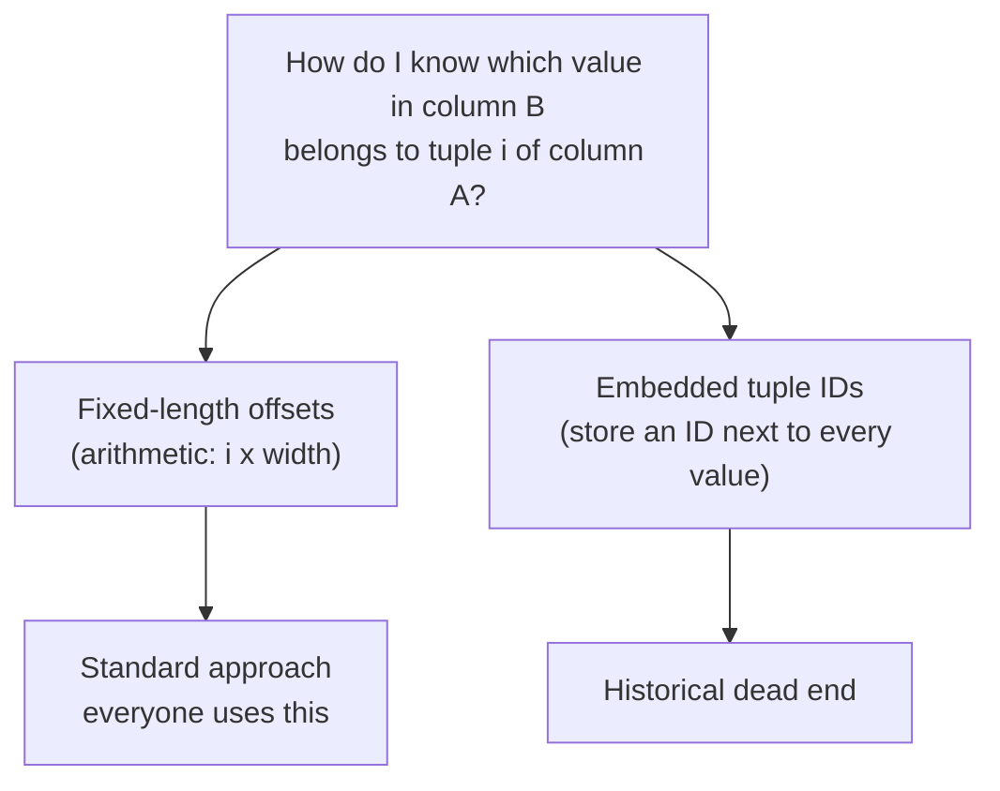

# 05 — Decomposition Storage Model (column store)

## Definition

- DSM is the academic term; everyone says **column store**. True pure DSM is rare — most "column stores" actually use PAX ([`22:12`](https://www.youtube.com/watch?v=nhlpwmOBEiE&t=1332)).
- Store all values of **one attribute for all tuples** contiguously, instead of all attributes of one tuple ([`22:38`](https://www.youtube.com/watch?v=nhlpwmOBEiE&t=1358)).
- Enabled by logical/physical data independence: the application declares a table of columns; the DBMS splits them into separate locations and **stitches them back together** at query time, entirely hidden from the application ([`23:03`](https://www.youtube.com/watch?v=nhlpwmOBEiE&t=1383)).
- Page layout per column: header (which column, checksums, compression info) + a null bitmap that is now **per column**, not per tuple; offsets in the bitmap map to offsets in the value array ([`23:33`](https://www.youtube.com/watch?v=nhlpwmOBEiE&t=1413), [`24:01`](https://www.youtube.com/watch?v=nhlpwmOBEiE&t=1441)).

## The analytical query, re-run

1. The `WHERE` clause only touches `hostname`, so only the hostname page is read — rip straight through the values ([`24:51`](https://www.youtube.com/watch?v=nhlpwmOBEiE&t=1491)).
2. Result is a set of **matching offsets** — the tuple positions where the predicate was true ([`25:30`](https://www.youtube.com/watch?v=nhlpwmOBEiE&t=1530)).
3. Only then bring in the `lastLogin` page and aggregate the values at those offsets ([`25:30`](https://www.youtube.com/watch?v=nhlpwmOBEiE&t=1530)).

**Result**: in a 6-page toy database, the row store read all 6 pages; the column store read **2** — a third of the I/O ([`26:02`](https://www.youtube.com/watch?v=nhlpwmOBEiE&t=1562)). At billions of pages or petabytes, either the disk is slow or you literally **pay Amazon per S3 lookup**, so queries run both faster and cheaper ([`26:23`](https://www.youtube.com/watch?v=nhlpwmOBEiE&t=1583), [`26:32`](https://www.youtube.com/watch?v=nhlpwmOBEiE&t=1592)).

## History

- The idea dates to the **1970s**, in an obscure Swedish military tech report on a file system called Cantor that nobody noticed ([`26:32`](https://www.youtube.com/watch?v=nhlpwmOBEiE&t=1592)).
- The DSM paper appeared in **1984** ([`26:32`](https://www.youtube.com/watch?v=nhlpwmOBEiE&t=1592)).
- Not until the **2000s** did people accept that analytical data should be stored columnar; now it is commonplace ([`27:11`](https://www.youtube.com/watch?v=nhlpwmOBEiE&t=1631)).
- Informal poll: fewer than ~5–10% of the class had heard of column stores before ([`26:32`](https://www.youtube.com/watch?v=nhlpwmOBEiE&t=1592)).

## Tuple identification: two approaches

- **Fixed-length offsets** — every value in a column is the same width (32-bit, 64-bit int, …), so tuple *i* is at offset *i × width*. Simple arithmetic. This is what essentially everyone does ([`27:51`](https://www.youtube.com/watch?v=nhlpwmOBEiE&t=1671), [`28:24`](https://www.youtube.com/watch?v=nhlpwmOBEiE&t=1704)).
- **Embedded tuple IDs** — store a tuple ID with every value plus an auxiliary structure to locate a tuple across columns. Marked "don't do this" ([`28:24`](https://www.youtube.com/watch?v=nhlpwmOBEiE&t=1704), [`29:17`](https://www.youtube.com/watch?v=nhlpwmOBEiE&t=1757)).
- Cautionary tale: **DATAllegro** contorted a row-store engine to look like a column store; Microsoft paid ~**$200 million** for it and within **three months** decided the code was garbage and threw it all away ([`28:51`](https://www.youtube.com/watch?v=nhlpwmOBEiE&t=1731)).

## Handling variable-length data

- Integers, floats and dates are fixed length. VARCHARs, TEXT and BLOBs are not ([`29:17`](https://www.youtube.com/watch?v=nhlpwmOBEiE&t=1757)).
- Solution: **dictionary encoding** — store an integer code in the column and keep the code→string mapping in a separate structure. Everything becomes fixed length ([`29:45`](https://www.youtube.com/watch?v=nhlpwmOBEiE&t=1785)).
- Of Parquet and ORC, one dictionary-encodes **everything** regardless of type (so every column is 32/64-bit integers) and the other only does it for strings ([`30:29`](https://www.youtube.com/watch?v=nhlpwmOBEiE&t=1829)).

## Trade-off summary

**Advantages** ([`30:59`](https://www.youtube.com/watch?v=nhlpwmOBEiE&t=1859)):
- Reduces I/O to exactly the attributes the query needs — nothing comes along for the ride.
- Sequential strides of memory instead of offset jumps; a modern superscalar x86 CPU wants a stream of instructions with no branching or indirection, and a columnar scan applies the same predicate value after value ([`31:22`](https://www.youtube.com/watch?v=nhlpwmOBEiE&t=1882), [`31:39`](https://www.youtube.com/watch?v=nhlpwmOBEiE&t=1899)).
- Much better compression: contiguous values share one **value domain** (e.g. all zip codes) ([`32:06`](https://www.youtube.com/watch?v=nhlpwmOBEiE&t=1926)).

**Disadvantage — writes get slower** ([`32:54`](https://www.youtube.com/watch?v=nhlpwmOBEiE&t=1974)):
- One insert must be split across attributes and written to many locations — a 1,000-attribute table means writing 1,000 pages for a single tuple.

**Mitigations** ([`33:20`](https://www.youtube.com/watch?v=nhlpwmOBEiE&t=2000)):
- A log-structured **write buffer** that is effectively a row store; the background "compaction" step installs data into the column store ([`33:20`](https://www.youtube.com/watch?v=nhlpwmOBEiE&t=2000)).
- Oracle's approach: keep the normal fast row store for OLTP **plus** a separate in-memory column-store copy. The DBMS routes analytical queries to the columnar copy transparently — the application never chooses ([`33:49`](https://www.youtube.com/watch?v=nhlpwmOBEiE&t=2029), [`34:04`](https://www.youtube.com/watch?v=nhlpwmOBEiE&t=2044)).
- So columnar storage can be either the *entire* storage design or a *supplemental* one ([`34:23`](https://www.youtube.com/watch?v=nhlpwmOBEiE&t=2063)).

## Why pure DSM isn't enough

- Pure column stores shine when a query touches **one** column, which is rare; most queries need several ([`34:40`](https://www.youtube.com/watch?v=nhlpwmOBEiE&t=2080)).
- Column-count limits in the wild: PostgreSQL ~16,000 per table (hardcoded); **Oracle 1,000** — originally 100 from someone's 1990s hardcode, raised to 1,000 in the early 2000s, and the retrofit was so painful they said they never want to change it again ([`34:40`](https://www.youtube.com/watch?v=nhlpwmOBEiE&t=2080), [`35:14`](https://www.youtube.com/watch?v=nhlpwmOBEiE&t=2114)).
- With fully separate pages, a multi-column query must fetch pages from all over. What we want is columnar layout **plus spatial locality** → see [PAX](./06-pax-hybrid-storage.md) ([`35:48`](https://www.youtube.com/watch?v=nhlpwmOBEiE&t=2148)).
