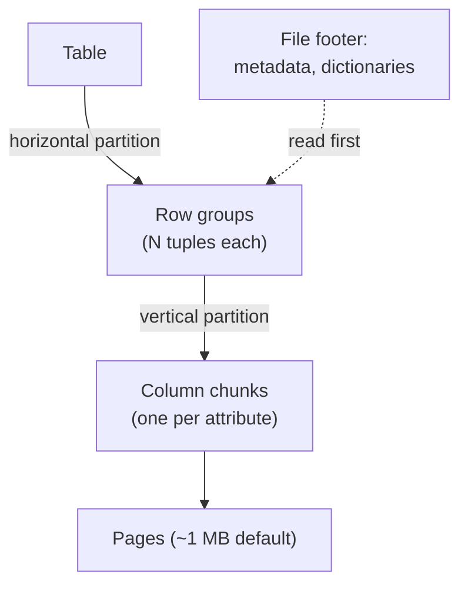

# 06 — PAX: the hybrid storage model

## Idea and origin

- **PAX = Partition Attributes Across** ([`36:14`](https://www.youtube.com/watch?v=nhlpwmOBEiE&t=2174)).
- From the last chapter of Anastassia Ailamaki's PhD thesis at Wisconsin; she was CMU's database professor before Andy, then left for EPFL ([`36:14`](https://www.youtube.com/watch?v=nhlpwmOBEiE&t=2174)).
- Goal: get the column-store benefit **while keeping spatial locality**, so values of a single tuple stay physically close ([`37:05`](https://www.youtube.com/watch?v=nhlpwmOBEiE&t=2225)).
- Most systems that call themselves column stores are really doing PAX — including the open formats **Parquet, ORC and Arrow** ([`37:17`](https://www.youtube.com/watch?v=nhlpwmOBEiE&t=2237)).

## The two-step partitioning

1. **Horizontally** partition tuples into **row groups** ([`37:32`](https://www.youtube.com/watch?v=nhlpwmOBEiE&t=2252)).
2. **Vertically** partition each row group into **column chunks** — write out all of column 1, then all of column 2, etc. Then start a new row group for the next batch of tuples ([`37:32`](https://www.youtube.com/watch?v=nhlpwmOBEiE&t=2252), [`38:31`](https://www.youtube.com/watch?v=nhlpwmOBEiE&t=2311)).
3. Each row group carries its own metadata header describing what's inside ([`38:31`](https://www.youtube.com/watch?v=nhlpwmOBEiE&t=2311)).

## Footer, not header

- Parquet and ORC are **read-only, immutable** file formats: written once, never updated ([`38:03`](https://www.youtube.com/watch?v=nhlpwmOBEiE&t=2283)).
- Because metadata is only complete once the file is finished, it goes in the **footer**. Opening one of these files means reading the footer first ([`38:03`](https://www.youtube.com/watch?v=nhlpwmOBEiE&t=2283)).
- Contrast: PostgreSQL-style systems put metadata in the **header** because they dynamically update pages ([`38:31`](https://www.youtube.com/watch?v=nhlpwmOBEiE&t=2311)).

## Sizes

| Unit | Size |
| --- | --- |
| Parquet row group | ~128 MB default ([`39:09`](https://www.youtube.com/watch?v=nhlpwmOBEiE&t=2349)) |
| ORC row group | Always **1 million tuples**, regardless of byte size ([`39:09`](https://www.youtube.com/watch?v=nhlpwmOBEiE&t=2349)) |
| Parquet page | ~1 MB default ([`39:49`](https://www.youtube.com/watch?v=nhlpwmOBEiE&t=2389)) |
| Traditional OLTP page | 4 KB / 8 KB ([`39:09`](https://www.youtube.com/watch?v=nhlpwmOBEiE&t=2349)) |

- Rationale: fetching a row group from S3 means large chunk reads (e.g. 8 MB), and everything needed for any tuple in it is present ([`39:34`](https://www.youtube.com/watch?v=nhlpwmOBEiE&t=2374)).
- For analytics you want **large strides** brought into memory, not 4 KB pages ([`39:49`](https://www.youtube.com/watch?v=nhlpwmOBEiE&t=2389)).
- On "is 128 MB really close?": L3 no longer fits everything — AMD sells CPUs with ~800 MB of L3 cache — but a row group is still vastly bigger than a 4 KB page ([`40:14`](https://www.youtube.com/watch?v=nhlpwmOBEiE&t=2414)).
